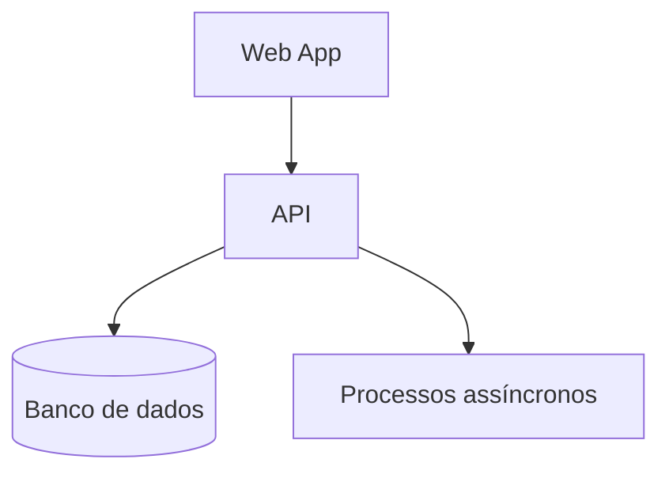

# {{NOME_DO_PRODUTO}} — TDD

> **Documento:** Technical Design Document
> **Projeto:** {{NOME_DO_PRODUTO}}
> **Versão:** {{VERSAO}}
> **Status:** {{RASCUNHO | EM REVISÃO | APROVADO}}
> **Data:** {{DATA}}
> **Responsável:** {{RESPONSAVEL}}
> **PRD/SPEC de referência:** {{DOCUMENTO_E_VERSAO}}

## Histórico de alterações

| Versão | Data | Autor | Alteração |
| --- | --- | --- | --- |
| {{VERSAO}} | {{DATA}} | {{AUTOR}} | Criação do documento |

---

# 1. Resumo executivo

<!-- Síntese da solução em até 1 página: arquitetura, stack, banco, hospedagem e principais trade-offs. -->

{{RESUMO_EXECUTIVO}}

## 1.1. Decisões principais

| Área | Decisão | ADR |
| --- | --- | --- |
| Linguagem e runtime | {{DECISAO}} | {{ADR}} |
| Framework | {{DECISAO}} | {{ADR}} |
| Arquitetura | {{DECISAO}} | {{ADR}} |
| Banco de dados | {{DECISAO}} | {{ADR}} |
| Autenticação | {{DECISAO}} | {{ADR}} |
| Infraestrutura | {{DECISAO}} | {{ADR}} |

---

# 2. Contexto e objetivos

## 2.1. Contexto do produto

{{CONTEXTO_DO_PRODUTO}}

## 2.2. Problema técnico

{{PROBLEMA_TECNICO}}

## 2.3. Objetivos técnicos

- {{OBJETIVO_TECNICO_1}}
- {{OBJETIVO_TECNICO_2}}

## 2.4. Público e operação

| Perfil | Como usa o sistema | Volume esperado |
| --- | --- | --- |
| {{PERFIL}} | {{USO}} | {{VOLUME}} |

---

# 3. Escopo e não escopo

## 3.1. Escopo técnico desta versão

- {{ITEM_INCLUIDO}}

## 3.2. Fora do escopo

- {{ITEM_EXCLUIDO}} — {{MOTIVO}}

## 3.3. Premissas

| ID | Premissa | Impacto se não se confirmar |
| --- | --- | --- |
| PREM-001 | {{PREMISSA}} | {{IMPACTO}} |

---

# 4. Direcionadores e requisitos

## 4.1. Requisitos funcionais críticos

| ID | Requisito | Módulo/componente | Impacto arquitetural |
| --- | --- | --- | --- |
| {{RF}} | {{DESCRICAO}} | {{COMPONENTE}} | {{IMPACTO}} |

## 4.2. Requisitos não funcionais

| ID | Categoria | Meta | Solução técnica | Como verificar |
| --- | --- | --- | --- | --- |
| {{RNF}} | {{CATEGORIA}} | {{META}} | {{SOLUCAO}} | {{VERIFICACAO}} |

## 4.3. Restrições

| Tipo | Restrição | Origem | Consequência |
| --- | --- | --- | --- |
| Técnica | {{RESTRICAO}} | {{ORIGEM}} | {{CONSEQUENCIA}} |
| Negócio | {{RESTRICAO}} | {{ORIGEM}} | {{CONSEQUENCIA}} |
| Operacional | {{RESTRICAO}} | {{ORIGEM}} | {{CONSEQUENCIA}} |

---

# 5. Arquitetura

## 5.1. Visão de contexto


{{DESCRICAO_DO_CONTEXTO}}

## 5.2. Visão de contêineres



| Contêiner | Responsabilidade | Tecnologia | Comunicação |
| --- | --- | --- | --- |
| {{CONTEINER}} | {{RESPONSABILIDADE}} | {{TECNOLOGIA}} | {{COMUNICACAO}} |

## 5.3. Componentes e módulos

| Componente | Responsabilidade | Dependências permitidas | ADR |
| --- | --- | --- | --- |
| {{COMPONENTE}} | {{RESPONSABILIDADE}} | {{DEPENDENCIAS}} | {{ADR}} |

## 5.4. Fronteiras e regras de dependência

- {{REGRA_DE_DEPENDENCIA}}
- {{PROIBICAO_DE_ACOPLAMENTO}}

## 5.5. Fluxos críticos

### 5.5.1. {{FLUXO}}

**Atores:** {{ATORES}}
**Entradas:** {{ENTRADAS}}
**Transações:** {{TRANSACOES}}

1. {{PASSO}}
2. {{PASSO}}
3. {{PASSO}}

**Falhas e compensações:** {{FALHAS}}
**Idempotência:** {{IDEMPOTENCIA}}

---

# 6. Stack tecnológica

## 6.1. Linguagem e runtime

| Item | Escolha | Versão | Justificativa | ADR |
| --- | --- | --- | --- | --- |
| Linguagem | {{LINGUAGEM}} | {{VERSAO}} | {{JUSTIFICATIVA}} | {{ADR}} |
| Runtime | {{RUNTIME}} | {{VERSAO}} | {{JUSTIFICATIVA}} | {{ADR}} |
| Gerenciador de pacotes | {{GERENCIADOR}} | {{VERSAO}} | {{JUSTIFICATIVA}} | {{ADR}} |

## 6.2. Frameworks

| Camada | Framework | Versão | Papel | ADR |
| --- | --- | --- | --- | --- |
| Backend | {{FRAMEWORK}} | {{VERSAO}} | {{PAPEL}} | {{ADR}} |
| Frontend | {{FRAMEWORK}} | {{VERSAO}} | {{PAPEL}} | {{ADR}} |

## 6.3. Bibliotecas

| Biblioteca | Versão | Papel | Justificativa | Alternativas rejeitadas | Licença/risco |
| --- | --- | --- | --- | --- | --- |
| {{BIBLIOTECA}} | {{VERSAO}} | {{PAPEL}} | {{JUSTIFICATIVA}} | {{ALTERNATIVAS}} | {{RISCO}} |

## 6.4. Ferramentas de desenvolvimento

| Ferramenta | Versão | Uso |
| --- | --- | --- |
| {{FERRAMENTA}} | {{VERSAO}} | {{USO}} |

## 6.5. Matriz de decisão da stack

| Critério | Peso | {{OPCAO_A}} | {{OPCAO_B}} | {{OPCAO_C}} |
| --- | --- | --- | --- | --- |
| {{CRITERIO}} | {{PESO}} | {{NOTA}} | {{NOTA}} | {{NOTA}} |

---

# 7. Estrutura do repositório

```text
{{ARVORE_DE_DIRETORIOS}}
```

## 7.1. Convenções

- {{CONVENCAO_DE_NOMES}}
- {{CONVENCAO_DE_IMPORTS}}
- {{CONVENCAO_DE_TESTES}}

## 7.2. Organização dos módulos

| Caminho | Módulo | Responsabilidade |
| --- | --- | --- |
| {{CAMINHO}} | {{MODULO}} | {{RESPONSABILIDADE}} |

---

# 8. Modelo de dados

## 8.1. Entidades

| Entidade | Descrição | Campos principais | Chave primária |
| --- | --- | --- | --- |
| {{ENTIDADE}} | {{DESCRICAO}} | {{CAMPOS}} | {{CHAVE}} |

## 8.2. Relacionamentos

| Origem | Relação | Destino | Cardinalidade | Regra |
| --- | --- | --- | --- | --- |
| {{ORIGEM}} | {{RELACAO}} | {{DESTINO}} | {{CARDINALIDADE}} | {{REGRA}} |

## 8.3. Índices e restrições

| Tabela | Índice/Restrição | Colunas | Objetivo |
| --- | --- | --- | --- |
| {{TABELA}} | {{TIPO}} | {{COLUNAS}} | {{OBJETIVO}} |

## 8.4. Migrations e versionamento

- {{ESTRATEGIA_DE_MIGRATION}}
- {{POLITICA_DE_COMPATIBILIDADE}}
- {{PROCEDIMENTO_DE_ROLLBACK}}

## 8.5. Histórico, retenção e privacidade

- {{POLITICA_DE_HISTORICO}}
- {{POLITICA_DE_RETENCAO}}
- {{ANONIMIZACAO_OU_EXCLUSAO}}

---

# 9. Multi-tenancy e isolamento

| Aspecto | Decisão |
| --- | --- |
| Modelo | {{MODELO_DE_MULTITENANCY}} |
| Identificação | {{COMO_O_TENANT_E_IDENTIFICADO}} |
| Isolamento de consultas | {{COMO_O_ISOLAMENTO_E_GARANTIDO}} |
| Autorização | {{COMO_O_ACESSO_E_VALIDADO}} |
| Migrações | {{COMO_MIGRATIONS_AFETAM_TENANTS}} |
| Dados compartilhados | {{O_QUE_E_COMPARTILHADO}} |

**Riscos de vazamento entre tenants:** {{RISCOS}}
**Testes de isolamento:** {{TESTES}}

---

# 10. APIs e contratos

## 10.1. Convenções

| Item | Decisão |
| --- | --- |
| Estilo | {{ESTILO_DE_API}} |
| Base path | {{BASE_PATH}} |
| Versionamento | {{ESTRATEGIA}} |
| Formato | {{FORMATO}} |
| Autenticação | {{AUTENTICACAO}} |
| Paginação | {{PAGINACAO}} |
| Filtros | {{FILTROS}} |
| Limites | {{RATE_LIMIT}} |
| Idempotência | {{IDEMPOTENCIA}} |

## 10.2. Endpoints

| Método | Caminho | Objetivo | Perfil autorizado | Requisitos |
| --- | --- | --- | --- | --- |
| {{METODO}} | {{CAMINHO}} | {{OBJETIVO}} | {{PERFIL}} | {{RF}} |

## 10.3. Contratos

### {{OPERACAO}}

**Entrada:**

| Campo | Tipo | Obrigatório | Validação |
| --- | --- | --- | --- |
| {{CAMPO}} | {{TIPO}} | Sim/Não | {{VALIDACAO}} |

**Saída:**

| Campo | Tipo | Descrição |
| --- | --- | --- |
| {{CAMPO}} | {{TIPO}} | {{DESCRICAO}} |

**Erros:**

| Código | HTTP | Quando ocorre |
| --- | --- | --- |
| {{CODIGO}} | {{HTTP}} | {{CONDICAO}} |

## 10.4. Eventos e contratos assíncronos

| Evento | Produtor | Consumidor | Payload | Garantia |
| --- | --- | --- | --- | --- |
| {{EVENTO}} | {{PRODUTOR}} | {{CONSUMIDOR}} | {{PAYLOAD}} | {{GARANTIA}} |

---

# 11. Autenticação, autorização e segurança

## 11.1. Autenticação e sessão

| Item | Decisão |
| --- | --- |
| Método de login | {{METODO}} |
| Hash de senha | {{ALGORITMO_E_PARAMETROS}} |
| Sessão | {{COOKIE_OU_TOKEN}} |
| Expiração | {{DURACAO}} |
| Renovação | {{ESTRATEGIA}} |
| Recuperação de acesso | {{FLUXO}} |
| MFA | {{SIM_NAO_E_QUANDO}} |

## 11.2. Autorização

| Recurso | Proprietário | Barbeiro | Cliente | Regra |
| --- | --- | --- | --- | --- |
| {{RECURSO}} | {{PERMISSAO}} | {{PERMISSAO}} | {{PERMISSAO}} | {{REGRA}} |

**Onde a autorização é aplicada:** {{CAMADA}}
**Como o isolamento por tenant é validado:** {{VALIDACAO}}

## 11.3. Ameaças e mitigações

| Ameaça | Vetor | Impacto | Mitigação |
| --- | --- | --- | --- |
| {{AMEACA}} | {{VETOR}} | {{IMPACTO}} | {{MITIGACAO}} |

## 11.4. Dados, segredos e privacidade

- {{CLASSIFICACAO_DOS_DADOS}}
- {{CRIPTOGRAFIA_EM_TRANSITO_E_REPOUSO}}
- {{GESTAO_DE_SEGREDOS}}
- {{MINIMIZACAO_E_LGPD}}
- {{AUDITORIA_E_LOGS_SENSIVEIS}}

---

# 12. Concorrência, consistência e processos assíncronos

## 12.1. Operações críticas

| Operação | Risco | Mecanismo | Limite/transação | ADR |
| --- | --- | --- | --- | --- |
| {{OPERACAO}} | {{RISCO}} | {{LOCK_TRANSACAO_CONSTRAINT}} | {{LIMITE}} | {{ADR}} |

## 12.2. Transações e idempotência

- **Fronteira transacional:** {{FRONTEIRA}}
- **Idempotência:** {{CHAVE_E_ESTRATEGIA}}
- **Retries:** {{POLITICA}}
- **Conflitos:** {{TRATAMENTO}}
- **Consistência eventual:** {{ONDE_E_COMO}}

## 12.3. Jobs e agendamentos

| Job | Gatilho | Frequência | Idempotência | Falha/retry | Alerta |
| --- | --- | --- | --- | --- | --- |
| {{JOB}} | {{GATILHO}} | {{FREQUENCIA}} | {{IDEMPOTENCIA}} | {{FALHA}} | {{ALERTA}} |

## 12.4. Fuso horário e calendário

- {{FUSO_DE_ARMAZENAMENTO}}
- {{CONVERSAO_POR_BARBEARIA}}
- {{LIMITES_DE_DIA_SEMANA_MES}}

---

# 13. Integrações

| Integração | Provedor | Objetivo | Síncrona/assíncrona | Timeout | Retry | Fallback | ADR |
| --- | --- | --- | --- | --- | --- | --- | --- |
| {{INTEGRACAO}} | {{PROVEDOR}} | {{OBJETIVO}} | {{TIPO}} | {{TIMEOUT}} | {{RETRY}} | {{FALLBACK}} | {{ADR}} |

**Contratos e versionamento:** {{CONTRATOS}}
**Credenciais:** {{CREDENCIAIS}}
**Ambiente de sandbox:** {{SANDBOX}}
**Monitoramento:** {{MONITORAMENTO}}

---

# 14. Observabilidade

## 14.1. Logs

| Aspecto | Decisão |
| --- | --- |
| Formato | {{ESTRUTURADO}} |
| Níveis | {{NIVEIS}} |
| Correlação | {{REQUEST_ID_TRACE_ID}} |
| Dados sensíveis | {{REDUCAO}} |
| Retenção | {{RETENCAO}} |

## 14.2. Métricas e traces

| Sinal | O que medir | Limite/alerta |
| --- | --- | --- |
| Latência | {{MEDICAO}} | {{ALERTA}} |
| Erros | {{MEDICAO}} | {{ALERTA}} |
| Disponibilidade | {{MEDICAO}} | {{ALERTA}} |
| Banco | {{MEDICAO}} | {{ALERTA}} |
| Jobs | {{MEDICAO}} | {{ALERTA}} |
| Integrações | {{MEDICAO}} | {{ALERTA}} |

## 14.3. Alertas e plantão

- {{ALERTA_CRITICO}}
- {{CANAL_DE_ALERTA}}
- {{RUNBOOK}}

---

# 15. Testes e qualidade

## 15.1. Estratégia

| Nível | Ferramenta | Escopo | Meta |
| --- | --- | --- | --- |
| Unitário | {{FERRAMENTA}} | {{ESCOPO}} | {{META}} |
| Integração | {{FERRAMENTA}} | {{ESCOPO}} | {{META}} |
| Contrato | {{FERRAMENTA}} | {{ESCOPO}} | {{META}} |
| E2E | {{FERRAMENTA}} | {{ESCOPO}} | {{META}} |
| Carga | {{FERRAMENTA}} | {{ESCOPO}} | {{META}} |

## 15.2. Cenários críticos

| Cenário | Requisitos | Nível | Resultado esperado |
| --- | --- | --- | --- |
| {{CENARIO}} | {{RF}} | {{NIVEL}} | {{RESULTADO}} |

## 15.3. Dados e isolamento de testes

- {{ESTRATEGIA_DE_DADOS}}
- {{BANCO_DE_TESTE}}
- {{ISOLAMENTO_ENTRE_TESTES}}

## 15.4. Quality gates

- {{LINT}}
- {{TIPOS}}
- {{COBERTURA}}
- {{ANALISE_ESTATICA}}
- {{REVISAO}}

---

# 16. Infraestrutura, deploy e CI/CD

## 16.1. Ambientes

| Ambiente | Objetivo | URL | Dados | Acesso |
| --- | --- | --- | --- | --- |
| Local | {{OBJETIVO}} | {{URL}} | {{DADOS}} | {{ACESSO}} |
| Staging | {{OBJETIVO}} | {{URL}} | {{DADOS}} | {{ACESSO}} |
| Produção | {{OBJETIVO}} | {{URL}} | {{DADOS}} | {{ACESSO}} |

## 16.2. Infraestrutura

| Componente | Serviço | Configuração | Escala |
| --- | --- | --- | --- |
| {{COMPONENTE}} | {{SERVICO}} | {{CONFIGURACAO}} | {{ESCALA}} |

## 16.3. Pipeline

```text
{{ESTAGIOS_DO_PIPELINE}}
```

| Estágio | Ferramenta | Gatilho | Critério de sucesso |
| --- | --- | --- | --- |
| {{ESTAGIO}} | {{FERRAMENTA}} | {{GATILHO}} | {{CRITERIO}} |

## 16.4. Release, rollback e backup

- **Estratégia de release:** {{RELEASE}}
- **Rollback:** {{ROLLBACK}}
- **Migrations em produção:** {{MIGRATIONS}}
- **Backup:** {{BACKUP}}
- **Restauração testada:** {{RESTAURACAO}}
- **Continuidade:** {{DR}}

---

# 17. Desempenho, capacidade e custos

## 17.1. Metas de desempenho

| Operação | Latência alvo | Throughput | Condição |
| --- | --- | --- | --- |
| {{OPERACAO}} | {{LATENCIA}} | {{THROUGHPUT}} | {{CONDICAO}} |

## 17.2. Capacidade

| Recurso | Premissa | Limite | Estratégia de escala |
| --- | --- | --- | --- |
| {{RECURSO}} | {{PREMISSA}} | {{LIMITE}} | {{ESCALA}} |

## 17.3. Gargalos e otimizações

- {{GARGALO}}
- {{OTIMIZACAO}}
- {{QUANDO_ESCALAR}}

## 17.4. Custos operacionais

| Item | Custo estimado | Observação |
| --- | --- | --- |
| {{ITEM}} | {{CUSTO}} | {{OBSERVACAO}} |

---

# 18. Riscos técnicos e trade-offs

| Risco | Impacto | Probabilidade | Mitigação | Responsável |
| --- | --- | --- | --- | --- |
| {{RISCO}} | Alto/Médio/Baixo | Alta/Média/Baixa | {{MITIGACAO}} | {{RESPONSAVEL}} |

## 18.1. Trade-offs aceitos

| Trade-off | Benefício | Custo | Reversibilidade |
| --- | --- | --- | --- |
| {{TRADEOFF}} | {{BENEFICIO}} | {{CUSTO}} | {{REVERSIBILIDADE}} |

---

# 19. Decisões arquiteturais (ADRs)

## 19.1. Índice

| ID | Título | Status | Data | Substitui |
| --- | --- | --- | --- | --- |
| ADR-001 | {{TITULO}} | Aceito | {{DATA}} | Nenhum |
| ADR-002 | {{TITULO}} | Proposto | {{DATA}} | Nenhum |

## 19.2. Registros

<!-- Repita o bloco abaixo para cada ADR, seguindo references/adr-template.md. -->

### ADR-001 — {{TITULO}}

- **Status:** {{STATUS}}
- **Data:** {{DATA}}
- **Decisores:** {{DECISORES}}
- **Requisitos relacionados:** {{IDS}}

**Contexto:** {{CONTEXTO}}

**Decisão:** {{DECISAO}}

**Alternativas consideradas:**

| Alternativa | Prós | Contras | Motivo da rejeição |
| --- | --- | --- | --- |
| {{ALTERNATIVA}} | {{PROS}} | {{CONTRAS}} | {{MOTIVO}} |

**Consequências:**

- Positivas: {{POSITIVAS}}
- Negativas: {{NEGATIVAS}}
- Custos e riscos: {{RISCOS}}

**Critérios de verificação:** {{VERIFICACAO}}

---

# 20. Plano de implementação

## 20.1. Fases

| Fase | Entrega | Dependências | Critério de conclusão |
| --- | --- | --- | --- |
| {{FASE}} | {{ENTREGA}} | {{DEPENDENCIAS}} | {{CRITERIO}} |

## 20.2. Ordem de implementação

1. {{PASSO}}
2. {{PASSO}}
3. {{PASSO}}

## 20.3. Estratégias de migração e corte

- {{MIGRACAO_DE_DADOS}}
- {{ESTRATEGIA_DE_CUTOVER}}
- {{COMPATIBILIDADE_TEMPORARIA}}
- {{CRITERIOS_DE_DESATIVACAO}}

## 20.4. Definição de pronto

- {{DEFINICAO_DE_PRONTO}}

---

# 21. Premissas e questões em aberto

| ID | Tipo | Descrição | Impacto | Responsável | Prazo |
| --- | --- | --- | --- | --- | --- |
| ABT-001 | Premissa | {{DESCRICAO}} | {{IMPACTO}} | {{RESPONSAVEL}} | {{PRAZO}} |
| ABT-002 | Questão | {{DESCRICAO}} | {{IMPACTO}} | {{RESPONSAVEL}} | {{PRAZO}} |

---

# Apêndice A — Glossário técnico

| Termo | Definição |
| --- | --- |
| ADR | Architecture Decision Record |
| {{TERMO}} | {{DEFINICAO}} |

# Apêndice B — Matriz de rastreabilidade

| Requisito | Componente | ADR | Teste/verificação |
| --- | --- | --- | --- |
| {{RF_OU_RNF}} | {{COMPONENTE}} | {{ADR}} | {{TESTE}} |

# Apêndice C — Referências

- {{DOCUMENTO}}
- {{LINK}}

