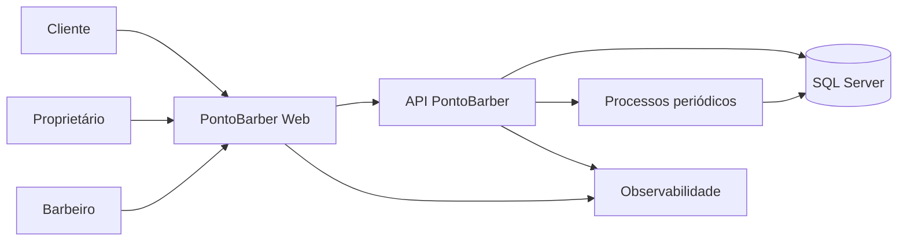
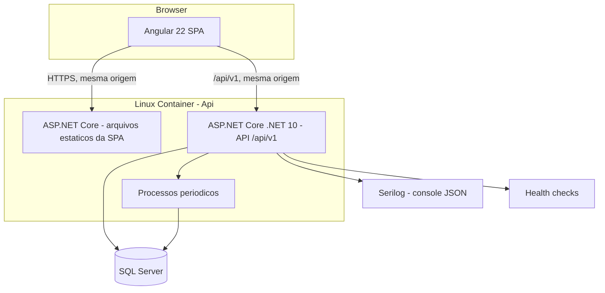

# PontoBarber — TDD

> **Documento:** Technical Design Document
> **Projeto:** PontoBarber
> **Versão:** 1.0
> **Status:** Aprovado
> **Data:** 16/11/2026
> **Responsável:** Equipe PontoBarber
> **PRD/SPEC de referência:** `docs/PRD.md` versão 1.0

## Histórico de alterações

| Versão | Data | Autor | Alteração |
| --- | --- | --- | --- |
| 1.0 | 16/11/2026 | Equipe PontoBarber | Criação do documento a partir do PRD 1.0 |

---

# 1. Resumo executivo

O PontoBarber será implementado como uma aplicação web com frontend Angular 22 e backend .NET 10, organizados em um único repositório. O backend segue Clean Architecture com modelagem tática de DDD, expõe uma API REST versionada em `/api/v1`, usa ASP.NET Core Identity com autenticação por cookie e persiste em SQL Server por meio do EF Core 10. O frontend é uma SPA standalone, zoneless, baseada em signals, com Bootstrap 5 + SCSS + Bootstrap Icons e design system próprio em `shared/ui`.

O isolamento entre barbearias é feito em banco único compartilhado, com `TenantId` obrigatório em todas as entidades de negócio, filtros globais no EF Core e validação de tenant na camada de aplicação. A reserva de horários é o ponto de maior risco técnico: a confirmação ocorre em transação com `sp_getapplock` por profissional e data, seguida de verificação de sobreposição e índice único para impedir duplicidade exata. Processos periódicos, como a expiração da sugestão de horário, são abstraídos na aplicação e executados por um adaptador de scheduler cuja escolha permanece pendente (ADR-027); cada processo é implementado como operação idempotente.

A aplicação é empacotada em containers Linux sobre SQL Server 2022. O serviço de banco gerenciado, o provedor de nuvem e o ambiente de execução não estão definidos e permanecem em aberto (ADR-028, ABT-003, ABT-014). As decisões ainda não confirmadas permanecem marcadas como `Proposto` na seção 19 e na seção 21.

## 1.1. Decisões principais

| Área | Decisão | ADR |
| --- | --- | --- |
| Frontend | Angular 22 standalone, zoneless, signals, Bootstrap 5 + SCSS + Bootstrap Icons | ADR-001, ADR-026 |
| Backend | .NET 10, ASP.NET Core, solução no formato `.slnx` | ADR-002 |
| Arquitetura | Clean Architecture com DDD tático e monólito modular | ADR-003 |
| Banco de dados | SQL Server 2022+ com EF Core 10 e migrations versionadas | ADR-004 |
| Autenticação | ASP.NET Core Identity com cookie httpOnly | ADR-005 |
| Multi-tenancy | Banco único com `TenantId`, filtros globais e validação na aplicação | ADR-006 |
| API | REST com controllers, versionamento por URL e ProblemDetails | ADR-007, ADR-017 |
| Concorrência | Transação + `sp_getapplock` por profissional/data + índice único | ADR-010 |
| Jobs | Execução de processos periódicos abstraída; adaptador de scheduler pendente | ADR-027 |
| Datas e horários | UTC no banco, `TimeZoneId` IANA por barbearia | ADR-011 |
| Testes | MSTest, WebApplicationFactory, Testcontainers e Playwright | ADR-012 |
| Infraestrutura | Containers Linux e GitHub Actions; hospedagem e provedor de nuvem pendentes | ADR-025, ADR-028 |
| Observabilidade | Serilog estruturado + health checks; instrumentação/exportação adiada | ADR-014, ADR-037 |

---

# 2. Contexto e objetivos

## 2.1. Contexto do produto

O PontoBarber centraliza a gestão de barbearias: cadastro do estabelecimento, catálogo de serviços, horários de funcionamento, disponibilidade dos profissionais, agenda, atendimentos, pagamentos e indicadores. A plataforma atende três perfis — proprietário, barbeiro e cliente — com login compartilhado e cadastros separados para cliente e barbeiro.

O produto é uma aplicação web responsiva, sem aplicativo nativo na V1.0. Cada barbearia opera em um único fuso horário e possui código de convite único e permanente para entrada de profissionais. Agendamentos públicos e manuais são confirmados automaticamente, sem aprovação.

## 2.2. Problema técnico

O sistema precisa garantir quatro propriedades que orientam o desenho:

- **Consistência de agenda:** dois clientes não podem confirmar o mesmo horário do mesmo profissional, mesmo em requisições simultâneas.
- **Isolamento entre barbearias:** nenhuma consulta ou operação pode expor dados de outro estabelecimento, inclusive em relatórios e listagens.
- **Preservação histórica:** nome, duração e preço do serviço, dados do agendamento, cancelamentos e pagamentos devem permanecer íntegros após alterações cadastrais, remoção de serviços ou de vínculos.
- **Rastreabilidade temporal:** horários planejados e reais, janelas de sugestão de 24 horas e indicadores por dia, semana e mês dependem de tratamento correto de fuso horário e calendário.

## 2.3. Objetivos técnicos

- Entregar uma API REST única, versionada e documentada, com contratos explícitos e erros padronizados.
- Isolar as regras de domínio de agenda, atendimento e pagamento em componentes testáveis sem banco.
- Garantir que a confirmação de agendamento seja atômica e livre de sobreposição.
- Aplicar autenticação por cookie e autorização por perfil e por recurso em todas as operações.
- Manter o histórico imutável por meio de snapshots e registros de eventos do agendamento.
- Oferecer frontend com carregamento rápido, estado previsível e acessibilidade WCAG 2.1 AA.
- Operar com deploy reproduzível, migrations compatíveis e observabilidade desde a primeira versão.

## 2.4. Público e operação

| Perfil | Como usa o sistema | Volume esperado |
| --- | --- | --- |
| Proprietário | Navegador desktop e mobile; configuração, agenda, dashboard | 1 por barbearia |
| Barbeiro | Navegador mobile e desktop; agenda, disponibilidade, atendimento e pagamento | 1 a 15 por barbearia |
| Cliente | Navegador mobile; página pública, agendamento e histórico | Centenas por barbearia |

Premissa de volumetria para a V1.0: até 500 barbearias, até 5.000 profissionais, até 300.000 clientes e até 20.000 agendamentos por dia no pico. O dimensionamento detalhado está na seção 17.

---

# 3. Escopo e não escopo

## 3.1. Escopo técnico desta versão

- API REST `/api/v1` com autenticação por cookie, autorização por perfil e isolamento por tenant.
- SPA Angular com área pública, área do cliente, área do profissional e área administrativa.
- Cadastro de cliente e barbeiro, login compartilhado, criação de barbearia e entrada por código de convite.
- Catálogo de serviços com snapshot por agendamento.
- Horários de funcionamento, disponibilidade semanal e bloqueios pontuais.
- Agenda diária, semanal e mensal, com criação manual, cancelamento, remarcação e sugestão de horário.
- Atendimento com horários reais e pagamento presencial.
- Dashboard do proprietário com indicadores e próximos agendamentos.
- Notificações internas persistidas e consultadas por polling.
- Jobs de expiração de sugestão, fechamento de agendamentos vencidos e limpeza de dados operacionais.
- Observabilidade, health checks, backups e pipeline de CI/CD.

## 3.2. Fora do escopo

- WhatsApp, e-mail, SMS e integrações de calendário — previstos para versões futuras no PRD.
- Gateway de pagamento, cobrança online e pagamento antecipado — pagamento é presencial na V1.0.
- Aplicativo móvel nativo — a V1.0 é web responsiva.
- Relatórios financeiros avançados e conciliação — não previstos no PRD.
- Multi-tenant por schema ou por banco — decisão registrada em ADR-006.
- Microsserviços, mensageria externa e cache distribuído — sem necessidade comprovada na escala inicial.
- Recuperação de senha por e-mail — depende de provedor ainda não definido (ABT-006).
- Verificação do telefone comercial — procedimento em aberto no PRD (ABT-005).

## 3.3. Premissas

| ID | Premissa | Impacto se não se confirmar |
| --- | --- | --- |
| PREM-001 | Cada barbearia opera em um único fuso horário IANA | Cálculo de disponibilidade e indicadores precisa ser revisto |
| PREM-002 | A V1.0 opera em um único provedor e região (a definir em ADR-028), com latência de banco inferior a 20 ms | Metas de desempenho e escolha de camada do banco mudam |
| PREM-003 | O volume inicial é de até 500 barbearias e 20.000 agendamentos/dia | Escala horizontal e cache passam a ser necessários antes do previsto |
| PREM-004 | A verificação do telefone comercial não bloqueia a V1.0 | Cadastro pode exigir fluxo adicional e integração externa |
| PREM-005 | As metas numéricas dos RNFs são alvos propostos e serão validadas | Testes de carga e SLOs precisam ser recalibrados |
| PREM-006 | O navegador alvo suporta ES2022, cookies, `Date` e `Intl` com base IANA | Necessário transpilação adicional e polyfills |
| PREM-007 | A equipe domina C#, Angular e SQL Server | Curva de aprendizado e prazo são afetados |
| PREM-008 | O produto não exige CNPJ nem documentos no cadastro | Nenhuma validação cadastral adicional é necessária |

---

# 4. Direcionadores e requisitos

## 4.1. Requisitos funcionais críticos

| ID | Requisito | Módulo/componente | Impacto arquitetural |
| --- | --- | --- | --- |
| RF-AUTH-001 a RF-AUTH-010 | Cadastro, login, criação de barbearia e código de convite | `Auth`, `Tenants`, `Professionals` | Identity, cookie, policies e transação de criação de tenant |
| RF-EMP-001 a RF-EMP-003 | Consulta e edição da barbearia | `Tenants` | Autorização por papel e isolamento por tenant |
| RF-SERV-001 a RF-SERV-008 | Catálogo de serviços e snapshot | `Services`, `Appointments` | Desativação lógica e cópia de dados no agendamento |
| RF-HOR-001 a RF-HOR-007 | Funcionamento, disponibilidade e bloqueios | `Scheduling`, `Professionals` | Motor de disponibilidade e conversão de fuso |
| RF-AGD-001 a RF-AGD-018 | Agenda, criação manual, cancelamento, remarcação e sugestão | `Appointments`, `Scheduling` | Transação de reserva, histórico e job de expiração |
| RF-ATD-001 a RF-ATD-009 | Atendimento e pagamento | `Appointments`, `Payments` | Máquina de estados e separação de situações |
| RF-CLI-001 a RF-CLI-006 | Consulta de clientes e edição dos próprios dados | `Customers`, `Appointments` | Consulta derivada de agendamentos e autorização por titular |
| RF-PROF-001 a RF-PROF-008 | Gestão de vínculos e código de convite | `Professionals` | Vínculo como entidade própria e histórico preservado |
| RF-DASH-001 a RF-DASH-005 | Indicadores e próximos agendamentos | `Dashboard` | Consultas agregadas por período e tenant |
| RF-PUB-001 a RF-PUB-006 | Página pública e agendamento | `PublicBooking` | Endpoints anônimos de leitura e confirmação autenticada |
| RF-CONF-001 a RF-CONF-008 | Configurações gerais e individuais | `Settings` | Autorização diferenciada por papel |
| RF-NOTIF-001 | Notificações internas | `Notifications` | Persistência, polling e geração por eventos de domínio |

## 4.2. Requisitos não funcionais

| ID | Categoria | Meta | Solução técnica | Como verificar |
| --- | --- | --- | --- | --- |
| RNF-DESEMPENHO-001 | Desempenho | Agenda e telas principais em até 2 s no p95 | Lazy loading por rota, consultas projetadas, índices por tenant e período, compressão e cache HTTP de assets | Teste de carga k6 e métricas de p95 no destino definido em ADR-028 |
| RNF-DESEMPENHO-002 | Desempenho | Disponibilidade em até 1 s no p95 | Consulta única com janelas indexadas e cálculo em memória limitado ao dia | Teste de carga e APM |
| RNF-DESEMPENHO-003 | Desempenho | Confirmação em até 3 s no p95 | Transação curta com lock por profissional/data e índices de conflito | Teste de concorrência e APM |
| RNF-SEGURANCA-001 | Segurança | Senhas irreversíveis | Identity com PBKDF2-HMAC-SHA512, 210.000 iterações e salt por usuário | Revisão de configuração e teste de hash |
| RNF-SEGURANCA-002 | Segurança | 100% das operações críticas validadas no servidor | Autorização por policy e resource handler em todos os endpoints | Testes de autorização por perfil e tenant |
| RNF-SEGURANCA-003 | Segurança | Código de convite imprevisível | Código aleatório de 8 caracteres em base32 com `RandomNumberGenerator` | Teste estatístico e revisão de código |
| RNF-CONCORRENCIA-001 | Consistência | Zero reservas conflitantes | `sp_getapplock`, verificação de sobreposição e índice único | Teste de concorrência paralela e teste de integração |
| RNF-DISPONIBILIDADE-001 | Disponibilidade | 99,5% mensal | Duas instâncias, health checks, banco SQL Server com backup e deploy sem downtime | Monitoramento de disponibilidade e relatório mensal |
| RNF-PRIVACIDADE-001 | Privacidade e LGPD | Acesso por titular e permissão | Minimização, autorização por recurso, logs sem PII e política de retenção | Revisão de privacidade e testes de acesso |
| RNF-AUDITORIA-001 | Auditoria | Autor, data e hora em cancelamentos e alterações | Histórico de agendamento e campos de auditoria | Testes de histórico e consulta de auditoria |
| RNF-ACESSIBILIDADE-001 | Acessibilidade | WCAG 2.1 AA nas telas principais | Bootstrap 5 + primitivas acessíveis em `shared/ui`, foco, rótulos, contraste e testes axe | Auditoria automatizada axe + revisão manual |
| RNF-COMPATIBILIDADE-001 | Compatibilidade | Últimas 2 versões de Chrome, Edge, Firefox e Safari | Browserslist, polyfills e layout responsivo | Matriz de testes E2E e checklist manual |
| RNF-USABILIDADE-001 | Usabilidade | Agendamento sem suporte em até 5 etapas | Wizard com etapas explícitas e resumo | Teste de usabilidade e E2E do fluxo público |
| RNF-RETENCAO-001 | Retenção | 100% do histórico preservado | Desativação lógica, snapshots e proibição de exclusão física | Testes de histórico e revisão de schema |

## 4.3. Restrições

| Tipo | Restrição | Origem | Consequência |
| --- | --- | --- | --- |
| Técnica | .NET 10, Angular 22, SQL Server e EF Core | Solicitação do produto | Stack fechada; bibliotecas devem ser compatíveis |
| Técnica | Solução no formato `.slnx` | Solicitação do produto | Ferramentas de build precisam suportar o formato |
| Técnica | Testes com MSTest | Solicitação do produto | Sem xUnit/NUnit no backend |
| Técnica | Identity com cookies | Solicitação do produto | Sem JWT para a SPA; CSRF precisa ser tratado |
| Negócio | Pagamento apenas presencial | PRD, seção 4.2 | Nenhuma integração financeira na V1.0 |
| Negócio | Um serviço por agendamento | PRD, RN-AGD-003 | Modelo simplificado, sem itens de agendamento |
| Operacional | Equipe pequena e prazo de MVP | Contexto do projeto | Monólito modular, poucos serviços operados |
| Legal | LGPD | PRD, RNF-PRIVACIDADE-001 | Minimização, retenção definida e logs sem PII |

---

# 5. Arquitetura

## 5.1. Visão de contexto



O sistema é acessado por navegador. A SPA consome apenas a API do próprio produto; não há integrações externas síncronas na V1.0. A verificação de telefone e o envio por WhatsApp estão fora do escopo e são representados apenas como evolução futura.

## 5.2. Visão de contêineres



| Contêiner | Responsabilidade | Tecnologia | Comunicação |
| --- | --- | --- | --- |
| Api (API + SPA) | Servir os arquivos estáticos do Angular e expor a API na mesma origem | ASP.NET Core .NET 10 + assets Angular 22 | HTTPS para o navegador; `/api/v1` no mesmo host |
| Banco | Persistência relacional | SQL Server 2022; serviço gerenciado a definir (ABT-014) | TDS 1433 |
| Jobs | Expirações e rotinas periódicas | Adaptador de scheduler a definir (ADR-027) | — |
| Observabilidade | Logs estruturados e health checks | Serilog com saída JSON no console; telemetria adiada (ADR-037) | JSON no console |

A hospedagem dos arquivos estáticos pelo ASP.NET Core substitui o contêiner Nginx e o contêiner web separado (ADR-033). A integração dos assets ocorre quando o projeto Angular existir, sem antecipar sua criação nesta etapa.

A execução de processos periódicos é abstraída na aplicação e o adaptador de scheduler permanece em decisão pendente (ADR-027). A garantia de execução durável e coordenada entre instâncias somente pode ser afirmada após essa decisão; até lá, todo processo é implementado como operação idempotente, segura sob execução concorrente ou repetida.

## 5.3. Componentes e módulos

| Componente | Responsabilidade | Dependências permitidas | ADR |
| --- | --- | --- | --- |
| `PontoBarber.Dominio` | Entidades, valor objects, enums, eventos de domínio, regras invariantes | Nenhuma | ADR-003 |
| `PontoBarber.Aplicacao` | Casos de uso, DTOs, validação, autorização de aplicação, portas | Dominio | ADR-003 |
| `PontoBarber.Infra` | EF Core, Identity, adaptador de scheduler, e-mail futuro, relógio, storage | Aplicacao, Dominio | ADR-004, ADR-005, ADR-027 |
| `PontoBarber.Api` | Controllers, filters, middleware, composição, health checks | Aplicacao, Infra | ADR-007 |
| `PontoBarber.Contracts` | DTOs públicos compartilhados com o frontend | Nenhuma | ADR-007 |
| `PontoBarber.Web` | SPA Angular, rotas, componentes, serviços HTTP | Contracts (gerado) | ADR-001 |
| `PontoBarber.Testes.Unidade` | Testes de domínio e aplicação | Dominio, Aplicacao | ADR-012 |
| `PontoBarber.Testes.Integracao` | Testes de API, banco e jobs | Api, Infra | ADR-012 |
| `PontoBarber.E2ETests` | Fluxos de navegador | Web, Api | ADR-012 |

Módulos de domínio mapeados a partir do PRD:

| Módulo | Bounded contexto lógico | Agregados principais |
| --- | --- | --- |
| `Auth` | Identidade e acesso | `User`, `CustomerProfile`, `ProfessionalProfile` |
| `Tenants` | Barbearia | `Barbershop`, `BusinessHour` |
| `Professionals` | Vínculos profissionais | `ProfessionalTenantLink`, `WeeklyAvailability`, `ScheduleBlock` |
| `Services` | Catálogo | `Service` |
| `Scheduling` | Disponibilidade e reserva | `AvailabilitySlot` (read model), `BookingPolicy` |
| `Appointments` | Agenda | `Appointment`, `AppointmentHistory`, `TimeSlotSuggestion` |
| `Payments` | Financeiro operacional | `Payment` |
| `Dashboard` | Leitura agregada | Projeções de consulta |
| `Notifications` | Comunicação interna | `Notification` |
| `Settings` | Configurações | Visões sobre `Barbershop` e `ProfessionalTenantLink` |

## 5.4. Fronteiras e regras de dependência

- `Dominio` não referencia EF Core, ASP.NET Core, Identity, bibliotecas de agendamento de tarefas ou qualquer biblioteca de infraestrutura.
- `Aplicacao` depende de `Dominio` e de abstrações próprias (`IContextoAplicacao`, `IRelogio`, `IContextoTenant`, `IServicoIdentidade`).
- `Infra` implementa as abstrações de `Aplicacao`; `Api` depende de `Aplicacao` e `Infra` apenas na composição.
- Controllers não contêm regra de negócio: apenas traduzem HTTP, acionam casos de uso e devolvem `ProblemDetails`.
- Um módulo não acessa diretamente o `DbContext` de outro; a comunicação ocorre por casos de uso, eventos de domínio ou projeções de leitura.
- Entidades de outro agregado são referenciadas por identificador, não por navegação cruzada.
- `Contracts` não referencia `Dominio`; os DTOs são tipos primitivos e enums estáveis.
- O frontend não conhece detalhes de persistência e consome apenas `/api/v1`.
- Proibido usar `DateTime.Now`, `Guid.NewGuid()` e `Random` diretamente no domínio; usar `IRelogio` e geradores injetados.

## 5.5. Fluxos críticos

### 5.5.1. Confirmação de agendamento (público e manual)

**Atores:** Cliente autenticado, barbeiro ou proprietário.
**Entradas:** `tenantId` derivado da rota ou do contexto, `professionalId`, `serviceId`, `start` em UTC, `notes`, `origin`, chave de idempotência.
**Transações:** uma transação `READ COMMITTED` com `sp_getapplock` exclusivo por `tenantId:professionalId:yyyy-MM-dd`.

1. Validar autenticação, tenant, serviço ativo, profissional ativo e vinculado.
2. Carregar duração do serviço e calcular `end = start + duration` no fuso da barbearia.
3. Adquirir `sp_getapplock` com timeout de 5 segundos.
4. Validar funcionamento da barbearia, disponibilidade semanal, bloqueios e conflitos de agendamento.
5. Criar `Appointment` com snapshot de nome, duração e preço do serviço.
6. Persistir, registrar histórico inicial e notificações, e confirmar a transação.
7. Liberar o lock; em caso de falha, retornar `409` com código `schedule.slot_unavailable`.

**Falhas e compensações:** conflito retorna 409 sem persistência; timeout de lock retorna 503 com `Retry-After: 1`; falha após persistência é resolvida pela transação atômica.
**Idempotência:** cabeçalho `Idempotency-Key`; a chave é armazenada por 24 horas e devolve a mesma resposta para requisições repetidas.

### 5.5.2. Cancelamento com sugestão de horário

**Atores:** Barbeiro ou proprietário (cancelamento), cliente (decisão).
**Transações:** transação única para cancelar e reservar a sugestão; job para expiração.

1. Validar que o agendamento está confirmado e não iniciou.
2. Exigir motivo e novo horário quando a origem for barbeiro.
3. Cancelar o agendamento com autor e data, preservando o histórico.
4. Criar `TimeSlotSuggestion` com `ExpiresAtUtc = now + 24h` e reservar o horário sugerido.
5. Notificar o cliente.
6. Cliente aceita: transferir o agendamento para o novo horário e manter o histórico.
7. Cliente rejeita ou job expira: liberar o horário e manter o agendamento original cancelado.

**Falhas e compensações:** se o horário sugerido ficar indisponível antes da criação, retornar 409; se o job falhar, a próxima execução reprocessa por `ExpiresAtUtc` vencido.
**Idempotência:** aceite e rejeição são idempotentes por `suggestionId` e estado atual.

### 5.5.3. Atendimento e pagamento

**Atores:** Barbeiro.
**Transações:** transições de estado com verificação de concorrência otimista por `RowVersion`.

1. Iniciar atendimento apenas em agendamento confirmado e no dia do agendamento.
2. Registrar `ActualStartUtc` com `IRelogio` e mudar status para `InProgress`.
3. Finalizar apenas atendimento em andamento; registrar `ActualEndUtc`.
4. Registrar pagamento com valor não negativo e forma permitida, independente do estado do atendimento.
5. Atualizar indicadores por consulta agregada, sem tabela de saldo.

**Falhas e compensações:** conflito de concorrência retorna 409; pagamento duplicado no mesmo atendimento é rejeitado por índice único.

### 5.5.4. Login e sessão

1. Cliente ou profissional envia e-mail e senha para `POST /api/v1/auth/login`.
2. A API valida via `SignInManager`, aplica bloqueio por tentativas e emite cookie `__Host-pb.auth`.
3. O cookie é `HttpOnly`, `Secure`, `SameSite=Lax`, com expiração deslizante de 8 horas e absoluta de 7 dias.
4. A SPA consulta `GET /api/v1/auth/me` para obter perfil, tenant ativo e permissões.
5. Logout remove o cookie e invalida a sessão no servidor.

**Falhas e compensações:** credenciais inválidas retornam 401 genérico; conta bloqueada retorna 423; falha de CSRF retorna 400.
**Idempotência:** login não é idempotente por natureza; logout é idempotente.

---

# 6. Stack tecnológica

## 6.1. Linguagem e runtime

| Item | Escolha | Versão | Justificativa | ADR |
| --- | --- | --- | --- | --- |
| Linguagem backend | C# | 14 | Linguagem da plataforma .NET 10, tipagem forte e suporte a DDD | ADR-002 |
| Runtime backend | .NET | 10 LTS | Suporte de longo prazo, desempenho e integração com ASP.NET Core | ADR-002 |
| Linguagem frontend | TypeScript | 5.9 | Tipagem estática e integração com Angular | ADR-001 |
| Runtime frontend | Node.js | 22 LTS | Necessário apenas para build e testes | ADR-001 |
| Gerenciador de pacotes backend | NuGet | 6.x | Padrão do ecossistema .NET | ADR-002 |
| Gerenciador de pacotes frontend | npm | 10.x | Padrão do Angular CLI e do ambiente de CI | ADR-001 |
| Build backend | `dotnet` CLI + MSBuild | 10 | Compatível com `.slnx` | ADR-002 |
| Build frontend | Angular CLI + esbuild | 22 | Build rápido e saída otimizada | ADR-001 |

## 6.2. Frameworks

| Camada | Framework | Versão | Papel | ADR |
| --- | --- | --- | --- | --- |
| Backend | ASP.NET Core | 10 | API REST, DI, configuração, middleware e health checks | ADR-002 |
| Backend | ASP.NET Core Identity | 10 | Usuários, senhas, lockout e cookies | ADR-005 |
| Backend | EF Core | 10 | Mapeamento, migrations e consultas | ADR-004 |
| Backend | Adaptador de scheduler | A definir | Execução de processos periódicos; decisão pendente | ADR-027 |
| Frontend | Angular | 22 | SPA standalone, zoneless e signals | ADR-001 |
| Frontend | Bootstrap 5 + SCSS + Bootstrap Icons | 5.x | Componentes, layout e ícones; design system em `shared/ui` | ADR-026 |
| Testes backend | MSTest | 4.x | Testes unitários e de integração | ADR-012 |
| Testes frontend | Vitest + Playwright | 3.x / 1.5x | Testes de unidade, componente e E2E | ADR-012 |

## 6.3. Bibliotecas

| Biblioteca | Versão | Papel | Justificativa | Alternativas rejeitadas | Licença/risco |
| --- | --- | --- | --- | --- | --- |
| `Microsoft.AspNetCore.Authentication.Cookies` | 10 | Autenticação por cookie | Integrada ao Identity e adequada a SPA same-origin | JWT em `localStorage` — risco de XSS | MIT |
| `Microsoft.EntityFrameworkCore.SqlServer` | 10 | Provider SQL Server | Suporte oficial, migrations e recursos de lock | Dapper puro — mais código e sem migrations | MIT |
| `Microsoft.EntityFrameworkCore.Design` | 10 | Geração de migrations | Ferramenta oficial | Scripts SQL manuais — sem versionamento | MIT |
| `System.ComponentModel.DataAnnotations` | 10 (integrado ao .NET) | Validação de entrada | Atributos nativos, integrados ao model binding; sem dependência externa | FluentValidation — substituído em ADR-029 | Integrado |
| `Serilog.AspNetCore` | 9.x | Logs estruturados | Enriquecimento, sinks e correlação | `ILogger` puro — menos contexto | Apache-2.0 |
| `Bootstrap` | 5.x | Base de layout e componentes | Decisão aprovada em ADR-026 | Angular Material — rejeitado em ADR-008 | MIT |
| `bootstrap-icons` | 1.x | Ícones | Padronização visual aprovada em ADR-026 | Biblioteca de ícones própria — custo alto | MIT |
| `sass` (dart-sass) | 1.x | SCSS e tokens de tema | Tema próprio sobre Bootstrap | CSS puro — sem tokens | MIT |
| Versionamento nativo por rotas `/api/v1` | — (ASP.NET Core routing) | Versionamento de API | Prefixo explícito na rota, sem pacote adicional | `Asp.Versioning.Mvc` e versionamento por header — substituídos em ADR-030 | Integrado |
| `Swashbuckle.AspNetCore` | 9.x | OpenAPI | Documentação e geração de clientes; decisão aprovada no ADR-007 | NSwag - redundante | MIT |
| `Microsoft.OpenApi` | 2.7.5 | Metadados OpenAPI (dependência transitiva) | Correção de CVE-2026-49451; versões 2.0.0 a 2.7.4 são vulneráveis | Microsoft.OpenApi 3.x - incompatível com o runtime atual | MIT |
| `Serilog.Sinks.Console` | 6.x | Logs locais | Diagnóstico em desenvolvimento e container | Destino proprietário — lock-in | Apache-2.0 |
| `Testcontainers.MsSql` | 4.x | SQL Server em testes | Isolamento real de banco | LocalDB — indisponível em Linux CI | MIT |
| `Microsoft.AspNetCore.Mvc.Testing` | 10 | Testes de integração | `WebApplicationFactory` oficial | Servidor HTTP real — mais lento | MIT |
| Limpeza controlada do banco de testes | — (SQL Server + Testcontainers) | Isolamento entre testes | Banco exclusivo por teste, criado e removido explicitamente | Respawn — substituído em ADR-032; banco em memória — sem fidelidade | Integrado |
| APIs nativas JavaScript/TypeScript (`Date`, `Intl`) | ES2022 / `Intl` | Datas e fusos no frontend | `date-fns` / `@date-fns/tz` → `Date` e `Intl` nativos, utilizando `Intl.DateTimeFormat` e a opção `timeZone` com identificadores IANA da barbearia (ADR-034) | Moment.js — legado e maior | Integrado |

**Correção de segurança (17/11/2026):** o template `webapi` do .NET 10 adicionou `Microsoft.AspNetCore.OpenApi` 10.0.3, que referencia `Microsoft.OpenApi` 2.0.0. Essa versão é afetada por **CVE-2026-49451** (`GHSA-v5pm-xwqc-g5wc`, severidade alta): um documento OpenAPI com referência circular de schema pode causar *stack overflow* e encerrar o processo durante o parsing. O restore passou a emitir `NU1903`. A versão de `Microsoft.OpenApi` foi fixada em **2.7.5**, primeira versão corrigida da linha 2.x; a linha 3.x também corrige (3.5.4+), mas não é compatível com o runtime atual. A documentação permanece exposta apenas em Development e Staging.

**Decisão x estado atual (OpenAPI):** a decisão aprovada no ADR-007 e registrada na lista oficial de tecnologias é `Swashbuckle.AspNetCore`/OpenAPI para documentação e geração de clientes. Atualmente o projeto referencia `Microsoft.AspNetCore.OpenApi` 10.0.3, dependência transitiva do template `webapi` do .NET 10, com `Microsoft.OpenApi` 2.7.5 fixado por segurança. Esse fato descreve **apenas o estado atual da implementação** e não substitui a decisão aprovada. Nenhuma dependência é alterada por esta correção documental; a consolidação entre implementação e decisão ocorrerá na tarefa de documentação da API.

Bibliotecas deliberadamente ausentes:

| Biblioteca | Motivo da ausência |
| --- | --- |
| MediatR | Casos de uso chamados diretamente por serviços de aplicação; menos indireção e licença comercial na versão 13+ |
| AutoMapper | Mapeamentos explícitos, poucos e testáveis; evita configuração implícita |
| MassTransit/RabbitMQ | Sem comunicação assíncrona entre serviços na V1.0 |
| Redis | Sem gargalo mensurável; cache local e índices atendem à escala inicial |
| NgRx | Signals e serviços com estado local cobrem o estado da SPA |
| Angular Material + CDK | Rejeitado em ADR-008; a UI usa Bootstrap 5 + SCSS + Bootstrap Icons (ADR-026) |
| FluentValidation | Substituído por DataAnnotations (ADR-029) |
| FluentAssertions | Não utilizar; preferir `Assert` nativo do MSTest (lista oficial de tecnologias) |
| `Asp.Versioning.Mvc` | Substituído por versionamento nativo em `/api/v1` (ADR-030) |
| NetArchTest | Substituído por testes arquiteturais próprios com MSTest (ADR-031) |
| Respawn | Substituído por criação e remoção controlada do banco de testes (ADR-032) |
| Nginx | Substituído pelo ASP.NET Core servindo os arquivos estáticos da SPA (ADR-033) |
| `date-fns` + `@date-fns/tz` | Substituídos por `Date` e `Intl` nativos com fusos IANA (ADR-034) |
| Quartz.NET | Rejeitado em ADR-009; a estratégia de scheduler permanece pendente (ADR-027) |
| Swagger UI em produção | Exposto apenas em Development e Staging |

**Ferramentas complementares autorizadas:** Vitest (testes de unidade/componente frontend), axe-core (acessibilidade), k6 (testes de carga), OWASP ZAP (análise de segurança) e `Swashbuckle.AspNetCore`/OpenAPI (decisão aprovada no ADR-007) são mantidos por decisão explícita, ainda que não constem da lista oficial de tecnologias. Nenhuma ferramenta semelhante será adicionada sem autorização.

**Lista oficial de tecnologias:** C# 14, .NET 10, ASP.NET Core Web API, ASP.NET Core Identity com cookies, EF Core 10, SQL Server 2022, MSTest 4, NSubstitute, Testcontainers.MsSql, Playwright, Serilog, ProblemDetails nativo do ASP.NET Core, Angular 22, TypeScript, RxJS, Angular Signals, Bootstrap 5, SCSS, Bootstrap Icons, Docker, GitHub Actions, OpenSpec, dotnet-ef e SDK .NET 10.0.103.

## 6.4. Ferramentas de desenvolvimento

| Ferramenta | Versão | Uso |
| --- | --- | --- |
| Visual Studio 2022 17.14+ / Rider 2025.2+ | Atual | IDE com suporte a `.slnx` |
| Angular CLI | 22 | Geração, build, lint e testes |
| ESLint + `angular-eslint` | 20.x | Lint do frontend |
| Prettier | 3.x | Formatação do frontend |
| `dotnet format` | 10 | Formatação e análise do backend |
| EditorConfig | — | Convenções entre editores |
| Docker Desktop | 27+ | Ambiente local com SQL Server |
| Azure Data Studio / SSMS | Atual | Inspeção do banco |
| k6 | 0.5x | Testes de carga |
| axe-core + Playwright | 4.x / 1.5x | Acessibilidade automatizada |
| GitHub Actions | — | CI/CD |
| OpenSpec | — | Especificações e mudanças |

## 6.5. Matriz de decisão da stack

| Critério | Peso | Angular 22 + .NET 10 | React + Node/NestJS | Vue + Laravel |
| --- | --- | --- | --- | --- |
| Produtividade da equipe | 30% | 5 | 3 | 3 |
| Tipagem e contratos | 20% | 5 | 4 | 3 |
| Aderência ao solicitado | 20% | 5 | 1 | 1 |
| Ecossistema e suporte | 15% | 5 | 5 | 4 |
| Custo operacional | 15% | 4 | 4 | 4 |
| **Total ponderado** | 100% | **4,85** | **3,35** | **2,95** |

---

# 7. Estrutura do repositório

```text
PontoBarber/
├── Directory.Build.props
├── Directory.Packages.props
├── .editorconfig
├── .gitignore
├── AGENTS.md
├── docs/
│   ├── PRD.md
│   ├── TDD.md
│   └── adr/
├── openspec/
│   ├── specs/
│   └── changes/
├── server/
│   ├── PontoBarber.slnx
│   ├── src/
│   │   ├── PontoBarber.Dominio/
│   │   │   ├── Common/
│   │   │   ├── Identity/
│   │   │   ├── Tenants/
│   │   │   ├── Professionals/
│   │   │   ├── Services/
│   │   │   ├── Scheduling/
│   │   │   ├── Appointments/
│   │   │   ├── Payments/
│   │   │   └── Notifications/
│   │   ├── PontoBarber.Aplicacao/
│   │   │   ├── Abstractions/
│   │   │   ├── Auth/
│   │   │   ├── Tenants/
│   │   │   ├── Professionals/
│   │   │   ├── Services/
│   │   │   ├── Scheduling/
│   │   │   ├── Appointments/
│   │   │   ├── Payments/
│   │   │   ├── Dashboard/
│   │   │   └── Notifications/
│   │   ├── PontoBarber.Infra/
│   │   │   ├── Persistence/
│   │   │   │   ├── Configurations/
│   │   │   │   ├── Migrations/
│   │   │   │   └── Interceptors/
│   │   │   ├── Identity/
│   │   │   ├── Jobs/
│   │   │   ├── Time/
│   │   │   └── DependencyInjection.cs
│   │   ├── PontoBarber.Api/
│   │   │   ├── Controllers/
│   │   │   ├── Filters/
│   │   │   ├── Middleware/
│   │   │   ├── Authorization/
│   │   │   ├── Program.cs
│   │   │   └── appsettings.json
│   │   └── PontoBarber.Contracts/
│   └── tests/
│       ├── PontoBarber.Testes.Unidade/
│       ├── PontoBarber.Testes.Integracao/
│       └── PontoBarber.Testes.Arquitetura/
├── client/
│   └── ponto-barber-web/
│       ├── src/
│       │   ├── app/
│       │   │   ├── core/
│       │   │   ├── shared/
│       │   │   ├── features/
│       │   │   │   ├── auth/
│       │   │   │   ├── dashboard/
│       │   │   │   ├── schedule/
│       │   │   │   ├── services/
│       │   │   │   ├── professionals/
│       │   │   │   ├── customers/
│       │   │   │   ├── settings/
│       │   │   │   ├── public-booking/
│       │   │   │   └── notifications/
│       │   │   └── app.routes.ts
│       │   └── styles/
│       ├── e2e/
│       └── package.json
├── deploy/
│   ├── docker/
│   │   └── api.Dockerfile
│   └── github/
│       └── workflows/
└── scripts/
    ├── db-migrate.ps1
    └── generate-api-client.ps1
```

## 7.1. Convenções

- Projetos, namespaces e tipos em PascalCase; variáveis e parâmetros em camelCase; campos privados com `_camelCase`.
- Rotas da API em kebab-case e plural: `/api/v1/barbershops/{barbershopId}/appointments`.
- Componentes Angular com sufixo `.component.ts`, serviços `.service.ts`, guards `.guard.ts` e modelos `.models.ts`.
- Testes nomeados `Metodo_Cenario_Resultado` no backend e `should comportamento when cenario` no frontend.
- Um caso de uso por classe em `Aplicacao`, com sufixo `Handler` ou `Service` e método único `HandleAsync`.
- DTOs de entrada terminam em `Request`; de saída, em `Response`.
- Enums de domínio persistidos como `int` e serializados como `string` na API.
- Nenhum `SELECT *`; consultas sempre projetadas.
- Imports do frontend por alias `@core`, `@shared`, `@features`.
- Migrations nomeadas `YYYYMMDDHHmm_Descricao` e nunca editadas após aplicadas em produção.

## 7.2. Organização dos módulos

| Caminho | Módulo | Responsabilidade |
| --- | --- | --- |
| `Dominio/Identity` | AUTH | Usuários, perfis e regras de vínculo de conta |
| `Dominio/Tenants` | EMP, CONF | Barbearia, horários de funcionamento e configurações |
| `Dominio/Professionals` | PROF, HOR | Vínculo, disponibilidade semanal e bloqueios |
| `Dominio/Services` | SERV | Catálogo e regras de preço e duração |
| `Dominio/Appointments` | AGD, PUB, ATD | Agendamento, histórico, sugestão e atendimento |
| `Dominio/Payments` | ATD, DASH | Pagamento presencial |
| `Dominio/Notifications` | NOTIF | Notificação interna |
| `Aplicacao/Dashboard` | DASH | Projeções e consultas agregadas |
| `Api/Controllers` | Todos | Contratos HTTP versionados |
| `client/src/app/features/public-booking` | PUB | Página pública e wizard de agendamento |
| `client/src/app/features/schedule` | AGD, ATD | Agenda diária, semanal e mensal |
| `client/src/app/features/settings` | CONF, HOR | Configurações e disponibilidade |
| `client/src/app/features/dashboard` | DASH | Indicadores e próximos agendamentos |

---

# 8. Modelo de dados

## 8.1. Entidades

Todas as tabelas de negócio possuem `Id uniqueidentifier`, `TenantId uniqueidentifier` (exceto `Users` e catálogo global), `CreatedAtUtc`, `UpdatedAtUtc` e `RowVersion rowversion`. Chaves primárias são `uniqueidentifier` geradas na aplicação com `Guid.CreateVersion7()`.

| Entidade | Tabela | Descrição | Campos principais | Chave primária |
| --- | --- | --- | --- | --- |
| `User` | `AspNetUsers` | Conta de acesso | `Id`, `UserName`, `NormalizedEmail`, `Email`, `PhoneNumber`, `PasswordHash`, `SecurityStamp`, `LockoutEnd`, `AccessFailedCount`, `FullName`, `UserType` | `Id` |
| `CustomerProfile` | `Customers` | Dados do cliente | `Id`, `UserId`, `FullName`, `Email`, `PhoneNumber`, `IsActive` | `Id` |
| `ProfessionalProfile` | `Professionals` | Dados do barbeiro | `Id`, `UserId`, `FullName`, `PhoneNumber`, `IsActive` | `Id` |
| `Barbershop` | `Barbershops` | Barbearia (tenant) | `Id`, `Name`, `CommercialPhone`, `CommercialEmail`, `City`, `Address`, `Instagram`, `InviteCode`, `TimeZoneId`, `OwnerProfessionalId`, `IsActive` | `Id` |
| `ProfessionalTenantLink` | `ProfessionalTenantLinks` | Vínculo profissional-barbearia | `Id`, `TenantId`, `ProfessionalId`, `Role`, `Status`, `JoinedAtUtc`, `RemovedAtUtc` | `Id` |
| `Service` | `Services` | Serviço do catálogo | `Id`, `TenantId`, `Name`, `DurationMinutes`, `Price`, `IsActive`, `IsTemplate` | `Id` |
| `BusinessHour` | `BusinessHours` | Funcionamento por dia | `Id`, `TenantId`, `DayOfWeek`, `OpensAt`, `ClosesAt`, `IsClosed` | `Id` |
| `WeeklyAvailability` | `WeeklyAvailabilities` | Disponibilidade recorrente | `Id`, `TenantId`, `ProfessionalId`, `DayOfWeek`, `StartsAt`, `EndsAt` | `Id` |
| `ScheduleBlock` | `ScheduleBlocks` | Bloqueio pontual | `Id`, `TenantId`, `ProfessionalId`, `StartsAtUtc`, `EndsAtUtc`, `Reason` | `Id` |
| `Appointment` | `Appointments` | Agendamento | `Id`, `TenantId`, `CustomerId`, `ProfessionalId`, `ServiceId`, `StartsAtUtc`, `EndsAtUtc`, `ServiceNameSnapshot`, `DurationMinutesSnapshot`, `PriceSnapshot`, `Notes`, `Origin`, `Status`, `CancelledAtUtc`, `CancelledByUserId`, `CancellationReason`, `ActualStartUtc`, `ActualEndUtc`, `RowVersion` | `Id` |
| `AppointmentHistory` | `AppointmentHistories` | Eventos do agendamento | `Id`, `TenantId`, `AppointmentId`, `EventType`, `ActorUserId`, `OccurredAtUtc`, `PreviousStartsAtUtc`, `NewStartsAtUtc`, `Details` | `Id` |
| `TimeSlotSuggestion` | `TimeSlotSuggestions` | Sugestão de novo horário | `Id`, `TenantId`, `AppointmentId`, `ProfessionalId`, `SuggestedStartUtc`, `SuggestedEndUtc`, `Reason`, `Status`, `ExpiresAtUtc`, `RespondedAtUtc` | `Id` |
| `Payment` | `Payments` | Pagamento do atendimento | `Id`, `TenantId`, `AppointmentId`, `Amount`, `Method`, `RegisteredAtUtc`, `RegisteredByUserId` | `Id` |
| `Notification` | `Notifications` | Notificação interna | `Id`, `TenantId`, `RecipientUserId`, `Type`, `AppointmentId`, `Message`, `CreatedAtUtc`, `ReadAtUtc` | `Id` |
| `IdempotencyRecord` | `IdempotencyRecords` | Controle de requisições repetidas | `Id`, `UserId`, `Key`, `RequestHash`, `ResponseJson`, `StatusCode`, `CreatedAtUtc`, `ExpiresAtUtc` | `Id` |
| `JobRun` | `JobRuns` | Registro de execução de processos periódicos (estrutura definida junto da decisão de scheduler, ADR-027) | `Id`, `JobName`, `StartedAtUtc`, `FinishedAtUtc`, `Outcome` | `Id` |

Value objects mapeados como tipos complexos:

| Value object | Campos | Usado em |
| --- | --- | --- |
| `Money` | `Amount decimal(18,2)`, `Currency char(3)` | `Service.Price`, `Payment.Amount`, snapshots |
| `PhoneNumber` | `CountryCode`, `AreaCode`, `Number` | `CustomerProfile`, `ProfessionalProfile`, `Barbershop` |
| `TimeRange` | `StartsAt TimeOnly`, `EndsAt TimeOnly` | `BusinessHour`, `WeeklyAvailability` |
| `InviteCode` | `Value char(8)` | `Barbershop` |

Enums:

| Enum | Valores |
| --- | --- |
| `UserType` | `Customer`, `Professional` |
| `ProfessionalRole` | `Owner`, `Barber` |
| `LinkStatus` | `Active`, `Inactive`, `Removed` |
| `AppointmentStatus` | `Confirmed`, `InProgress`, `Completed`, `Cancelled`, `NoShow` |
| `AppointmentOrigin` | `Public`, `Manual` |
| `SuggestionStatus` | `Pending`, `Accepted`, `Rejected`, `Expired` |
| `PaymentMethod` | `Cash`, `Pix`, `DebitCard`, `CreditCard` |
| `NotificationType` | `AppointmentCreated`, `AppointmentCancelled`, `SuggestionCreated`, `SuggestionAccepted`, `SuggestionRejected`, `SugestaoExpirada`, `ServiceStarted`, `ServiceCompleted`, `PaymentRegistered` |

## 8.2. Relacionamentos

| Origem | Relação | Destino | Cardinalidade | Regra |
| --- | --- | --- | --- | --- |
| `User` | possui | `CustomerProfile` | 1:0..1 | Apenas usuários do tipo `Customer` |
| `User` | possui | `ProfessionalProfile` | 1:0..1 | Apenas usuários do tipo `Professional` |
| `ProfessionalProfile` | possui | `ProfessionalTenantLink` | 1:N | Um vínculo por barbearia; remoção é lógica |
| `Barbershop` | possui | `ProfessionalTenantLink` | 1:N | Inclui o proprietário como vínculo `Owner` |
| `Barbershop` | possui | `Service` | 1:N | Serviços são exclusivos do tenant |
| `Barbershop` | possui | `BusinessHour` | 1:7 | Um registro por dia da semana |
| `ProfessionalTenantLink` | possui | `WeeklyAvailability` | 1:N | Disponibilidade por dia da semana |
| `ProfessionalTenantLink` | possui | `ScheduleBlock` | 1:N | Bloqueios pontuais |
| `Barbershop` | possui | `Appointment` | 1:N | Todo agendamento pertence a um tenant |
| `CustomerProfile` | realiza | `Appointment` | 1:N | Cliente precisa de conta |
| `ProfessionalProfile` | atende | `Appointment` | 1:N | Profissional ativo e vinculado |
| `Service` | origina | `Appointment` | 1:N | Serviço pode estar inativo após o agendamento |
| `Appointment` | possui | `AppointmentHistory` | 1:N | Histórico imutável |
| `Appointment` | possui | `TimeSlotSuggestion` | 1:0..1 | Apenas uma sugestão pendente por agendamento |
| `Appointment` | possui | `Payment` | 1:0..1 | Um pagamento por atendimento na V1.0 |
| `User` | recebe | `Notification` | 1:N | Notificação por destinatário |

## 8.3. Índices e restrições

| Tabela | Índice/Restrição | Colunas | Objetivo |
| --- | --- | --- | --- |
| `AspNetUsers` | `UX_Users_NormalizedEmail` UNIQUE | `NormalizedEmail` | Impedir e-mail duplicado |
| `Customers` | `UX_Customers_UserId` UNIQUE | `UserId` | Um perfil por usuário |
| `Professionals` | `UX_Professionals_UserId` UNIQUE | `UserId` | Um perfil por usuário |
| `Barbershops` | `UX_Barbershops_InviteCode` UNIQUE | `InviteCode` | Código de convite único global |
| `ProfessionalTenantLinks` | `UX_Links_Tenant_Professional` UNIQUE | `TenantId`, `ProfessionalId` | Um vínculo por par |
| `ProfessionalTenantLinks` | `IX_Links_Tenant_Status` | `TenantId`, `Status` | Listagem de profissionais |
| `Services` | `IX_Services_Tenant_Active` | `TenantId`, `IsActive` | Catálogo ativo |
| `BusinessHours` | `UX_BusinessHours_Tenant_Day` UNIQUE | `TenantId`, `DayOfWeek` | Um horário por dia |
| `WeeklyAvailabilities` | `IX_Availability_Tenant_Pro_Day` | `TenantId`, `ProfessionalId`, `DayOfWeek` | Motor de disponibilidade |
| `ScheduleBlocks` | `IX_Blocks_Tenant_Pro_Start` | `TenantId`, `ProfessionalId`, `StartsAtUtc` | Detecção de bloqueios |
| `Appointments` | `IX_Appointments_Tenant_Pro_Start` | `TenantId`, `ProfessionalId`, `StartsAtUtc` | Agenda e conflitos |
| `Appointments` | `IX_Appointments_Tenant_Start` | `TenantId`, `StartsAtUtc` | Dashboard e listagens |
| `Appointments` | `UX_Appointments_Pro_Start_Active` UNIQUE FILTERED | `TenantId`, `ProfessionalId`, `StartsAtUtc` WHERE `Status IN (0,1,2)` | Impedir duplicidade exata de início |
| `Appointments` | `IX_Appointments_Customer_Start` | `CustomerId`, `StartsAtUtc` | Agendamentos do cliente |
| `Appointments` | `IX_Appointments_Tenant_Status_Start` | `TenantId`, `Status`, `StartsAtUtc` | Indicadores |
| `AppointmentHistories` | `IX_History_Appointment_Occurred` | `AppointmentId`, `OccurredAtUtc` | Consulta de histórico |
| `TimeSlotSuggestions` | `UX_Suggestions_Appointment_Pending` UNIQUE FILTERED | `AppointmentId` WHERE `Status = 0` | Uma sugestão pendente |
| `TimeSlotSuggestions` | `IX_Suggestions_Status_Expires` | `Status`, `ExpiresAtUtc` | Job de expiração |
| `Payments` | `UX_Payments_Appointment` UNIQUE | `AppointmentId` | Um pagamento por atendimento |
| `Notifications` | `IX_Notifications_Recipient_Created` | `RecipientUserId`, `CreatedAtUtc` | Polling e listagem |
| `Notifications` | `IX_Notifications_Recipient_Unread` | `RecipientUserId`, `ReadAtUtc` | Contador de não lidas |
| `IdempotencyRecords` | `UX_Idempotency_User_Key` UNIQUE | `UserId`, `Key` | Garantia de idempotência |
| `IdempotencyRecords` | `IX_Idempotency_Expires` | `ExpiresAtUtc` | Limpeza periódica |

A restrição de sobreposição não pode ser expressa por índice único no SQL Server. Por isso, a garantia é composta por `sp_getapplock` por `tenant:professional:date` e verificação `starts < @end AND ends > @start` dentro da mesma transação.

## 8.4. Migrations e versionamento

- Migrations geradas com `dotnet ef migrations add` no projeto `PontoBarber.Infra` e versionadas no repositório.
- Aplicação em produção por job de pipeline com `dotnet ef database update` em etapa separada do deploy da API.

**Verificação em CI:** `dotnet ef migrations has-pending-model-changes` compara o modelo atual com o snapshot sem abrir conexão com o banco, por meio de `IDesignTimeDbContextFactory<ContextoPontoBarber>` com connection string fictícia. Enquanto não existir migration/snapshot, o comando passa de forma vácua — a verificação só passa a ter efeito quando a primeira migration real for criada. Não se deve criar uma migration artificial apenas para satisfazer o pipeline.
- Estratégia expandir/contrair: adicionar colunas e índices compatíveis, fazer backfill, migrar o código e remover o que ficou obsoleto em release posterior.
- Toda migration deve ser idempotente e testada contra um banco com dados representativos.
- Rollback preferencial por correção forward; migrations destrutivas exigem aprovação e backup verificado.
- O pipeline falha se houver modelo pendente (`dotnet ef migrations has-pending-model-changes`).
- Scripts SQL de emergência ficam em `deploy/sql` e não substituem migrations.
- `rowversion` e `CreatedAtUtc` não podem ser alterados manualmente.

## 8.5. Histórico, retenção e privacidade

- `AppointmentHistory` é append-only: sem update nem delete pela aplicação.
- Serviços e vínculos são desativados, nunca excluídos fisicamente quando referenciados.
- Snapshots de serviço (`ServiceNameSnapshot`, `DurationMinutesSnapshot`, `PriceSnapshot`) preservam o contrato comercial.
- Pagamentos permanecem vinculados ao agendamento e nunca são recalculados.
- Exclusão de conta de cliente: anonimização de nome, e-mail e telefone após 5 anos da última atividade, mantendo o histórico financeiro agregado e o identificador.
- Logs de aplicação retidos por 90 dias; traces por 30 dias; auditoria por 5 anos.
- Dados sensíveis (senha, tokens, telefone completo) não aparecem em logs.
- A política definitiva de retenção depende de ABT-009 e deve ser confirmada antes da operação.

---

# 9. Multi-tenancy e isolamento

| Aspecto | Decisão |
| --- | --- |
| Modelo | Banco único compartilhado com `TenantId` |
| Identificação | `TenantId` na rota (`/api/v1/barbershops/{barbershopId}`), validado contra o vínculo ativo do usuário |
| Isolamento de consultas | Filtro global do EF Core por `IContextoTenant.TenantId` e `IgnoreQueryFilters` proibido fora de jobs internos |
| Autorização | Policy `TenantMember`, `TenantOwner` e `AppointmentOwner`; resource handlers validam o recurso antes da ação |
| Migrações | Uma única migration aplicada a todos os tenants |
| Dados compartilhados | `AspNetUsers`, `Customers`, `Professionals` e o catálogo modelo (`Services.IsTemplate = true`) |
| Tenant em jobs | Jobs percorrem tenants ativos em lotes e definem o contexto por execução |
| Tenant em notificações | `TenantId` obrigatório na notificação, exceto avisos globais de conta |

Regras adicionais:

- O `TenantId` nunca é aceito do corpo da requisição; é derivado da rota e do vínculo autenticado.
- Um usuário pode ter vínculo com mais de uma barbearia. O frontend mantém o tenant ativo em memória e o envia na rota.
- `CustomerProfile` não pertence a um tenant; o relacionamento com a barbearia é derivado dos agendamentos.
- Consultas de dashboard e de clientes sempre filtram por `TenantId` e período.
- O filtro global é aplicado por convenção em todas as entidades que implementam `IPertencenteTenant`.
- Testes de isolamento criam dois tenants com dados homônimos e verificam que nenhum endpoint retorna dados cruzados.

**Riscos de vazamento entre tenants:** consultas com `IgnoreQueryFilters`, projeções SQL cruas, jobs sem contexto, cache compartilhado por chave não tenantizada e logs com identificadores de outro tenant.

**Testes de isolamento:** suíte de integração por endpoint com dois tenants; teste de arquitetura que proíbe `IgnoreQueryFilters` fora de `Infra/Jobs`; teste de cache com chave composta por tenant.

---

# 10. APIs e contratos

## 10.1. Convenções

| Item | Decisão |
| --- | --- |
| Estilo | REST com controllers |
| Base path | `/api/v1` |
| Versionamento | URL segment (`/v1`, `/v2`); versão `1.0` inicial |
| Formato | JSON UTF-8; datas em ISO 8601 UTC |
| Autenticação | Cookie de autenticação `__Host-pb.auth` |
| Autorização | Policies por perfil + resource handlers por recurso |
| Paginação | `page` (1-based) e `pageSize` (máx. 100), com envelope `items`, `page`, `pageSize`, `total` |
| Filtros | Query string tipada e validada; intervalos com `from` e `to` em UTC |
| Ordenação | `sort` com campos permitidos por endpoint |
| Limites | Rate limit de 100 req/min por usuário e 20 req/min por IP em endpoints públicos |
| Idempotência | `Idempotency-Key` obrigatório em `POST` de agendamento e de pagamento |
| CSRF | Token antiforgery obrigatório em `POST`, `PUT`, `PATCH` e `DELETE` autenticados |
| Erros | RFC 7807 com `Microsoft.AspNetCore.Mvc.ProblemDetails` nativo e `Extensions` para `code`, `traceId` e `errors`; formato JSON inalterado (ADR-035) |
| Concorrência | `If-Match` com `rowVersion` em atualizações de agendamento |
| Cache | `Cache-Control: no-store` em dados autenticados; assets da SPA com hash e cache longo |

Códigos de erro estáveis:

| Código | HTTP | Significado |
| --- | --- | --- |
| `auth.invalid_credentials` | 401 | Credenciais inválidas |
| `auth.locked_out` | 423 | Conta temporariamente bloqueada |
| `auth.forbidden` | 403 | Perfil ou recurso não autorizado |
| `tenant.not_found` | 404 | Barbearia inexistente ou inacessível |
| `tenant.forbidden` | 403 | Usuário sem vínculo com a barbearia |
| `tenant.invite_conflict` | 409 | Não foi possível gerar código de convite único |
| `validacao.failed` | 400 | Erros de validação por campo |
| `schedule.slot_unavailable` | 409 | Horário indisponível ou conflitante |
| `schedule.outside_business_hours` | 422 | Fora do funcionamento |
| `schedule.outside_availability` | 422 | Fora da disponibilidade do profissional |
| `schedule.blocked` | 422 | Período bloqueado |
| `appointment.invalid_state` | 409 | Transição de estado inválida |
| `appointment.not_started` | 409 | Operação exige atendimento iniciado |
| `appointment.already_started` | 409 | Operação não permitida após início |
| `payment.already_registered` | 409 | Pagamento já registrado |
| `suggestion.expired` | 409 | Sugestão expirada |
| `concurrency.conflito` | 409 | `rowversion` divergente |
| `idempotency.missing_key` | 400 | Chave de idempotência ausente |
| `rate_limit.exceeded` | 429 | Limite de requisições excedido |

## 10.2. Endpoints

### Autenticação e conta

| Método | Caminho | Objetivo | Perfil autorizado | Requisitos |
| --- | --- | --- | --- | --- |
| `POST` | `/api/v1/auth/register/customer` | Cadastrar cliente | Anônimo | RF-AUTH-002 |
| `POST` | `/api/v1/auth/register/professional` | Cadastrar barbeiro | Anônimo | RF-AUTH-003 |
| `POST` | `/api/v1/auth/login` | Autenticar e emitir cookie | Anônimo | RF-AUTH-004 |
| `POST` | `/api/v1/auth/logout` | Encerrar sessão | Autenticado | RF-AUTH-004 |
| `GET` | `/api/v1/auth/me` | Perfil, vínculos e permissões | Autenticado | RF-AUTH-001, RF-AUTH-007 |
| `PUT` | `/api/v1/auth/me` | Atualizar próprios dados | Autenticado | RF-CLI-005, RF-CLI-006 |
| `POST` | `/api/v1/auth/change-password` | Alterar senha | Autenticado | RF-AUTH-004 |

### Barbearias e vínculos

| Método | Caminho | Objetivo | Perfil autorizado | Requisitos |
| --- | --- | --- | --- | --- |
| `POST` | `/api/v1/barbershops` | Criar barbearia e proprietário | Barbeiro | RF-AUTH-005, RF-AUTH-006, RF-AUTH-010 |
| `GET` | `/api/v1/barbershops/{barbershopId}` | Consultar dados da barbearia | Proprietário, Barbeiro | RF-EMP-001 |
| `PUT` | `/api/v1/barbershops/{barbershopId}` | Editar dados da barbearia | Proprietário | RF-EMP-002, RF-EMP-003 |
| `GET` | `/api/v1/barbershops/{barbershopId}/invite-code` | Consultar código de convite | Proprietário | RF-AUTH-008, RF-PROF-008 |
| `POST` | `/api/v1/barbershops/join` | Entrar por código de convite | Barbeiro | RF-AUTH-009 |
| `GET` | `/api/v1/barbershops/{barbershopId}/professionals` | Listar profissionais | Proprietário, Barbeiro | RF-PROF-001, RF-PROF-002, RF-PROF-003 |
| `GET` | `/api/v1/barbershops/{barbershopId}/professionals/{id}` | Consultar profissional | Proprietário, o próprio | RF-PROF-004 |
| `PUT` | `/api/v1/barbershops/{barbershopId}/professionals/{id}` | Editar dados profissionais | Proprietário, o próprio | RF-PROF-005 |
| `PATCH` | `/api/v1/barbershops/{barbershopId}/professionals/{id}/status` | Ativar ou desativar | Proprietário | RF-PROF-006 |
| `DELETE` | `/api/v1/barbershops/{barbershopId}/professionals/{id}` | Remover vínculo | Proprietário | RF-PROF-007 |

### Serviços

| Método | Caminho | Objetivo | Perfil autorizado | Requisitos |
| --- | --- | --- | --- | --- |
| `GET` | `/api/v1/barbershops/{barbershopId}/services` | Listar serviços | Proprietário, Barbeiro, Cliente autenticado | RF-SERV-007, RF-SERV-008 |
| `POST` | `/api/v1/barbershops/{barbershopId}/services` | Criar serviço | Proprietário | RF-SERV-002, RF-SERV-005, RF-SERV-006 |
| `PUT` | `/api/v1/barbershops/{barbershopId}/services/{id}` | Editar serviço | Proprietário | RF-SERV-003, RF-SERV-005, RF-SERV-006 |
| `DELETE` | `/api/v1/barbershops/{barbershopId}/services/{id}` | Desativar serviço | Proprietário | RF-SERV-004 |
| `GET` | `/api/v1/service-templates` | Catálogo modelo | Autenticado | RF-SERV-001 |

### Horários, disponibilidade e bloqueios

| Método | Caminho | Objetivo | Perfil autorizado | Requisitos |
| --- | --- | --- | --- | --- |
| `GET` | `/api/v1/barbershops/{barbershopId}/business-hours` | Consultar funcionamento | Proprietário, Barbeiro | RF-HOR-001 |
| `PUT` | `/api/v1/barbershops/{barbershopId}/business-hours` | Salvar funcionamento semanal | Proprietário | RF-HOR-001, RF-HOR-002, RF-HOR-003, RF-CONF-002, RF-CONF-003, RF-CONF-004 |
| `GET` | `/api/v1/barbershops/{barbershopId}/professionals/{id}/availability` | Consultar disponibilidade | Proprietário, o próprio | RF-HOR-004, RF-CONF-007 |
| `PUT` | `/api/v1/barbershops/{barbershopId}/professionals/{id}/availability` | Salvar disponibilidade semanal | Proprietário, o próprio | RF-HOR-004, RF-CONF-007 |
| `GET` | `/api/v1/barbershops/{barbershopId}/professionals/{id}/blocks` | Listar bloqueios | Proprietário, o próprio | RF-HOR-005, RF-HOR-006 |
| `POST` | `/api/v1/barbershops/{barbershopId}/professionals/{id}/blocks` | Criar bloqueio | Proprietário, o próprio | RF-HOR-006, RF-HOR-007, RF-CONF-008 |
| `DELETE` | `/api/v1/barbershops/{barbershopId}/professionals/{id}/blocks/{blockId}` | Remover bloqueio | Proprietário, o próprio | RF-HOR-006 |

### Disponibilidade e agendamentos

| Método | Caminho | Objetivo | Perfil autorizado | Requisitos |
| --- | --- | --- | --- | --- |
| `GET` | `/api/v1/barbershops/{barbershopId}/availability` | Horários livres por serviço, profissional e data | Autenticado e anônimo (público) | RF-PUB-004, RF-HOR-004, RF-AGD-007 |
| `GET` | `/api/v1/barbershops/{barbershopId}/appointments` | Agenda por período e filtros | Proprietário, Barbeiro | RF-AGD-001, RF-AGD-002, RF-AGD-003, RF-AGD-004 |
| `GET` | `/api/v1/barbershops/{barbershopId}/appointments/{id}` | Detalhar agendamento | Proprietário, Barbeiro do agendamento, Cliente titular | RF-AGD-009 |
| `POST` | `/api/v1/barbershops/{barbershopId}/appointments` | Criar agendamento manual | Proprietário, Barbeiro | RF-AGD-005, RF-AGD-006, RF-AGD-007, RF-AGD-008 |
| `POST` | `/api/v1/barbershops/{barbershopId}/appointments/public` | Confirmar agendamento público | Cliente | RF-PUB-003, RF-PUB-005, RF-PUB-006 |
| `POST` | `/api/v1/barbershops/{barbershopId}/appointments/{id}/cancel` | Cancelar | Proprietário, Barbeiro do agendamento, Cliente titular | RF-AGD-011, RF-AGD-013, RF-AGD-014, RF-AGD-017 |
| `POST` | `/api/v1/barbershops/{barbershopId}/appointments/{id}/reschedule` | Remarcar | Cliente titular, Proprietário, Barbeiro | RF-AGD-012 |
| `POST` | `/api/v1/barbershops/{barbershopId}/appointments/{id}/suggestions` | Sugerir novo horário | Barbeiro do agendamento | RF-AGD-015 |
| `POST` | `/api/v1/barbershops/{barbershopId}/appointments/{id}/suggestions/{suggestionId}/accept` | Aceitar sugestão | Cliente titular | RF-AGD-016 |
| `POST` | `/api/v1/barbershops/{barbershopId}/appointments/{id}/suggestions/{suggestionId}/reject` | Rejeitar sugestão | Cliente titular | RF-AGD-016 |
| `GET` | `/api/v1/me/appointments` | Agendamentos do cliente | Cliente | RF-AGD-010 |
| `GET` | `/api/v1/me/appointments/{id}` | Detalhe do próprio agendamento | Cliente titular | RF-AGD-009, RF-AGD-010 |

### Atendimento e pagamento

| Método | Caminho | Objetivo | Perfil autorizado | Requisitos |
| --- | --- | --- | --- | --- |
| `POST` | `/api/v1/barbershops/{barbershopId}/appointments/{id}/start` | Iniciar atendimento | Barbeiro do agendamento | RF-ATD-002, RF-ATD-003 |
| `POST` | `/api/v1/barbershops/{barbershopId}/appointments/{id}/complete` | Finalizar atendimento | Barbeiro do agendamento | RF-ATD-004, RF-ATD-005 |
| `POST` | `/api/v1/barbershops/{barbershopId}/appointments/{id}/no-show` | Marcar não comparecimento | Barbeiro do agendamento | RF-ATD-008 |
| `POST` | `/api/v1/barbershops/{barbershopId}/appointments/{id}/payment` | Registrar pagamento | Barbeiro do agendamento | RF-ATD-006, RF-ATD-007 |
| `GET` | `/api/v1/barbershops/{barbershopId}/payments` | Listar pagamentos por período | Proprietário | RF-ATD-006, RF-DASH-002 |

### Clientes

| Método | Caminho | Objetivo | Perfil autorizado | Requisitos |
| --- | --- | --- | --- | --- |
| `GET` | `/api/v1/barbershops/{barbershopId}/customers` | Listar e pesquisar clientes com agendamentos | Proprietário | RF-CLI-001, RF-CLI-002, RF-CLI-003 |
| `GET` | `/api/v1/barbershops/{barbershopId}/customers/{id}` | Consultar cliente relacionado | Proprietário | RF-CLI-002 |
| `GET` | `/api/v1/me/customer-profile` | Consultar próprios dados | Cliente | RF-CLI-004 |
| `PUT` | `/api/v1/me/customer-profile` | Editar próprios dados | Cliente | RF-CLI-005, RF-CLI-006 |

### Dashboard e notificações

| Método | Caminho | Objetivo | Perfil autorizado | Requisitos |
| --- | --- | --- | --- | --- |
| `GET` | `/api/v1/barbershops/{barbershopId}/dashboard` | Indicadores e próximos agendamentos | Proprietário | RF-DASH-001 a RF-DASH-005 |
| `GET` | `/api/v1/notifications` | Listar notificações e não lidas | Autenticado | RF-NOTIF-001 |
| `POST` | `/api/v1/notifications/{id}/read` | Marcar como lida | Destinatário | RF-NOTIF-001 |
| `POST` | `/api/v1/notifications/read-all` | Marcar todas como lidas | Autenticado | RF-NOTIF-001 |

### Página pública

| Método | Caminho | Objetivo | Perfil autorizado | Requisitos |
| --- | --- | --- | --- | --- |
| `GET` | `/api/v1/public/barbershops/{slug}` | Dados públicos da barbearia | Anônimo | RF-PUB-001, RF-PUB-002 |
| `GET` | `/api/v1/public/barbershops/{slug}/services` | Serviços ativos | Anônimo | RF-PUB-002 |
| `GET` | `/api/v1/public/barbershops/{slug}/professionals` | Profissionais ativos | Anônimo | RF-PUB-004 |
| `GET` | `/api/v1/public/barbershops/{slug}/availability` | Horários livres | Anônimo | RF-PUB-004 |

### Operação

| Método | Caminho | Objetivo | Perfil autorizado | Requisitos |
| --- | --- | --- | --- | --- |
| `GET` | `/health/live` | Liveness | Anônimo interno | RNF-DISPONIBILIDADE-001 |
| `GET` | `/health/ready` | Readiness com banco e jobs | Anônimo interno | RNF-DISPONIBILIDADE-001 |
| `GET` | `/api/v1/meta/version` | Versão da API e build | Autenticado | Rastreabilidade |

## 10.3. Contratos

### Criar agendamento público

**Entrada:** `POST /api/v1/barbershops/{barbershopId}/appointments/public`

| Campo | Tipo | Obrigatório | Validação |
| --- | --- | --- | --- |
| `serviceId` | `guid` | Sim | Serviço ativo do tenant |
| `professionalId` | `guid` | Sim | Profissional ativo e vinculado |
| `startsAtUtc` | `datetime` | Sim | UTC, múltiplo de 5 minutos, futuro |
| `notes` | `string` | Não | Máximo 500 caracteres |
| `Idempotency-Key` | header `string` | Sim | UUID v4 ou v7, válido por 24 h |

**Saída:** `201 Created` com `Location`.

| Campo | Tipo | Descrição |
| --- | --- | --- |
| `id` | `guid` | Identificador do agendamento |
| `status` | `string` | `Confirmed` |
| `startsAtUtc` | `datetime` | Início confirmado |
| `endsAtUtc` | `datetime` | Fim calculado |
| `serviceName` | `string` | Snapshot do serviço |
| `price` | `decimal` | Snapshot do preço |
| `professionalName` | `string` | Nome do profissional |
| `barbershopName` | `string` | Nome da barbearia |

**Erros:**

| Código | HTTP | Quando ocorre |
| --- | --- | --- |
| `validacao.failed` | 400 | Campos inválidos |
| `auth.forbidden` | 403 | Usuário não é cliente |
| `schedule.slot_unavailable` | 409 | Horário ocupado ou bloqueado |
| `schedule.outside_business_hours` | 422 | Fora do funcionamento |
| `schedule.outside_availability` | 422 | Fora da jornada do profissional |
| `idempotency.missing_key` | 400 | Header ausente |

### Consultar disponibilidade

**Entrada:** `GET /api/v1/public/barbershops/{slug}/availability?serviceId=&professionalId=&date=2026-11-20`

| Campo | Tipo | Obrigatório | Validação |
| --- | --- | --- | --- |
| `serviceId` | `guid` | Sim | Serviço ativo |
| `professionalId` | `guid` | Não | Se ausente, retorna todos |
| `date` | `date` | Sim | Data local da barbearia, até 90 dias à frente |

**Saída:** `200 OK`.

| Campo | Tipo | Descrição |
| --- | --- | --- |
| `date` | `date` | Data consultada |
| `timeZoneId` | `string` | Fuso IANA da barbearia |
| `slots` | `array` | Lista de `{ professionalId, startsAtUtc, endsAtUtc, startsAtLocal }` |
| `hasAvailability` | `boolean` | Indica se há ao menos um horário |

**Erros:**

| Código | HTTP | Quando ocorre |
| --- | --- | --- |
| `tenant.not_found` | 404 | Slug inexistente ou inativo |
| `validacao.failed` | 400 | Data fora da janela ou serviço inválido |

### Cancelar agendamento

**Entrada:** `POST /api/v1/barbershops/{barbershopId}/appointments/{id}/cancel`

| Campo | Tipo | Obrigatório | Validação |
| --- | --- | --- | --- |
| `reason` | `string` | Condicional | Obrigatório quando o autor é barbeiro ou proprietário |
| `If-Match` | header `string` | Sim | `rowversion` atual |

**Saída:** `200 OK` com `status`, `cancelledAtUtc`, `cancelledBy` e `historyId`.

**Erros:**

| Código | HTTP | Quando ocorre |
| --- | --- | --- |
| `appointment.already_started` | 409 | Atendimento iniciado |
| `appointment.invalid_state` | 409 | Agendamento já cancelado ou finalizado |
| `concurrency.conflito` | 409 | `rowversion` divergente |
| `auth.forbidden` | 403 | Sem permissão sobre o agendamento |

### Registrar pagamento

**Entrada:** `POST /api/v1/barbershops/{barbershopId}/appointments/{id}/payment`

| Campo | Tipo | Obrigatório | Validação |
| --- | --- | --- | --- |
| `amount` | `decimal` | Sim | Maior ou igual a zero, duas casas |
| `method` | `string` | Sim | `Cash`, `Pix`, `DebitCard`, `CreditCard` |
| `Idempotency-Key` | header `string` | Sim | Válido por 24 h |

**Saída:** `201 Created` com `paymentId`, `amount`, `method`, `registeredAtUtc` e `appointmentPaymentStatus`.

**Erros:**

| Código | HTTP | Quando ocorre |
| --- | --- | --- |
| `validacao.failed` | 400 | Valor negativo ou forma inválida |
| `payment.already_registered` | 409 | Já existe pagamento |
| `appointment.invalid_state` | 409 | Agendamento cancelado ou não compareceu |

### Criar barbearia

**Entrada:** `POST /api/v1/barbershops`

| Campo | Tipo | Obrigatório | Validação |
| --- | --- | --- | --- |
| `name` | `string` | Sim | 3 a 120 caracteres |
| `commercialPhone` | `string` | Sim | E.164 ou formato brasileiro válido |
| `commercialEmail` | `string` | Sim | E-mail válido |
| `city` | `string` | Sim | 2 a 100 caracteres |
| `address` | `string` | Sim | 5 a 200 caracteres |
| `instagram` | `string` | Não | Máximo 60 caracteres |
| `timeZoneId` | `string` | Sim | IANA válido |

**Saída:** `201 Created` com `barbershopId`, `slug`, `inviteCode`, `ownerProfessionalId` e `role`.

**Erros:**

| Código | HTTP | Quando ocorre |
| --- | --- | --- |
| `validacao.failed` | 400 | Campos inválidos |
| `auth.forbidden` | 403 | Usuário não é barbeiro |
| `tenant.invite_conflict` | 409 | Colisão de código após 5 tentativas |

## 10.4. Eventos e contratos assíncronos

Não há broker externo na V1.0. Eventos de domínio são processados em processo, após o commit, e materializam notificações e histórico.

| Evento | Produtor | Consumidor | Payload | Garantia |
| --- | --- | --- | --- | --- |
| `AppointmentCreated` | `Appointments` | `Notifications` | `appointmentId`, `tenantId`, `customerId`, `professionalId`, `startsAtUtc` | Após commit, pelo menos uma vez |
| `AppointmentCancelled` | `Appointments` | `Notifications` | `appointmentId`, `tenantId`, `actorUserId`, `reason` | Após commit |
| `TimeSlotSuggested` | `Appointments` | `Notifications` | `appointmentId`, `suggestionId`, `expiresAtUtc` | Após commit |
| `TimeSlotSuggestionAccepted` | `Appointments` | `Notifications`, `Appointments` | `appointmentId`, `suggestionId`, `newStartUtc` | Após commit |
| `TimeSlotSuggestionExpired` | `Jobs` | `Notifications` | `appointmentId`, `suggestionId` | Após commit |
| `ServiceStarted` | `Appointments` | `Notifications` | `appointmentId`, `actualStartUtc` | Após commit |
| `ServiceCompleted` | `Appointments` | `Notifications` | `appointmentId`, `actualEndUtc` | Após commit |
| `PaymentRegistered` | `Payments` | `Notifications` | `appointmentId`, `paymentId`, `amount` | Após commit |

Implementação: eventos de domínio coletados no `DbContext` e despachados por um `SaveChangesInterceptor` após o commit, com gravação de notificações na mesma transação por meio de um outbox leve (`Notifications` como destino idempotente por `EventId`). Consumidores são idempotentes por `EventId`; falhas são registradas e reprocessadas pelo job de reconciliação.

---

# 11. Autenticação, autorização e segurança

## 11.1. Autenticação e sessão

| Item | Decisão |
| --- | --- |
| Método de login | E-mail e senha via ASP.NET Core Identity |
| Hash de senha | PBKDF2-HMAC-SHA512, 210.000 iterações, salt de 128 bits (padrão Identity v3) |
| Sessão | Cookie `__Host-pb.auth` (`HttpOnly`, `Secure`, `SameSite=Lax`, `Path=/`) |
| Expiração | Deslizante de 8 horas; absoluta de 7 dias |
| Renovação | Renovação no servidor a cada requisição autenticada; `SecurityStamp` validado a cada 30 minutos |
| Recuperação de acesso | Fora do escopo da V1.0; procedimento administrativo documentado |
| MFA | Não na V1.0; previsto para perfis proprietários em versão futura |
| Bloqueio | 5 tentativas inválidas → 5 minutos; 10 tentativas → 30 minutos |
| Política de senha | Mínimo 8 caracteres, ao menos uma letra e um número; sem exigência de rotação |
| CSRF | Antiforgery token com cookie `__Host-pb.csrf` e header `X-CSRF-TOKEN` |
| CORS | Sem CORS: SPA e API são servidas na mesma origem pelo ASP.NET Core (ADR-033) |

Regras complementares:

- Cookies de autenticação nunca são acessíveis por JavaScript.
- `SecurityStamp` é renovado em troca de senha e em logout global.
- Login, logout, troca de senha e registro são auditados sem registrar senha.
- A resposta de login é sempre genérica para credenciais inválidas.
- Sessões de usuários desativados são invalidadas na próxima validação de `SecurityStamp`.
- O identificador do tenant ativo não é confiado ao cookie; vem da rota e é validado por vínculo.

## 11.2. Autorização

| Recurso | Proprietário | Barbeiro | Cliente | Regra |
| --- | --- | --- | --- | --- |
| Dados da barbearia | Total | Leitura | Nenhum | `TenantOwner` para escrita |
| Serviços | Total | Leitura | Leitura de ativos | `TenantOwner` para escrita |
| Horários gerais | Total | Leitura | Nenhum | `TenantOwner` |
| Disponibilidade própria | Total | Total | Nenhum | Recurso do próprio profissional ou proprietário |
| Disponibilidade de outro profissional | Leitura | Nenhum | Nenhum | `TenantOwner` |
| Bloqueios próprios | Total | Total | Nenhum | Recurso do próprio profissional |
| Agenda da barbearia | Total | Própria agenda | Nenhum | `TenantOwner` ou filtro por profissional |
| Agendamento próprio do cliente | Leitura | Nenhum | Leitura e ações permitidas | `AppointmentCustomer` |
| Agendamento de profissional | Total | Própria agenda | Nenhum | `AppointmentProfessional` |
| Atendimento e pagamento | Própria atuação | Própria agenda | Nenhum | `AppointmentProfessional` |
| Clientes da barbearia | Leitura | Via agendamentos | Próprios dados | `TenantOwner` e `SelfCustomer` |
| Profissionais | Total | Próprios dados | Nenhum | `TenantOwner` e `SelfProfessional` |
| Dashboard | Total | Nenhum | Nenhum | `TenantOwner` |
| Notificações | Próprias | Próprias | Próprias | `NotificationRecipient` |

**Onde a autorização é aplicada:** policies declaradas nos controllers, validação de aplicação nos casos de uso e `IAuthorizationService` em resource handlers para decisões dependentes do recurso (por exemplo, agendamento do profissional ou do cliente).

**Como o isolamento por tenant é validado:** `IContextoTenant` resolve o tenant da rota; um `ManipuladorAutorizacaoTenant` verifica vínculo ativo do usuário; o filtro global do EF Core complementa a proteção; toda consulta que usa `IgnoreQueryFilters` exige justificativa e teste dedicado.

## 11.3. Ameaças e mitigações

| Ameaça | Vetor | Impacto | Mitigação |
| --- | --- | --- | --- |
| Acesso entre tenants | Manipulação de `barbershopId` na URL | Alto | Vínculo validado por handler, filtro global e testes por endpoint |
| Sequestro de sessão | XSS ou cookie exposto | Alto | Cookie `HttpOnly` e `Secure`, CSP restritiva, sanitização e sem `innerHTML` |
| CSRF | Requisição forjada em sessão válida | Alto | Antiforgery token, `SameSite=Lax` e verificação de origem |
| Força bruta | Tentativas repetidas de login | Médio | Lockout do Identity, rate limit por IP e por conta |
| Enumeração de contas | Respostas diferentes para e-mail existente | Médio | Resposta genérica e tempo constante |
| Injeção SQL | Entrada não tratada | Alto | EF Core parametrizado; SQL cru apenas com parâmetros |
| Abuso de código de convite | Tentativas em massa de códigos | Médio | Código de 8 caracteres, rate limit e registro de tentativas |
| Upload malicioso | Não aplicável na V1.0 | Baixo | Sem upload de arquivos |
| Vazamento em logs | PII, senha ou token | Alto | Redação de campos sensíveis e revisão de templates |
| Dependência vulnerável | Pacote desatualizado | Médio | `dotnet list package --vulnerable`, `npm audit` e Dependabot |
| Negação de serviço | Requisições custosas repetidas | Médio | Rate limit, limites de paginação e timeout de lock |
| Adivinhação de IDs | IDs sequenciais | Baixo | GUID v7 e autorização por recurso |

## 11.4. Dados, segredos e privacidade

- **Classificação:** público (catálogo e página pública), interno (agenda e indicadores), confidencial (dados pessoais e pagamentos) e restrito (hash de senha, strings de conexão).
- **Criptografia em trânsito:** TLS 1.2+ obrigatório; HSTS com `max-age` de 1 ano em produção.
- **Criptografia em repouso:** definida pelo serviço de banco escolhido (ABT-014), mantendo o requisito de criptografia em repouso.
- **Segredos:** User Secrets em desenvolvimento e variáveis de ambiente em containers; o gerenciador de segredos de produção será definido junto da hospedagem (ADR-028). Nenhum segredo no repositório.
- **Minimização:** apenas nome, e-mail, telefone e dados operacionais necessários; sem CPF, documentos ou dados de pagamento.
- **LGPD:** base legal de execução de contrato; acesso por titular e por permissão; anonimização após retenção; registro de operações sensíveis.
- **Auditoria:** histórico de agendamento e logs estruturados de login, criação, cancelamento, atendimento e pagamento.
- **Logs sensíveis:** e-mail mascarado (`a***@dominio`), telefone mascarado, sem corpo de requisição de login ou senha.
- **Headers:** CSP, `X-Content-Type-Options: nosniff`, `Referrer-Policy: strict-origin-when-cross-origin`, `Permissions-Policy` restritiva.

---

# 12. Concorrência, consistência e processos assíncronos

## 12.1. Operações críticas

| Operação | Risco | Mecanismo | Limite/transação | ADR |
| --- | --- | --- | --- | --- |
| Confirmação de agendamento | Sobreposição de horário | `sp_getapplock` exclusivo + consulta de conflito + índice único filtrado | Lock de 5 s; transação única | ADR-010 |
| Remarcação | Conflito com novo horário | Mesmo mecanismo da confirmação | Lock de 5 s | ADR-010 |
| Aceite de sugestão | Horário já ocupado | Lock no profissional e revalidação | Lock de 5 s | ADR-010 |
| Início/fim de atendimento | Transição concorrente | `rowversion` + verificação de estado | `If-Match` | ADR-021 |
| Registro de pagamento | Duplicidade | `Idempotency-Key` + índice único por agendamento | 24 h de retenção | ADR-021 |
| Criação de vínculo | Vínculo duplicado | Índice único `TenantId, ProfessionalId` | — | ADR-006 |
| Expiração de sugestão | Dupla liberação | Job idempotente com `UPDATE ... WHERE Status = Pending` | Batch de 500 | ADR-027 |

## 12.2. Transações e idempotência

- **Fronteira transacional:** um caso de uso por transação; agendamento, histórico e notificação são persistidos juntos.
- **Idempotência:** `IdempotencyRecords` com `UserId`, `Key`, `RequestHash`, `ResponseJson` e `ExpiresAtUtc`; requisição repetida com mesmo hash devolve a resposta original; hash divergente retorna 409.
- **Retries:** até 3 tentativas para deadlock (erro 1205) e timeout de lock, com backoff exponencial de 50, 150 e 400 ms e jitter.
- **Conflitos:** `DbUpdateConcurrencyException` é convertido em `409 concurrency.conflito` com o estado atual.
- **Consistência eventual:** notificações e projeções de dashboard são atualizadas após commit; não há consistência eventual em dados financeiros.
- **Outbox:** notificações são gravadas na mesma transação do evento; um job de reconciliação reprocessa eventos sem notificação.
- **Transações longas:** proibidas; consultas externas e chamadas HTTP nunca ocorrem dentro da transação.

Implementação do lock:

```sql
DECLARE @result int;
EXEC @result = sp_getapplock
  @Resource = @lockResource,
  @LockMode = 'Exclusive',
  @LockOwner = 'Transaction',
  @LockTimeout = 5000;
IF @result < 0 THROW 51000, 'schedule.lock_timeout', 1;
```

O recurso é `pb:schedule:{tenantId}:{professionalId}:{yyyyMMdd}` no fuso da barbearia. O lock é liberado no commit ou rollback.

## 12.3. Jobs e agendamentos

| Job | Gatilho | Frequência | Idempotência | Falha/retry | Alerta |
| --- | --- | --- | --- | --- | --- |
| `ExpireTimeSlotSuggestionsJob` | Cron | A cada 5 minutos | `UPDATE` condicional por `Status = Pending AND ExpiresAtUtc <= now` | 3 retries com backoff | Falha ou atraso > 10 min |
| `CloseOverdueAppointmentsJob` | Cron | A cada 15 minutos | Marca `NoShow` apenas para confirmados com início há mais de 2 h | 3 retries | Atraso > 30 min |
| `PurgeIdempotencyRecordsJob` | Cron | Diário às 03:00 UTC | Exclusão por `ExpiresAtUtc` | 3 retries | Falha consecutiva 3× |
| `ReconcileNotificationsJob` | Cron | A cada 10 minutos | Reprocessa eventos sem notificação por `EventId` | 3 retries | Atraso > 20 min |
| `WarmDashboardJob` | Cron | A cada 30 minutos | Recalcula projeções do dia | 2 retries | Falha consecutiva 3× |
| `HealthCheckJob` | Cron | A cada minuto | Verifica banco e jobs | — | Indisponibilidade |

Regras:

- A execução coordenada entre instâncias depende da decisão de scheduler (ADR-027). Os processos são escritos para serem idempotentes e seguros sob concorrência, e a exclusividade de execução é configurada no adaptador escolhido.
- Cada execução registra início, fim, duração, quantidade processada e erros.
- Jobs operam em lotes de 500 registros para limitar locks.
- Timezone dos crons é UTC; regras de negócio convertem para o fuso da barbearia.
- `ExpireTimeSlotSuggestionsJob` notifica cliente, profissional e proprietário ao liberar o horário.

## 12.4. Fuso horário e calendário

- **Armazenamento:** todos os instantes em UTC (`datetime2(3)`), com sufixo `Utc` no nome.
- **Configuração:** `Barbershop.TimeZoneId` em formato IANA (ex.: `America/Sao_Paulo`), validado na criação.
- **Conversão:** feita no backend com `TimeZoneInfo.FindSystemTimeZoneById`; no frontend, com `Intl.DateTimeFormat` e `Date` nativos, usando o fuso IANA (ADR-034).
- **Horários de funcionamento e disponibilidade:** armazenados como `TimeOnly` local da barbearia, sem offset.
- **Bloqueios e agendamentos:** armazenados em UTC, convertidos para o fuso apenas na exibição.
- **Indicadores:** "Hoje", "Esta semana" e "Este mês" calculados no fuso da barbearia e convertidos para intervalos UTC na consulta.
- **Semana:** segunda a domingo, conforme ISO 8601.
- **Horário de verão:** conversão por `TimeZoneInfo`, com tratamento de horários inexistentes ou ambíguos; horários inválidos são rejeitados na validação.
- **Virada de dia:** agendamentos que cruzam a meia-noite são permitidos apenas se terminarem antes do fechamento do dia seguinte; a validação usa o intervalo UTC e o calendário local.
- **Limite de agendamento:** até 90 dias à frente.
- **Formato de API:** ISO 8601 com `Z` (`2026-11-20T14:30:00Z`); o frontend exibe no fuso da barbearia.

---

# 13. Integrações

| Integração | Provedor | Objetivo | Síncrona/assíncrona | Timeout | Retry | Fallback | ADR |
| --- | --- | --- | --- | --- | --- | --- | --- |
| Verificação de telefone | A definir | Validar telefone comercial | Assíncrona | 10 s | 2 | Cadastro segue pendente de verificação | ABT-005 |
| WhatsApp | A definir | Notificações externas | Assíncrona | 10 s | 3 | Apenas notificação interna | Fora do escopo |
| Gateway de pagamento | A definir | Cobrança online | Síncrona | 15 s | 2 | Pagamento presencial | Fora do escopo |
| E-mail transacional | A definir | Recuperação de senha | Assíncrona | 10 s | 3 | Atendimento administrativo | ABT-006 |
| Coletor OTLP | Adiado | Telemetria (logs, métricas e traces) | — | — | — | Reintrodução futura por ADR-037 | ADR-037 |

**Contratos e versionamento:** integrações futuras serão isoladas por interfaces em `Aplicacao/Abstracoes` e adaptadores em `Infra/Integrations`, com contrato versionado e testes de contrato.

**Credenciais:** gerenciador de segredos definido junto da hospedagem (ADR-028); nenhuma credencial em `appsettings.json` versionado.

**Ambiente de sandbox:** obrigatório para qualquer integração futura antes de produção.

**Monitoramento:** latência, taxa de erro, circuit breaker e alerta de falha consecutiva.

Circuit breaker padrão para integrações futuras: 5 falhas em 30 segundos abre o circuito por 1 minuto, com half-open de uma requisição.

---

# 14. Observabilidade

## 14.1. Logs

| Aspecto | Decisão |
| --- | --- |
| Formato | JSON estruturado via Serilog |
| Níveis | `Verbose` em Development, `Information` em produção, `Warning` para o esperado, `Error` para falhas |
| Correlação | `TraceId`, `SpanId`, `RequestId` e `TenantId` em todos os eventos |
| Dados sensíveis | Redação de senha, token, cookie, e-mail e telefone |
| Retenção | Definida pelo destino configurado do coletor; 7 dias em container local |
| Enriquecimento | `Aplicacao`, `Environment`, `Version`, `UserId` (hash), `TenantId` |

Eventos obrigatórios:

| Evento | Nível | Campos |
| --- | --- | --- |
| `UserLoggedIn` | Information | `usuarioId`, `userType`, `tenantId` |
| `UserLoginFailed` | Warning | `emailHash`, `reason`, `ipHash` |
| `AppointmentCreated` | Information | `appointmentId`, `tenantId`, `professionalId`, `origin` |
| `AppointmentConflictRejected` | Warning | `tenantId`, `professionalId`, `startsAtUtc` |
| `AppointmentCancelled` | Information | `appointmentId`, `actorUserId`, `reasonCode` |
| `PaymentRegistered` | Information | `paymentId`, `appointmentId`, `method` |
| `TenantIsolationViolation` | Error | `usuarioId`, `requestedTenantId`, `path` |
| `JobFailed` | Error | `jobName`, `attempt`, `exceptionType` |
| `MigrationApplied` | Information | `migrationId`, `durationMs` |

## 14.2. Métricas e traces

| Sinal | O que medir | Limite/alerta |
| --- | --- | --- |
| Latência | p50, p95 e p99 por endpoint | p95 > 2 s por 5 min |
| Erros | Taxa de 5xx e 4xx por endpoint | 5xx > 1% por 5 min |
| Disponibilidade | Health check `/health/ready` | 2 falhas consecutivas |
| Banco | CPU, DTU/vCore, deadlocks, duração de query | CPU > 80% por 10 min; deadlock > 1/min |
| Jobs | Execuções, duração, atraso e falhas | Atraso > 10 min ou 2 falhas consecutivas |
| Concorrência | Timeouts de `sp_getapplock` | > 5 por minuto |
| Autenticação | Logins falhos e bloqueios | > 50 falhas/min por IP |
| Frontend | Core Web Vitals (LCP, INP, CLS) | LCP > 2,5 s no p75 |
| Integrações | Latência e erros por dependência | Erro > 5% por 5 min |

Traces e métricas: instrumentação e exportação OpenTelemetry adiadas por ADR-037, até existir destino definido em ADR-028 e necessidade operacional.

**Configuração atual (F0):** a aplicação opera com logs estruturados em JSON no console, sem exigir coletor ou destino externo. O enriquecimento de correlação usa `HttpContext.TraceIdentifier` (`TraceId` e `RequestId`), usuário autenticado em hash e o `TenantId` validado pelo middleware. A redação é aplicada por `RedacaoLogEventSink` **antes de qualquer sink** e combina regras de nomes sensíveis com máscaras de e-mail, telefone, pares chave/valor e cabeçalhos `Bearer`.

## 14.3. Alertas e plantão

- **Crítico:** API indisponível, banco indisponível, falha de job de expiração, taxa de erro > 5%.
- **Alto:** p95 acima da meta por 15 minutos, deadlocks frequentes, fila de sugestões expiradas acumulada.
- **Médio:** aumento de logins falhos, uso de banco acima de 80%, job atrasado.
- **Canal:** definido junto da hospedagem (ADR-028); plantão rotativo da equipe.
- **Runbooks:** `docs/runbooks/api-down.md`, `docs/runbooks/db-high-cpu.md`, `docs/runbooks/job-failure.md` e `docs/runbooks/rollback.md`.
- **Postmortem:** obrigatório para incidentes críticos, com causa raiz e ação corretiva.

---

# 15. Testes e qualidade

## 15.1. Estratégia

| Nível | Ferramenta | Escopo | Meta |
| --- | --- | --- | --- |
| Unitário | MSTest 4 (`Assert` nativo) | Entidades, valor objects, regras de disponibilidade, cálculo de períodos | ≥ 85% no domínio, ≥ 70% global |
| Aplicação | MSTest + NSubstitute | Casos de uso, autorização, validação | ≥ 80% em `Aplicacao` |
| Integração | MSTest + `WebApplicationFactory` + Testcontainers | Endpoints, EF Core, Identity, migrations, jobs | Fluxos críticos 100% |
| Arquitetura | MSTest + testes próprios com reflexão | Regras de dependência e proibições | 100% das regras |
| Contrato | OpenAPI + verificação de DTOs | Compatibilidade entre API e cliente | Sem breaking change em `v1` |
| Componente | Vitest + Angular TestBed | Componentes, guards, serviços e signals | ≥ 70% no frontend |
| E2E | Playwright | Jornadas completas por perfil | 100% dos fluxos críticos |
| Acessibilidade | Playwright + axe-core | Telas principais | Zero violações críticas |
| Carga | k6 | Agenda, disponibilidade e confirmação | Metas da seção 17 |
| Segurança | OWASP ZAP baseline + `npm audit`/`dotnet list package` | Superfície HTTP e dependências | Zero alto/crítico |

## 15.2. Cenários críticos

| Cenário | Requisitos | Nível | Resultado esperado |
| --- | --- | --- | --- |
| Cadastro de cliente com e-mail duplicado | RF-AUTH-002, CA-AUTH-003 | Integração | 409 e nenhuma conta criada |
| Login, sessão e logout | RF-AUTH-004 | Integração + E2E | Cookie emitido, `/me` correto e sessão encerrada |
| Criação de barbearia e código de convite | RF-AUTH-006, RF-AUTH-008 | Integração | Tenant criado, proprietário vinculado e código único |
| Entrada por código inválido | RF-AUTH-009, CA-AUTH-008 | Integração | 404/422 sem vínculo |
| Catálogo com serviço inativo | RF-SERV-004, RF-SERV-007 | Integração | Serviço ausente em novos agendamentos |
| Snapshot de serviço | RF-SERV-008, CA-SERV-007 | Unitário + integração | Nome, duração e preço preservados |
| Disponibilidade fora do funcionamento | RF-HOR-004, CA-HOR-005 | Unitário | Rejeição com código específico |
| Bloqueio sobre agendamento existente | RF-HOR-006 | Integração | Bloqueio criado sem alterar agendamentos |
| Dois agendamentos simultâneos no mesmo horário | RNF-CONCORRENCIA-001, CA-PUB-007 | Concorrência | Apenas um 201; outro recebe 409 |
| Agendamento fora da disponibilidade | RF-PUB-004 | Integração | 422 `schedule.outside_availability` |
| Cancelamento após início | RN-AGD-019, CA-AGD-016 | Integração | 409 `appointment.already_started` |
| Sugestão aceita | RF-AGD-016, CA-AGD-012 | Integração | Horário transferido e histórico preservado |
| Sugestão expirada | RF-AGD-016, CA-AGD-013 | Integração + job | Horário liberado e notificação criada |
| Atendimento finalizado sem pagamento | RF-ATD-009, CA-ATD-006 | Integração | Status `Completed` e pagamento `Pending` |
| Pagamento duplicado | RF-ATD-006 | Integração | 409 `payment.already_registered` |
| Não comparecimento bloqueia atendimento | RN-ATD-010, CA-ATD-008 | Unitário + integração | Transição rejeitada |
| Isolamento entre tenants | RNF-SEGURANCA-002 | Integração | Nenhum dado cruzado em 100% dos endpoints |
| Job de expiração idempotente | RF-AGD-016 | Integração | Execuções repetidas não duplicam efeitos |
| Dashboard sem dados | RF-DASH-005 | Integração | Indicadores zero |
| Acessibilidade das telas principais | RNF-ACESSIBILIDADE-001 | E2E + axe | Zero violação crítica |
| Fluxo público completo | RF-PUB-003 a RF-PUB-006 | E2E | Agendamento visível nas três visões |

## 15.3. Dados e isolamento de testes

- Testes unitários sem banco, com `IRelogio` e geradores determinísticos.
- Testes de integração usam SQL Server em container via Testcontainers, com a mesma versão de produção.
- Cada classe de teste cria e remove um banco ou schema SQL Server exclusivo, sem ferramenta de reset de terceiros (ADR-032).
- Seed mínimo por teste, sem dependência de ordem de execução.
- Testes de E2E usam banco dedicado e massa criada por API, nunca por acesso direto.
- Testes de concorrência usam `Task.WhenAll` com 10 requisições simultâneas por horário.
- Nenhum teste depende de data real; `TestClock` fixa `2026-11-16T12:00:00Z`.
- Testes de fuso cobrem `America/Sao_Paulo`, `America/Manaus` e um fuso com horário de verão.
- Dados de teste não contêm PII real.

## 15.4. Quality gates

- Build sem warnings tratados como erro (`TreatWarningsAsErrors=true`).
- `dotnet format --verify-no-changes` e `dotnet build -warnaserror`.
- `dotnet test` com cobertura mínima por projeto.
- `npm run lint`, `npm run format:check`, `npm run test -- --coverage` e `npm run build`.
- Testes arquiteturais próprios com MSTest e reflexão validando dependências e proibições (ADR-031).
- Verificação de modelo pendente do EF Core.
- Análise de vulnerabilidades de pacotes e de imagem de container.
- Revisão por par obrigatória, com pelo menos um aprovador.
- Nenhum merge com pipeline vermelho ou cobertura abaixo da meta.

---

# 16. Infraestrutura, deploy e CI/CD

## 16.1. Ambientes

| Ambiente | Objetivo | URL | Dados | Acesso |
| --- | --- | --- | --- | --- |
| Local | Desenvolvimento e testes | `http://localhost:4200` e `https://localhost:7001` | Seed local e banco em container | Equipe |
| Staging | Homologação e E2E | Definida na decisão de hospedagem (ADR-028) | Dados sintéticos | Equipe e product owner |
| Produção | Operação real | Definida na decisão de hospedagem (ADR-028) | Dados reais | Equipe restrita |

Configuração por ambiente via `appsettings.{Environment}.json` e variáveis de ambiente; segredos apenas no gerenciador definido na decisão de hospedagem (ADR-028) ou em User Secrets.

## 16.2. Infraestrutura

| Componente | Serviço | Configuração | Escala |
| --- | --- | --- | --- |
| API | Container Linux (orquestração a definir) | 1,0 vCPU, 2 GiB, mínimo 2 réplicas | 2 a 6 réplicas; autoescala a definir |
| Web (SPA) | Arquivos estáticos servidos pelo ASP.NET Core no mesmo contêiner da API | Assets Angular 22 + ASP.NET Core; sem Nginx | Escala junto da API |
| Banco | SQL Server 2022 (serviço gerenciado a definir) | Camada e armazenamento definidos na decisão de hospedagem | Escala vertical e read replica futura |
| Jobs | Adaptador de scheduler (ADR-027) | Definido com a estratégia de scheduler | Definida com a estratégia de scheduler |
| Segredos | Gerenciador de segredos (ADR-028) | A definir | — |
| Telemetria | Não configurada na V1; adiada por ADR-037 | A definir em decisão futura (ADR-028) | — |
| Registry | Registry OCI configurável | Imagens versionadas por SHA | — |
| DNS/TLS | Provedor a definir (ADR-028) | HTTPS | — |

## 16.3. Pipeline

```text
push/PR
  -> restore
  -> build backend
  -> lint/format frontend
  -> unit tests backend
  -> unit tests frontend
  -> integration tests (SQL container)
  -> architecture tests
  -> build frontend
  -> E2E (ambiente definido na hospedagem)
  -> security scan
  -> docker build + push (registry configurável)
  -> migrate database
  -> deploy staging (etapa desacoplada do provedor)
  -> smoke tests
  -> deploy production (aprovação manual)
  -> smoke tests
```

O pipeline do GitHub Actions não conhece o provedor de hospedagem: build, testes, análise, imagem e migration são independentes. O deploy é uma etapa fina, parametrizada por ambiente, que consome artefatos e segredos do ambiente-alvo.

**Validação F0 (17/11/2026):** o workflow `.github/workflows/ci.yml` foi executado com sucesso no run `#1` (commit `c95f8aa`, 1m37s), com artefato de cobertura publicado. Nesta etapa entraram restore, build, formatação, testes com Testcontainers e verificação condicional do modelo EF; as etapas de frontend, segurança, imagem, aplicação de migrations e deploy permanecem nas tarefas seguintes do plano.

| Estágio | Ferramenta | Gatilho | Critério de sucesso |
| --- | --- | --- | --- |
| Build | GitHub Actions | Push e PR | Compilação sem warnings |
| Testes | GitHub Actions + Testcontainers | Push e PR | 100% verdes e cobertura mínima |
| Segurança | Dependabot, CodeQL, Trivy | Push, PR e semanal | Zero vulnerabilidade alta/crítica |
| Imagem | Docker Buildx | Push em `main` | Imagem publicada em registry OCI configurável com tag SHA |
| Migration | `dotnet ef database update` | Deploy | Migration aplicada sem erro |
| Deploy | Etapa desacoplada do provedor | Aprovação | Revisão saudável e smoke tests OK |

## 16.4. Release, rollback e backup

- **Estratégia de release:** rolling update com duas revisões e tráfego gradual (10% → 50% → 100%).
- **Rollback:** retorno à revisão anterior em até 5 minutos; migrations seguem expandir/contrair para permitir rollback de código.
- **Migrations em produção:** aplicadas antes do deploy, compatíveis com a versão anterior e a nova.
- **Backup:** definido pelo serviço de banco escolhido (ABT-014), com requisito de backup completo semanal, diferencial a cada 12 horas, log a cada 5 a 10 minutos e retenção de 35 dias com point-in-time restore.
- **Restauração testada:** trimestral em ambiente isolado, com registro de RTO e RPO.
- **RTO:** 2 horas; **RPO:** 15 minutos.
- **Continuidade:** redundância de zona e múltiplas réplicas da API conforme o provedor escolhido (ADR-028); região secundária documentada para evolução.
- **Feature flags:** configuração por ambiente para desligar jobs e funcionalidades em incidentes.

---

# 17. Desempenho, capacidade e custos

## 17.1. Metas de desempenho

| Operação | Latência alvo | Throughput | Condição |
| --- | --- | --- | --- |
| Carregar agenda semanal | p95 ≤ 2 s | 50 req/s | 1 profissional, 7 dias, 200 agendamentos |
| Consultar disponibilidade | p95 ≤ 1 s | 100 req/s | 1 serviço, 1 dia, 10 profissionais |
| Confirmar agendamento | p95 ≤ 3 s | 20 req/s | Com lock e validação |
| Registrar pagamento | p95 ≤ 1 s | 20 req/s | Um pagamento por atendimento |
| Dashboard | p95 ≤ 2 s | 10 req/s | 4 indicadores e 10 próximos agendamentos |
| Login | p95 ≤ 1,5 s | 10 req/s | Hash PBKDF2 |
| Listar notificações | p95 ≤ 800 ms | 50 req/s | 20 itens por página |

## 17.2. Capacidade

| Recurso | Premissa | Limite | Estratégia de escala |
| --- | --- | --- | --- |
| Banco | 500 tenants, 20.000 agendamentos/dia | 4 vCores, 100 GB | Escala vertical; read replica para dashboard |
| API | 2 réplicas, 1 vCPU cada | 200 req/s | Autoescala até 6 réplicas |
| Conexões | Pool de 100 por réplica | 600 conexões | Pool configurado e timeout de 30 s |
| Jobs | 6 jobs recorrentes | Lotes de 500 | Cluster e execução distribuída |
| Armazenamento | 100 GB em 3 anos | 1 TB | Arquivamento de histórico antigo |
| Logs | 5 GB/mês | 90 dias | Amostragem e retenção configurada |

## 17.3. Gargalos e otimizações

- **Conflito de agenda:** lock por profissional/data reduz contenção; monitorar timeouts e ajustar timeout de 5 s se necessário.
- **Consultas de agenda:** índices compostos por tenant, profissional e início; projeção apenas dos campos exibidos.
- **Dashboard:** projeções agregadas com índices por status e período; cache em memória de 60 segundos por tenant.
- **Listagem de clientes:** paginação obrigatória e busca por prefixo de nome/e-mail com índice.
- **Notificações:** polling a cada 60 segundos com `If-None-Match` e contador de não lidas.
- **Frontend:** lazy loading por feature, `OnPush`, signals, imagens otimizadas e bundle inicial ≤ 300 KB gzip.
- **Quando escalar:** p95 acima da meta por 15 minutos, CPU > 70% sustentado ou timeouts de lock > 5/min.
- **Sem cache distribuído na V1.0:** introduzir Redis apenas se o dashboard ou a disponibilidade se tornarem gargalo mensurável.

## 17.4. Custos operacionais

Custos dependem da decisão de hospedagem e do serviço de banco (ADR-028, ABT-014). Nenhum provedor está definido; a estimativa será produzida quando a hospedagem for aprovada e revisada trimestralmente.

---

# 18. Riscos técnicos e trade-offs

| Risco | Impacto | Probabilidade | Mitigação | Responsável |
| --- | --- | --- | --- | --- |
| Sobreposição de agenda sob concorrência | Alto | Média | Lock por profissional/data, índice único e testes de concorrência | Backend |
| Vazamento entre tenants | Alto | Baixa | Filtro global, resource handlers e testes por endpoint | Backend e QA |
| Timeout de lock em pico | Médio | Média | Timeout curto, retry com backoff e monitoramento | Backend |
| Job de expiração atrasado | Médio | Média | Estratégia de scheduler (ADR-027), alerta e reprocessamento idempotente | Backend |
| Erro de fuso horário | Alto | Média | UTC no banco, IANA por tenant e testes com fusos distintos | Backend e Frontend |
| Migração incompatível | Alto | Baixa | Expandir/contrair, backup e teste em staging | DevOps |
| Complexidade do Angular zoneless | Médio | Média | Signals, `OnPush` e revisão de mudanças | Frontend |
| Cookie e CSRF mal configurados | Alto | Baixa | `__Host-`, `SameSite`, antiforgery e testes de segurança | Backend |
| Custo de infraestrutura acima do previsto | Médio | Média | Estimar após a decisão de hospedagem (ADR-028) e monitorar consumo | DevOps |
| Dependência de versões pré-lançamento | Médio | Média | Fixar versões e validar compatibilidade no início | Tech lead |
| Ausência de política de retenção | Alto | Média | Anonimização e política provisória até ABT-009 | Produto e Jurídico |
| Notificações por polling | Baixo | Alta | Intervalo de 60 s e cache; SignalR em versão futura | Frontend |

## 18.1. Trade-offs aceitos

| Trade-off | Benefício | Custo | Reversibilidade |
| --- | --- | --- | --- |
| Monólito modular em vez de microsserviços | Simplicidade operacional e transações locais | Escala acoplada e extração futura | Média |
| Banco único com `TenantId` | Custo e operação menores | Isolamento lógico, não físico | Média |
| Cookie em vez de JWT | Proteção contra XSS e sessão revogável | Requer CSRF e same-origin | Alta |
| Polling em vez de SignalR | Menos complexidade na V1.0 | Latência de até 60 s | Alta |
| Sem MediatR/AutoMapper | Menos indireção e dependências | Mais código explícito | Alta |
| Processos periódicos no processo da API | Menos um serviço | Concorrência por recursos e dependência da decisão de scheduler | Alta |
| Snapshot de serviço no agendamento | Histórico íntegro | Duplicação controlada de dados | Baixa |
| GUID v7 | Índices mais eficientes que GUID v4 | IDs maiores que `int` | Baixa |

---

# 19. Decisões arquiteturais (ADRs)

## 19.1. Índice

| ID | Título | Status | Data | Substitui |
| --- | --- | --- | --- | --- |
| ADR-001 | Angular 22 standalone, zoneless e baseado em signals | Aceito | 16/11/2026 | Nenhum |
| ADR-002 | .NET 10 com solução no formato `.slnx` | Aceito | 16/11/2026 | Nenhum |
| ADR-003 | Clean Architecture com DDD tático e monólito modular | Aceito | 16/11/2026 | Nenhum |
| ADR-004 | SQL Server com EF Core 10 e migrations versionadas | Aceito | 16/11/2026 | Nenhum |
| ADR-005 | ASP.NET Core Identity com autenticação por cookie | Aceito | 16/11/2026 | Nenhum |
| ADR-006 | Banco único com `TenantId` e filtros globais | Aceito | 16/11/2026 | Nenhum |
| ADR-007 | API REST com controllers e versionamento por URL | Aceito | 16/11/2026 | Nenhum |
| ADR-008 | Angular Material + CDK como biblioteca de UI | Rejeitado | 16/11/2026 | Substituído por ADR-026 |
| ADR-009 | Quartz.NET com store no SQL Server | Rejeitado | 16/11/2026 | Substituído por ADR-027 |
| ADR-010 | Concorrência de agenda com `sp_getapplock` e índice único | Aceito | 16/11/2026 | Nenhum |
| ADR-011 | UTC no banco com fuso IANA por barbearia | Aceito | 16/11/2026 | Nenhum |
| ADR-012 | Testes com MSTest, Testcontainers e Playwright | Aceito | 16/11/2026 | Nenhum |
| ADR-013 | Containers Linux e Azure SQL na V1.0 | Proposto | 16/11/2026 | Nenhum |
| ADR-014 | Observabilidade com Serilog e OpenTelemetry | Aceito | 16/11/2026 | Nenhum |
| ADR-015 | Casos de uso explícitos sem MediatR e sem AutoMapper | Aceito | 16/11/2026 | Nenhum |
| ADR-016 | Notificações internas por polling na V1.0 | Aceito | 16/11/2026 | Nenhum |
| ADR-017 | Erros padronizados com ProblemDetails e códigos estáveis | Aceito | 16/11/2026 | Nenhum |
| ADR-018 | Estado do frontend com signals e serviços, sem NgRx | Aceito | 16/11/2026 | Nenhum |
| ADR-019 | Acesso a dados com DbContext e query services | Aceito | 16/11/2026 | Nenhum |
| ADR-020 | Endurecimento de sessão, CSRF e rate limiting | Aceito | 16/11/2026 | Nenhum |
| ADR-021 | Concorrência otimista com `rowversion` e idempotência | Aceito | 16/11/2026 | Nenhum |
| ADR-022 | Migrations com estratégia expandir/contrair | Aceito | 16/11/2026 | Nenhum |
| ADR-023 | Desativação lógica, snapshots e retenção de histórico | Aceito | 16/11/2026 | Nenhum |
| ADR-024 | Integrações externas por portas e adaptadores | Aceito | 16/11/2026 | Nenhum |
| ADR-025 | CI/CD com GitHub Actions desacoplado da hospedagem | Proposto | 16/11/2026 | Nenhum |
| ADR-026 | Bootstrap 5 + SCSS + Bootstrap Icons como design system | Aceito | 17/11/2026 | ADR-008 |
| ADR-027 | Estratégia de execução de processos periódicos | Pendente | 17/11/2026 | ADR-009 |
| ADR-028 | Hospedagem, provedor de nuvem e serviços gerenciados | Pendente | 17/11/2026 | ADR-013 |
| ADR-029 | Validação de entrada com DataAnnotations | Aceito | 18/11/2026 | ADR-015 (parcial) |
| ADR-030 | Versionamento nativo por rotas `/api/v1` | Aceito | 18/11/2026 | ADR-007 (parcial) |
| ADR-031 | Testes arquiteturais próprios com MSTest | Aceito | 18/11/2026 | ADR-003 (parcial) |
| ADR-032 | Isolamento de banco de testes por recriação controlada | Aceito | 18/11/2026 | ADR-012 (parcial) |
| ADR-033 | Hospedagem da SPA pelo ASP.NET Core | Aceito | 18/11/2026 | TDD §5.2; ADR-013 (parcial) |
| ADR-034 | Datas e fusos no frontend com `Date` e `Intl` nativos | Aceito | 18/11/2026 | TDD §6.3; ADR-011 (parcial) |
| ADR-035 | `ProblemDetails` nativo com `Extensions` preservando o contrato | Aceito | 18/11/2026 | ADR-017 (parcial) |
| ADR-036 | Assertivas nativas do MSTest, sem FluentAssertions | Aceito | 18/11/2026 | Lista oficial de tecnologias |
| ADR-037 | Adiamento da instrumentação e exportação OpenTelemetry | Aceito | 18/11/2026 | ADR-014 (parcial) |

**Substituições parciais (18/11/2026):** ADR-003, ADR-007, ADR-012 e ADR-015 permanecem aceitos e registrados na íntegra como histórico; somente os mecanismos citados abaixo foram substituídos por ADR-031, ADR-030, ADR-032 e ADR-029, respectivamente. ADR-011 permanece vigente para UTC/IANA no backend; ADR-034 cobre apenas o frontend. ADR-017 permanece vigente quanto ao contrato HTTP/JSON; ADR-035 cobre apenas o mecanismo de serialização. ADR-014 permanece vigente para Serilog, correlação, redação e health checks; ADR-037 adia apenas instrumentação/exportação OpenTelemetry. ADR-013 segue proposto e substituído por ADR-028 quanto à hospedagem, sem alteração de ADR-027 ou ADR-028.

## 19.2. Registros

### ADR-001 — Angular 22 standalone, zoneless e baseado em signals

- **Status:** Aceito
- **Data:** 16/11/2026
- **Decisores:** Equipe PontoBarber
- **Requisitos relacionados:** RNF-DESEMPENHO-001, RNF-USABILIDADE-001, RNF-ACESSIBILIDADE-001

**Contexto:** a SPA precisa de navegação por perfil, agenda com muitas interações e atualização previsível de estado, mantendo bundle pequeno e boa experiência em mobile.

**Decisão:** Angular 22 com componentes standalone, `provideZonelessChangeDetection()`, signals para estado local, `computed` para derivados e `resource`/`httpResource` para carregamento assíncrono. Sem NgModules, sem `zone.js` e sem NgRx.

**Alternativas consideradas:**

| Alternativa | Prós | Contras | Motivo da rejeição |
| --- | --- | --- | --- |
| Angular com NgModules e zone.js | Padrão histórico e mais exemplos | Mais boilerplate e change detection global | Não usa os recursos atuais do framework |
| React + Vite | Ecossistema amplo | Stack não solicitada e mais decisões a tomar | Fora da preferência do produto |
| Angular com NgRx | Estado centralizado e devtools | Complexidade e verbosidade para o tamanho da SPA | Signals cobrem o estado necessário |

**Consequências:**

- Positivas: menos boilerplate, change detection previsível, melhor desempenho em listas e agenda.
- Negativas: exigência de disciplina com signals e `OnPush`; bibliotecas de terceiros podem não ser zoneless.
- Custos e riscos: curva de aprendizado e necessidade de testes de mudança.

**Critérios de verificação:** `package.json` sem `zone.js`; `provideZonelessChangeDetection` no bootstrap; componentes standalone; ausência de `NgModules`; bundle inicial ≤ 300 KB gzip.

### ADR-002 — .NET 10 com solução no formato `.slnx`

- **Status:** Aceito
- **Data:** 16/11/2026
- **Decisores:** Equipe PontoBarber
- **Requisitos relacionados:** Todos os RFs de backend

**Contexto:** o produto exige backend moderno, com suporte de longo prazo, bom desempenho e ferramentas de build simples.

**Decisão:** .NET 10 LTS, C# 14, ASP.NET Core 10 e solução `PontoBarber.slnx` com projetos separados por camada. `Directory.Build.props` centraliza `Nullable`, `ImplicitUsings`, `TreatWarningsAsErrors` e versão do framework; `Directory.Packages.props` centraliza versões.

**Alternativas consideradas:**

| Alternativa | Prós | Contras | Motivo da rejeição |
| --- | --- | --- | --- |
| .NET 8 LTS | Amplamente adotado | Versão anterior e sem os recursos atuais | Produto pediu .NET 10 |
| .NET 9 STS | Recursos recentes | Suporte curto | Não é LTS |
| Node.js/NestJS | Mesma linguagem do frontend | Stack não solicitada | Fora da preferência do produto |

**Consequências:**

- Positivas: LTS, desempenho, tipagem e integração com Azure.
- Negativas: `.slnx` ainda não é suportado por todas as ferramentas antigas.
- Custos e riscos: exigir Visual Studio 17.14+ ou Rider atual.

**Critérios de verificação:** `dotnet build server/PontoBarber.slnx` funciona; `global.json` fixa SDK 10; `Directory.Packages.props` presente.

### ADR-003 — Clean Architecture com DDD tático e monólito modular

- **Status:** Aceito
- **Data:** 16/11/2026
- **Decisores:** Equipe PontoBarber
- **Requisitos relacionados:** RN-AGD-001 a RN-AGD-021, RN-ATD-001 a RN-ATD-011
- **Substituição parcial:** ADR-031 substitui apenas o mecanismo de verificação arquitetural (NetArchTest); o restante permanece vigente.

**Contexto:** as regras de agenda, atendimento e pagamento são o núcleo do produto e precisam ser testáveis e independentes de banco e HTTP. A equipe é pequena e a escala inicial não justifica serviços distribuídos.

**Decisão:** monólito modular com quatro camadas (`Dominio`, `Aplicacao`, `Infra`, `WebApp`), agregados por contexto, eventos de domínio e casos de uso explícitos. Regras de negócio ficam no domínio; orquestração e autorização de aplicação, em `Aplicacao`; detalhes técnicos, em `Infra`.

**Alternativas consideradas:**

| Alternativa | Prós | Contras | Motivo da rejeição |
| --- | --- | --- | --- |
| Microsserviços | Escala e isolamento independentes | Complexidade operacional e transações distribuídas | Escala não justifica |
| Monólito em camadas técnicas | Simples de iniciar | Acoplamento e regras vazando para controllers | Difícil de manter |
| Vertical slice | Menos camadas | Duplicação de infraestrutura | Não favorece regras compartilhadas de agenda |

**Consequências:**

- Positivas: testabilidade, fronteiras claras e evolução para serviços se necessário.
- Negativas: mais projetos e mapeamentos explícitos.
- Custos e riscos: disciplinas de dependência precisam ser verificadas por testes de arquitetura.

**Critérios de verificação:** NetArchTest sem violações; `Dominio` sem referências externas; controllers sem regra de negócio.

### ADR-004 — SQL Server com EF Core 10 e migrations versionadas

- **Status:** Aceito
- **Data:** 16/11/2026
- **Decisores:** Equipe PontoBarber
- **Requisitos relacionados:** RNF-RETENCAO-001, RNF-CONCORRENCIA-001, RNF-AUDITORIA-001

**Contexto:** o domínio é relacional, exige transações, integridade referencial e consultas por período. A stack solicitada inclui SQL Server e EF Core.

**Decisão:** SQL Server 2022+ com EF Core 10, configurações por `IEntityTypeConfiguration`, migrations versionadas no repositório e `AsNoTracking` em consultas de leitura. O serviço de banco gerenciado é definido na decisão de hospedagem (ADR-028).

**Alternativas consideradas:**

| Alternativa | Prós | Contras | Motivo da rejeição |
| --- | --- | --- | --- |
| PostgreSQL | Recursos avançados de exclusão e JSON | Não é a stack solicitada | Fora da preferência |
| Dapper + SQL manual | Controle total | Sem migrations e mais código | Custo de manutenção |
| EF Core com banco em memória | Testes rápidos | Não reproduz SQL Server | Testes de integração usam container |

**Consequências:**

- Positivas: produtividade, migrations e integração com Azure.
- Negativas: sem constraint de exclusão para intervalos; concorrência resolvida por lock (ADR-010).
- Custos e riscos: SQL Server e Azure SQL têm custo superior a alternativas open source.

**Critérios de verificação:** migrations aplicadas em CI; `has-pending-model-changes` limpo; consultas críticas sem N+1.

### ADR-005 — ASP.NET Core Identity com autenticação por cookie

- **Status:** Aceito
- **Data:** 16/11/2026
- **Decisores:** Equipe PontoBarber
- **Requisitos relacionados:** RF-AUTH-001 a RF-AUTH-010, RNF-SEGURANCA-001, RNF-SEGURANCA-002

**Contexto:** o produto tem login compartilhado entre perfis, cadastros separados e não possui integração com provedor de identidade externo.

**Decisão:** ASP.NET Core Identity com `UserManager`, `SignInManager`, hash PBKDF2 e cookie `__Host-pb.auth`. Perfis de negócio (`CustomerProfile`, `ProfessionalProfile`) são entidades separadas ligadas ao usuário.

**Alternativas consideradas:**

| Alternativa | Prós | Contras | Motivo da rejeição |
| --- | --- | --- | --- |
| JWT em `localStorage` | Stateless e simples para APIs | Vulnerável a XSS e sem revogação fácil | SPA same-origin não precisa |
| Auth0/Entra External ID | Menos código de autenticação | Custo e dependência externa | Simplicidade e controle |
| IdentityServer/Duende | OAuth completo | Complexidade e licença | Fora do escopo |

**Consequências:**

- Positivas: sessão revogável, cookie protegido e recursos prontos de lockout.
- Negativas: necessidade de antiforgery e same-origin.
- Custos e riscos: recuperação de senha depende de e-mail futuro.

**Critérios de verificação:** cookie com flags corretas; lockout ativo; `SecurityStamp` validado; testes de login e logout.

### ADR-006 — Banco único com `TenantId` e filtros globais

- **Status:** Aceito
- **Data:** 16/11/2026
- **Decisores:** Equipe PontoBarber
- **Requisitos relacionados:** RN-EMP-001, RN-DASH-009, RNF-SEGURANCA-002, RNF-PRIVACIDADE-001

**Contexto:** a escala inicial é de até 500 barbearias, com necessidade de custo baixo e migrations simples. O isolamento físico por banco ou schema aumentaria a complexidade operacional.

**Decisão:** utilizar banco único compartilhado, com `TenantId` nas entidades de negócio pertencentes a uma barbearia. O isolamento será realizado por filtros globais do EF Core, utilizando a interface `IPertencenteTenant`, e validação de vínculo na aplicação.

O `TenantId` representa o identificador da barbearia, mantendo a nomenclatura técnica já adotada no TDD. Ele nunca será recebido diretamente do corpo da requisição.

Entidades globais, que não pertencem a uma barbearia específica, não precisarão implementar `IPertencenteTenant`.

**Alternativas consideradas:**

| Alternativa | Prós | Contras | Motivo da rejeição |
|---|---|---|---|
| Schema por tenant | Isolamento intermediário | Migrations e conexões complexas | Custo operacional |
| Banco por tenant | Isolamento máximo | Provisionamento e custo altos | Escala inicial não justifica |
| Row-level security nativa | Defesa em profundidade | Configuração e testes adicionais | Pode ser adicionada depois |

**Consequências:**

- Positivas: operação simples, migrations centralizadas e custo menor.
- Negativas: risco de vazamento por consulta incorreta.
- Custos e riscos: exige testes de isolamento em todos os endpoints e controle rigoroso de consultas que ignorem filtros globais.

**Critérios de verificação:**
- Testes de isolamento entre dois tenants nos endpoints.
- Filtros globais ativos nas entidades pertencentes a uma barbearia.
- Uso de `IgnoreQueryFilters` restrito a operações administrativas ou jobs justificados e controlados.
- Validação de vínculo do usuário com a barbearia na aplicação.

### ADR-007 — API REST com controllers e versionamento por URL

- **Status:** Aceito
- **Data:** 16/11/2026
- **Decisores:** Equipe PontoBarber
- **Requisitos relacionados:** Todos os RFs expostos por API
- **Substituição parcial:** ADR-030 substitui apenas o mecanismo de versionamento (`Microsoft.AspNetCore.Mvc.Versioning`); REST com controllers, plural, `/api/v1`, OpenAPI e ProblemDetails permanecem vigentes.

**Contexto:** a SPA consome operações transacionais bem definidas e o contrato precisa ser estável e documentado.

**Decisão:** REST com controllers, recursos em plural, `/api/v1`, `Microsoft.AspNetCore.Mvc.Versioning`, OpenAPI gerado e ProblemDetails para erros.

**Alternativas consideradas:**

| Alternativa | Prós | Contras | Motivo da rejeição |
| --- | --- | --- | --- |
| Minimal APIs | Menos cerimônia | Organização manual e menos filtros prontos | Controllers favorecem consistência |
| GraphQL | Consultas flexíveis | Complexidade de autorização e cache | Não há necessidade |
| gRPC | Desempenho e contrato binário | Não é consumível diretamente pelo navegador | Inadequado para SPA |

**Consequências:**

- Positivas: contrato claro, documentação e versionamento.
- Negativas: múltiplos endpoints para a agenda.
- Custos e riscos: breaking changes exigem nova versão.

**Critérios de verificação:** OpenAPI publicado em staging; endpoint antigo retorna `api-version`; testes de contrato.

### ADR-008 — Angular Material + CDK como biblioteca de UI

- **Status:** Rejeitado
- **Data:** 16/11/2026
- **Substituído por:** ADR-026
- **Decisores:** Equipe PontoBarber
- **Requisitos relacionados:** RNF-ACESSIBILIDADE-001, RNF-COMPATIBILIDADE-001, RNF-USABILIDADE-001

**Contexto:** a aplicação tem formulários, diálogos, tabelas, seletores de data e navegação; acessibilidade é requisito.

**Decisão:** Angular Material 22 com CDK para overlay, a11y e virtual scroll, tema customizado com tokens e componentes compartilhados em `shared/ui`.

**Alternativas consideradas:**

| Alternativa | Prós | Contras | Motivo da rejeição |
| --- | --- | --- | --- |
| Tailwind + componentes próprios | Liberdade visual | Acessibilidade e consistência manuais | Custo alto |
| Bootstrap | Simples e conhecido | Menos integrado ao Angular | Acessibilidade e temas limitados |
| PrimeNG | Muitos componentes | Tema pesado e dependência adicional | Material é suficiente |

**Consequências:**

- Positivas: componentes acessíveis e integração nativa.
- Negativas: identidade visual próxima do Material.
- Custos e riscos: customização de tema exige conhecimento de tokens.

**Critérios de verificação:** axe sem violações críticas; tema único; nenhum componente de UI concorrente.

### ADR-009 — Quartz.NET com store no SQL Server

- **Status:** Rejeitado
- **Data:** 16/11/2026
- **Substituído por:** ADR-027 (pendente)
- **Decisores:** Equipe PontoBarber
- **Requisitos relacionados:** RF-AGD-015, RF-AGD-016, RF-AGD-017

**Contexto:** a sugestão de horário expira em 24 horas e precisa ser liberada mesmo com reinício da API ou múltiplas instâncias.

**Decisão:** Quartz.NET 3.15 com `AdoJobStore` no SQL Server, clusterizado, jobs `[DisallowConcurrentExecution]` e logs por execução.

**Alternativas consideradas:**

| Alternativa | Prós | Contras | Motivo da rejeição |
| --- | --- | --- | --- |
| `BackgroundService` | Sem dependência extra | Sem persistência e sem coordenação | Não garante expiração |
| Hangfire | Dashboard e retries | Modelo próprio e licença | Quartz é suficiente |
| Azure Functions Timer | Serviço gerenciado | Dependência de nuvem e deploy separado | Acoplamento |

**Consequências:**

- Positivas: persistência, cluster e tolerância a reinício.
- Negativas: tabelas adicionais e configuração.
- Custos e riscos: jobs competem por recursos com a API.

**Critérios de verificação:** job executa após reinício; apenas uma instância executa; expiração libera horário.

### ADR-010 — Concorrência de agenda com `sp_getapplock` e índice único

- **Status:** Aceito
- **Data:** 16/11/2026
- **Decisores:** Equipe PontoBarber
- **Requisitos relacionados:** RNF-CONCORRENCIA-001, RN-AGD-007, RN-PUB-007, RN-PUB-008

**Contexto:** duas confirmações simultâneas não podem ocupar o mesmo horário. O SQL Server não oferece constraint de exclusão para intervalos.

**Decisão:** transação única com `sp_getapplock` exclusivo por `tenant:professional:date`, consulta de sobreposição (`starts < @end AND ends > @start`) e índice único filtrado em `(TenantId, ProfessionalId, StartsAtUtc)` para o mesmo início. Timeout de 5 segundos e retorno 409 ou 503.

**Alternativas consideradas:**

| Alternativa | Prós | Contras | Motivo da rejeição |
| --- | --- | --- | --- |
| Apenas validação na aplicação | Simples | Vulnerável a corrida | Não garante consistência |
| `SERIALIZABLE` | Isolamento forte | Bloqueios amplos e deadlocks | Contenção maior |
| Fila serializada | Ordenação garantida | Infraestrutura adicional | Complexidade desnecessária |

**Consequências:**

- Positivas: garantia no banco e baixa contenção por profissional/data.
- Negativas: dependência de SQL Server e timeout em picos.
- Custos e riscos: monitorar timeouts e deadlocks.

**Critérios de verificação:** teste com 10 requisições simultâneas resulta em um 201; índice presente; timeout monitorado.

### ADR-011 — UTC no banco com fuso IANA por barbearia

- **Status:** Aceito
- **Data:** 16/11/2026
- **Decisores:** Equipe PontoBarber
- **Requisitos relacionados:** RN-DASH-002 a RN-DASH-005, RNF-AUDITORIA-001
- **Substituição parcial:** ADR-034 substitui apenas a biblioteca de datas do frontend; UTC no banco, `TimeZoneId` IANA e conversão no backend permanecem vigentes.

**Contexto:** cada barbearia opera em um único fuso e os indicadores dependem do calendário local. Comparar horários locais sem fuso gera erros em viradas de dia e horário de verão.

**Decisão:** instantes em UTC (`datetime2(3)`), `TimeZoneId` IANA na barbearia, `TimeOnly` para janelas semanais e conversão na borda. `IRelogio` injetado e proibição de `DateTime.Now`.

**Alternativas consideradas:**

| Alternativa | Prós | Contras | Motivo da rejeição |
| --- | --- | --- | --- |
| Horário local no banco | Simples de exibir | Ambíguo e sem ordenação global | Erros em fusos e viradas |
| `DateTimeOffset` | Preserva offset | Comparações e índices mais complexos | UTC é suficiente |
| Fuso fixo `America/Sao_Paulo` | Simples | Não atende barbearias em outros fusos | Premissa do PRD |

**Consequências:**

- Positivas: ordenação correta, indicadores precisos e suporte a múltiplos fusos.
- Negativas: conversão obrigatória na API e no frontend.
- Custos e riscos: horários inexistentes no horário de verão precisam ser rejeitados.

**Critérios de verificação:** testes com três fusos; dashboard no fuso da barbearia; nenhum `DateTime.Now` no código.

### ADR-012 — Testes com MSTest, Testcontainers e Playwright

- **Status:** Aceito
- **Data:** 16/11/2026
- **Decisores:** Equipe PontoBarber
- **Requisitos relacionados:** RNF-CONCORRENCIA-001, RNF-SEGURANCA-002, RNF-RETENCAO-001
- **Substituição parcial:** ADR-032 substitui apenas o mecanismo de limpeza de banco (Respawn); MSTest, Testcontainers, `WebApplicationFactory`, Vitest e Playwright permanecem vigentes.

**Contexto:** as regras críticas envolvem concorrência, banco real e navegador. Testes apenas unitários não detectariam falhas de SQL, cookie ou acessibilidade.

**Decisão:** MSTest no backend, Testcontainers com SQL Server para integração, `WebApplicationFactory` para API, Respawn para limpeza, Vitest para frontend e Playwright para E2E e acessibilidade.

**Alternativas consideradas:**

| Alternativa | Prós | Contras | Motivo da rejeição |
| --- | --- | --- | --- |
| xUnit/NUnit | Populares | Não solicitados | Preferência do produto |
| Banco em memória | Rápido | Não reproduz SQL Server | Falso positivo |
| Cypress | Bom DX | Menos suporte a múltiplos navegadores | Playwright cobre Chromium, Firefox e WebKit |

**Consequências:**

- Positivas: confiança em SQL real, concorrência e fluxo completo.
- Negativas: pipeline mais lento.
- Custos e riscos: containers exigem Docker no CI e na máquina.

**Critérios de verificação:** suíte de integração verde em CI; teste de concorrência presente; E2E dos fluxos críticos.

### ADR-013 — Containers Linux e Azure SQL na V1.0

- **Status:** Proposto
- **Data:** 16/11/2026
- **Substituído por:** ADR-028 (pendente)
- **Substituição parcial:** ADR-033 substitui a imagem web separada pela hospedagem da SPA no ASP.NET Core; a decisão de hospedagem/provedor permanece em ADR-028.
- **Decisores:** Equipe PontoBarber
- **Requisitos relacionados:** RNF-DISPONIBILIDADE-001, RNF-COMPATIBILIDADE-001

**Contexto:** o produto precisa de deploy reproduzível, HTTPS, backup gerenciado e baixa operação. Não há restrição de nuvem definida.

**Decisão:** imagens Linux para API e web, Azure Container Apps, Azure SQL, Key Vault e Application Insights. Ambientes local, staging e produção.

**Alternativas consideradas:**

| Alternativa | Prós | Contras | Motivo da rejeição |
| --- | --- | --- | --- |
| App Service | Menos configuração | Menos controle de containers e escala | Container Apps é mais flexível |
| VPS + Docker | Custo baixo | Operação, backup e TLS manuais | Custo operacional alto |
| AWS/GCP | Equivalentes | Sem vantagem para a stack Microsoft | Integração Azure é melhor |

**Consequências:**

- Positivas: deploy versionado, escala e serviços gerenciados.
- Negativas: custo fixo mensal e dependência de Azure.
- Custos e riscos: estimativa de US$ 585–900/mês.

**Critérios de verificação:** deploy em staging; rollback em 5 minutos; backup e restauração documentados.

### ADR-014 — Observabilidade com Serilog e OpenTelemetry

- **Status:** Aceito
- **Data:** 16/11/2026
- **Decisores:** Equipe PontoBarber
- **Requisitos relacionados:** RNF-DISPONIBILIDADE-001, RNF-AUDITORIA-001
- **Substituição parcial:** ADR-037 adia a instrumentação e a exportação OpenTelemetry; Serilog, logs estruturados, correlação, redação de dados sensíveis e health checks permanecem vigentes.

**Contexto:** falhas de agenda, jobs e isolamento precisam ser diagnosticadas rapidamente, com correlação entre requisição, banco e job.

**Decisão:** Serilog estruturado com enriquecimento de `TraceId` e `TenantId` para logs, OpenTelemetry para traces e métricas e health checks `/health/live` e `/health/ready`. O provider/exporter e o destino concreto da telemetria permanecem pendentes, condicionados à decisão de hospedagem e infraestrutura do ADR-028. Application Insights é mantido apenas como alternativa possível, não como destino escolhido ou aprovado.

**Escopo da decisão x destino concreto:** Serilog e OpenTelemetry são decisões aprovadas e permanecem vigentes. O provider/exporter e o destino concreto da telemetria, inclusive eventual Application Insights, permanecem condicionados à decisão de hospedagem e infraestrutura registrada no ADR-028. Nenhum destino proprietário é escolhido nesta correção documental.

**Alternativas consideradas:**

| Alternativa | Prós | Contras | Motivo da rejeição |
| --- | --- | --- | --- |
| `ILogger` + arquivos | Simples | Difícil correlação e busca | Operação pior |
| Elastic Stack | Busca poderosa | Operação e custo | Excessivo na V1.0 |
| Datadog | Excelente APM | Custo elevado | Azure Monitor já incluso |

**Consequências:**

- Positivas: diagnóstico rápido e métricas acionáveis.
- Negativas: custo de ingestão e necessidade de redação de PII.
- Custos e riscos: volume de logs deve ser monitorado.

**Critérios de verificação:** trace completo de uma requisição; logs com `TenantId`; alertas configurados.

### ADR-015 — Casos de uso explícitos sem MediatR e sem AutoMapper

- **Status:** Aceito
- **Data:** 16/11/2026
- **Decisores:** Equipe PontoBarber
- **Requisitos relacionados:** RNF-DESEMPENHO-003, manutenibilidade
- **Substituição parcial:** ADR-029 substitui apenas a biblioteca de validação de entrada (FluentValidation); casos de uso explícitos, ausência de MediatR/AutoMapper e mapeamentos explícitos permanecem vigentes.

**Contexto:** a equipe é pequena e o domínio tem poucos casos de uso por módulo. Indireção adicional aumenta o custo de leitura e depuração.

**Decisão:** serviços de aplicação injetados diretamente nos controllers, com um método público por caso de uso; mapeamentos explícitos em métodos estáticos ou extensões; FluentValidation para entrada.

**Alternativas consideradas:**

| Alternativa | Prós | Contras | Motivo da rejeição |
| --- | --- | --- | --- |
| MediatR | Desacoplamento e pipeline | Indireção e licença na versão recente | Não necessário |
| AutoMapper | Menos código de mapeamento | Configuração implícita e erros em runtime | Mapeamentos explícitos são poucos |
| Minimal APIs + serviços | Menos camadas | Menos convenções | Controllers padronizam |

**Consequências:**

- Positivas: fluxo explícito e fácil de depurar.
- Negativas: mais código de mapeamento manual.
- Custos e riscos: disciplinas para não duplicar lógica.

**Critérios de verificação:** ausência de pacotes MediatR/AutoMapper; um método público por caso de uso; validadores registrados.

### ADR-016 — Notificações internas por polling na V1.0

- **Status:** Aceito
- **Data:** 16/11/2026
- **Decisores:** Equipe PontoBarber
- **Requisitos relacionados:** RF-NOTIF-001, RN-NOTIF-001

**Contexto:** as notificações são internas e não há requisito de tempo real. SignalR adicionaria conexões persistentes e escala com sticky sessions.

**Decisão:** notificações persistidas e consultadas por polling a cada 60 segundos, com contador de não lidas e `If-None-Match`.

**Alternativas consideradas:**

| Alternativa | Prós | Contras | Motivo da rejeição |
| --- | --- | --- | --- |
| SignalR | Tempo real | Conexões, escala e infraestrutura | Sem requisito |
| SSE | Simples que SignalR | Conexões persistentes | Desnecessário |
| Web Push | Notificação fora do app | Permissão e service worker | Fora do escopo |

**Consequências:**

- Positivas: simplicidade e menor custo.
- Negativas: latência de até 60 segundos.
- Custos e riscos: tráfego periódico adicional.

**Critérios de verificação:** notificação aparece em até 60 s; polling pausa em aba inativa.

### ADR-017 — Erros padronizados com ProblemDetails e códigos estáveis

- **Status:** Aceito
- **Data:** 16/11/2026
- **Decisores:** Equipe PontoBarber
- **Requisitos relacionados:** RNF-USABILIDADE-001, RNF-SEGURANCA-002
- **Substituição parcial:** ADR-035 substitui apenas o mecanismo de serialização (implementação com `ProblemDetails` nativo e `Extensions`); o contrato HTTP, o `Content-Type` e o formato JSON com `code`, `traceId` e `errors` permanecem integralmente vigentes.

**Contexto:** a SPA precisa distinguir conflito de agenda, validação, autorização e concorrência para orientar o usuário.

**Decisão:** middleware global que converte exceções e resultados em `ProblemDetails` com `code`, `traceId` e `errors`. Códigos estáveis documentados e mapeados no frontend.

**Alternativas consideradas:**

| Alternativa | Prós | Contras | Motivo da rejeição |
| --- | --- | --- | --- |
| Mensagens livres | Simples | Difícil tratar na SPA | Sem contrato |
| Códigos HTTP apenas | Padrão | Perde granularidade | Insuficiente para agenda |
| Envelope próprio | Controle | Foge do padrão | ProblemDetails é suficiente |

**Consequências:**

- Positivas: tratamento consistente e tradução para o usuário.
- Negativas: necessidade de manter catálogo de códigos.
- Custos e riscos: códigos viram contrato público.

**Critérios de verificação:** todos os erros retornam `application/problem+json`; catálogo de códigos testado.

### ADR-018 — Estado do frontend com signals e serviços, sem NgRx

- **Status:** Aceito
- **Data:** 16/11/2026
- **Decisores:** Equipe PontoBarber
- **Requisitos relacionados:** RNF-DESEMPENHO-001, RNF-USABILIDADE-001

**Contexto:** o estado da SPA é majoritariamente local por tela, com sessão e tenant ativos globais.

**Decisão:** serviços com `signal` e `computed`, `resource` para carregamento, `localStorage` apenas para preferências não sensíveis e guards funcionais.

**Alternativas consideradas:**

| Alternativa | Prós | Contras | Motivo da rejeição |
| --- | --- | --- | --- |
| NgRx | Padrão e devtools | Verbosidade e boilerplate | Estado não justifica |
| RxJS puro | Poderoso | Mais difícil de manter | Signals são mais simples |
| Estado em componentes | Mínimo | Duplicação entre telas | Serviços compartilhados resolvem |

**Consequências:**

- Positivas: menos código e atualização previsível.
- Negativas: sem devtools de estado global.
- Custos e riscos: disciplina para não duplicar estado.

**Critérios de verificação:** ausência de NgRx; estado global restrito a sessão e tenant; componentes com `OnPush`.

### ADR-019 — Acesso a dados com DbContext e query services

- **Status:** Aceito
- **Data:** 16/11/2026
- **Decisores:** Equipe PontoBarber
- **Requisitos relacionados:** RNF-DESEMPENHO-001, RNF-DESEMPENHO-002

**Contexto:** repositórios genéricos adicionam abstração sem ganho e dificultam consultas projetadas de agenda e dashboard.

**Decisão:** `DbContext` exposto por `IContextoAplicacao` para escrita; consultas de leitura usam query services especializados em `Aplicacao` ou `Infra`, com projeção e `AsNoTracking`. Repositórios apenas quando houver necessidade real de abstração.

**Alternativas consideradas:**

| Alternativa | Prós | Contras | Motivo da rejeição |
| --- | --- | --- | --- |
| Repositório genérico | Padronização | Vazamento e consultas ineficientes | Sem ganho |
| Dapper para leitura | Desempenho | Dois modelos de acesso | EF projetado é suficiente |
| EF puro em controllers | Menos código | Acoplamento e regras vazando | Mantém separação |

**Consequências:**

- Positivas: consultas eficientes e menor abstração.
- Negativas: dependência de EF na infraestrutura de leitura.
- Custos e riscos: consultas precisam ser revisadas para N+1.

**Critérios de verificação:** consultas críticas projetadas; nenhum repositório genérico; testes de consulta.

### ADR-020 — Endurecimento de sessão, CSRF e rate limiting

- **Status:** Aceito
- **Data:** 16/11/2026
- **Decisores:** Equipe PontoBarber
- **Requisitos relacionados:** RNF-SEGURANCA-002, RNF-SEGURANCA-003

**Contexto:** autenticação por cookie em SPA exige proteção contra CSRF, fixação de sessão e abuso de endpoints públicos.

**Decisão:** cookie `__Host-`, antiforgery token, `SameSite=Lax`, CSP restritiva, rate limiting por política (`auth`, `public`, `authenticated`) e bloqueio progressivo de login.

**Alternativas consideradas:**

| Alternativa | Prós | Contras | Motivo da rejeição |
| --- | --- | --- | --- |
| Token no header | Sem CSRF | Exposição a XSS | Cookie é mais seguro |
| Sem rate limit | Menos configuração | Abuso e força bruta | Risco inaceitável |
| WAF apenas | Defesa externa | Não cobre regras de negócio | Complementar |

**Consequências:**

- Positivas: superfície de ataque reduzida.
- Negativas: complexidade de CSRF no frontend.
- Custos e riscos: falso positivo de rate limit em NAT corporativo.

**Critérios de verificação:** testes de CSRF; rate limit retorna 429; cookie sem acesso via JS.

### ADR-021 — Concorrência otimista com `rowversion` e idempotência

- **Status:** Aceito
- **Data:** 16/11/2026
- **Decisores:** Equipe PontoBarber
- **Requisitos relacionados:** RN-ATD-001 a RN-ATD-011, RNF-AUDITORIA-001

**Contexto:** duas abas ou profissionais podem tentar alterar o mesmo agendamento simultaneamente; redes instáveis podem repetir pagamentos.

**Decisão:** `rowversion` em `Appointment` com `If-Match`, exceção convertida em 409, e `Idempotency-Key` obrigatório em criação de agendamento e pagamento, com registro por 24 horas.

**Alternativas consideradas:**

| Alternativa | Prós | Contras | Motivo da rejeição |
| --- | --- | --- | --- |
| Last write wins | Simples | Perda silenciosa de dados | Inaceitável em agenda |
| Lock pessimista | Garantia | Contenção e deadlocks | Reservado à criação |
| Sem idempotência | Menos código | Pagamentos duplicados | Risco financeiro |

**Consequências:**

- Positivas: sem perda silenciosa e sem duplicidade.
- Negativas: frontend precisa reenviar com versão atualizada.
- Custos e riscos: tabela de idempotência precisa de limpeza.

**Critérios de verificação:** teste de concorrência de edição; pagamento repetido retorna a mesma resposta; `If-Match` obrigatório.

### ADR-022 — Migrations com estratégia expandir/contrair

- **Status:** Aceito
- **Data:** 16/11/2026
- **Decisores:** Equipe PontoBarber
- **Requisitos relacionados:** RNF-DISPONIBILIDADE-001

**Contexto:** o deploy rolling exige que versões antiga e nova coexistam durante a atualização.

**Decisão:** migrations em três etapas — expandir (adicionar), migrar código e contrair (remover) —, com compatibilidade retroativa e backup antes de mudanças destrutivas.

**Alternativas consideradas:**

| Alternativa | Prós | Contras | Motivo da rejeição |
| --- | --- | --- | --- |
| Migration destrutiva direta | Simples | Indisponibilidade e rollback impossível | Risco alto |
| Blue-green com banco separado | Isolamento | Custo e sincronização | Excessivo |
| Sem migrations | Menos ferramenta | Schema divergente | Inaceitável |

**Consequências:**

- Positivas: deploy sem downtime e rollback viável.
- Negativas: mais releases para concluir uma mudança.
- Custos e riscos: disciplina de revisão de migrations.

**Critérios de verificação:** migrations compatíveis em staging; rollback testado; `has-pending-model-changes` limpo.

### ADR-023 — Desativação lógica, snapshots e retenção de histórico

- **Status:** Aceito
- **Data:** 16/11/2026
- **Decisores:** Equipe PontoBarber
- **Requisitos relacionados:** RN-SERV-008, RN-SERV-009, RN-PROF-004, RN-PROF-005, RN-CLI-007, RNF-RETENCAO-001

**Contexto:** o PRD exige preservar histórico após alterações cadastrais, remoção de serviços e de vínculos.

**Decisão:** entidades referenciadas usam desativação lógica (`IsActive`, `Status`), agendamentos guardam snapshots de serviço e histórico append-only; exclusão física apenas para dados operacionais expirados.

**Alternativas consideradas:**

| Alternativa | Prós | Contras | Motivo da rejeição |
| --- | --- | --- | --- |
| Exclusão física com cascade | Simples | Perde histórico | Viola o PRD |
| Histórico em data warehouse | Escala analítica | Complexidade e atraso | Fora do escopo |
| Auditoria por triggers | Cobertura ampla | Difícil de testar e versionar | Histórico de domínio é suficiente |

**Consequências:**

- Positivas: histórico íntegro e auditável.
- Negativas: dados crescem e exigem arquivamento futuro.
- Custos e riscos: consultas precisam filtrar ativos.

**Critérios de verificação:** teste de serviço removido em agendamento antigo; teste de vínculo removido; nenhuma exclusão física de agendamento.

### ADR-024 — Integrações externas por portas e adaptadores

- **Status:** Aceito
- **Data:** 16/11/2026
- **Decisores:** Equipe PontoBarber
- **Requisitos relacionados:** RF-NOTIF-001, evolução futura

**Contexto:** WhatsApp, e-mail, verificação de telefone e pagamento online estão fora da V1.0, mas são evoluções previstas.

**Decisão:** toda integração futura é definida por interface em `Aplicacao/Abstracoes`, implementada em `Infra/Integrations`, com timeout, retry, circuit breaker e contrato testado.

**Alternativas consideradas:**

| Alternativa | Prós | Contras | Motivo da rejeição |
| --- | --- | --- | --- |
| Chamadas diretas no caso de uso | Menos código | Acoplamento e testes difíceis | Custo de mudança alto |
| Biblioteca específica no domínio | Conveniência | Domínio dependente de vendor | Viola Clean Architecture |
| Sem abstração até precisar | Simples agora | Refatoração posterior | Prevenção barata |

**Consequências:**

- Positivas: troca de provedor sem impacto no domínio.
- Negativas: interfaces sem implementação na V1.0.
- Custos e riscos: abstrações prematuras devem ser mínimas.

**Critérios de verificação:** nenhuma dependência externa no domínio; adaptadores com testes de contrato.

### ADR-025 — CI/CD com GitHub Actions e Azure Container Apps

- **Status:** Proposto
- **Data:** 16/11/2026
- **Decisores:** Equipe PontoBarber
- **Requisitos relacionados:** RNF-DISPONIBILIDADE-001

**Observação (17/11/2026):** a parte de deploy e provedor é tratada no ADR-028 (pendente). O pipeline do GitHub Actions deve permanecer independente da hospedagem; build, testes, imagem e migration não podem depender do destino.

**Contexto:** o repositório está no GitHub e a infraestrutura proposta é Azure; o pipeline precisa ser reproduzível e barato.

**Decisão:** GitHub Actions com estágios de build, testes, análise, imagem, migration, deploy staging e produção com aprovação. Imagens no Azure Container Registry e deploy no Azure Container Apps.

**Alternativas consideradas:**

| Alternativa | Prós | Contras | Motivo da rejeição |
| --- | --- | --- | --- |
| Azure DevOps | Integração Microsoft | Mais um serviço e configuração | GitHub já é o repositório |
| GitLab CI | Completo | Migração de plataforma | Fora do contexto |
| Deploy manual | Controle | Erro humano e baixa rastreabilidade | Inaceitável |

**Consequências:**

- Positivas: automação, rastreabilidade e rollback.
- Negativas: minutos de CI e necessidade de secrets.
- Custos e riscos: dependência de disponibilidade do GitHub.

**Critérios de verificação:** pipeline verde em PR; deploy staging automático; produção com aprovação.

### ADR-026 — Bootstrap 5 + SCSS + Bootstrap Icons como design system

- **Status:** Aceito
- **Data:** 17/11/2026
- **Decisores:** Equipe PontoBarber
- **Requisitos relacionados:** RNF-ACESSIBILIDADE-001, RNF-COMPATIBILIDADE-001, RNF-USABILIDADE-001, RNF-DESEMPENHO-001

**Contexto:** o ADR-008 foi rejeitado. A SPA continua exigindo layout responsivo, formulários, tabelas, diálogos, navegação e acessibilidade WCAG 2.1 AA, com bundle inicial controlado e sem dependência de uma biblioteca de componentes Angular.

**Decisão:** usar Bootstrap 5 com SCSS e Bootstrap Icons, importando apenas os módulos necessários (reboot, grid, utilities e componentes utilizados). O tema é definido por custom properties e variáveis SCSS. Componentes compartilhados, incluindo primitivas acessíveis de diálogo, formulário, tabela e layout, ficam em `shared/ui`. A agenda diária, semanal e mensal é construída em CSS Grid com SCSS. Acessibilidade, foco e teclado são responsabilidade do projeto, verificados com axe e revisão manual.

**Alternativas consideradas:**

| Alternativa | Prós | Contras | Motivo da rejeição |
| --- | --- | --- | --- |
| Angular Material + CDK | Componentes prontos e acessíveis | Não é a preferência atual e foi rejeitado no ADR-008 | Decisão registrada |
| PrimeNG | Muitos componentes | Tema pesado e dependência adicional | Não aprovado |
| Tailwind + componentes próprios | Liberdade visual | Acessibilidade e consistência manuais | Custo alto |

**Consequências:**

- Positivas: stack simples, CSS previsível, sem componentes de UI concorrentes e com tema próprio.
- Negativas: overlay, datepicker e foco precisam de implementação própria; acessibilidade não é herdada.
- Custos e riscos: maior esforço de design system na fundação e na agenda; orçamento de bundle precisa ser medido com importação seletiva.

**Critérios de verificação:** `package.json` sem Angular Material e sem CDK; Bootstrap importado por módulos; `shared/ui` usado pelas features; axe sem violação crítica nas telas principais; bundle inicial dentro do orçamento definido.

### ADR-027 — Estratégia de execução de processos periódicos

- **Status:** Pendente
- **Data:** 17/11/2026
- **Decisores:** Equipe PontoBarber
- **Requisitos relacionados:** RF-AGD-015, RF-AGD-016, RF-AGD-017, RN-AGD-015 a RN-AGD-017

**Contexto:** o ADR-009 (Quartz.NET com store no SQL Server) foi rejeitado e nenhuma biblioteca de agendamento foi aprovada. A regra de negócio que reserva o horário sugerido por 24 horas e o libera após rejeição ou expiração continua obrigatória (RN-AGD-015 a RN-AGD-017). O TDD também descreve rotinas periódicas de manutenção operacional na seção 12.3.

**Decisão:** a estratégia de execução de processos periódicos permanece **pendente**. Nenhum adaptador, biblioteca ou serviço é escolhido nesta decisão. Ficam definidos apenas os contratos e as restrições que qualquer escolha futura deve satisfazer:

- A aplicação define abstrações próprias para execução de processos; `Dominio` e `Aplicacao` não referenciam biblioteca de agendamento.
- A escolha do adaptador é feita em `Infra` e registrada em ADR próprio no momento da decisão.
- Todo processo é implementado como operação idempotente, segura sob execução repetida ou concorrente, com registro de execução em `JobRuns`.
- A garantia de execução durável e coordenada entre instâncias não pode ser afirmada enquanto a estratégia não for aprovada.
- Os processos existentes têm rastreabilidade na SPEC/TDD; nenhum processo novo é introduzido por esta decisão.

**Alternativas consideradas (não decididas):**

| Alternativa | Prós | Contras | Situação |
| --- | --- | --- | --- |
| Execução em processo (`BackgroundService`) | Sem dependência adicional | Não garante execução com a API parada | Candidata |
| Agendador do próprio banco | Independente da aplicação | Acopla a operação ao banco | Candidata |
| Biblioteca dedicada de jobs | Persistência e coordenação | Dependência e licença | Candidata |

**Consequências:**

- Positivas: evita compromisso prematuro e mantém o domínio independente.
- Negativas: a garantia de expiração em 24 horas fica explicitamente condicionada à decisão.
- Custos e riscos: a decisão deve ocorrer antes da conclusão da etapa de ciclo de vida do agendamento.

**Critérios de verificação:** ausência de dependência de scheduler no domínio; processos idempotentes testados; decisão registrada em ADR antes de afirmar durabilidade.

### ADR-028 — Hospedagem, provedor de nuvem e serviços gerenciados

- **Status:** Pendente
- **Data:** 17/11/2026
- **Decisores:** Equipe PontoBarber
- **Requisitos relacionados:** RNF-DISPONIBILIDADE-001, RNF-SEGURANCA-001, RNF-PRIVACIDADE-001

**Contexto:** o ADR-013 (containers Linux e Azure SQL) e o ADR-025 (CI/CD com Azure Container Apps) estão propostos, e o PRD/TDD tratam hospedagem e serviços gerenciados como premissas em aberto (ABT-003, ABT-014). Nenhum provedor de nuvem foi definido.

**Decisão:** a hospedagem, o provedor de nuvem, o serviço de banco gerenciado, o gerenciador de segredos e o destino de telemetria permanecem **pendentes**. Nenhum provedor é assumido. Ficam definidas as restrições que qualquer escolha futura deve satisfazer:

- Aplicação empacotada em containers Linux; a orquestração é definida com a hospedagem.
- Banco relacional SQL Server 2022, conforme ADR-004; o serviço gerenciado é escolhido com a hospedagem.
- Telemetria: logs estruturados por Serilog; instrumentação e exportação OpenTelemetry adiadas por ADR-037, sem destino proprietário obrigatório.
- Segredos acessados por abstração de configuração e gerenciador de segredos escolhido na decisão.
- O pipeline do GitHub Actions é independente do provedor: build, testes, imagem e migration não dependem do destino; o deploy é etapa fina e parametrizada.
- `Dominio` e `Aplicacao` não contêm código específico de provedor.

**Alternativas consideradas (não decididas):**

| Alternativa | Prós | Contras | Situação |
| --- | --- | --- | --- |
| Serviço de containers gerenciado | Operação simplificada | Custo e dependência de provedor | Candidata |
| Container em máquina virtual | Controle e custo | Operação, backup e TLS manuais | Candidata |
| Plataforma gerenciada de aplicação | Menos configuração | Menos controle de containers | Candidata |

**Consequências:**

- Positivas: evita lock-in prematuro e mantém o pipeline reutilizável.
- Negativas: custos, RTO/RPO, backups e alertas ficam sem números definitivos.
- Custos e riscos: a decisão deve ocorrer antes da etapa de produção e go-live.

**Critérios de verificação:** nenhuma referência a provedor em `Dominio`/`Aplicacao`; pipeline executando build, testes, imagem e migration sem conhecer o destino; decisão registrada antes do go-live.

### ADR-029 — Validação de entrada com DataAnnotations

- **Status:** Aceito
- **Data:** 18/11/2026
- **Decisores:** Equipe PontoBarber
- **Substitui:** ADR-015 (parcial — apenas a biblioteca de validação)
- **Requisitos relacionados:** RNF-SEGURANCA-001, ADR-017

**Contexto:** o TDD previa FluentValidation, mas o pacote nunca foi introduzido no repositório. O .NET 10 já oferece atributos de validação integrados ao model binding do ASP.NET Core.

**Decisão:** usar `System.ComponentModel.DataAnnotations` nos DTOs de entrada, com falhas convertidas para `application/problem+json`, `code` estável e erros por campo conforme ADR-017. Regras compostas ou dependentes de estado permanecem em `Aplicacao`, sinalizadas por `ExcecaoValidacaoAplicacao`.

**Comportamento padrão × comportamento esperado:** com `[ApiController]`, o ASP.NET Core produz **400** automaticamente para erros de validação de DataAnnotations. Esse é o comportamento padrão do framework e **não** o comportamento esperado do PontoBarber. O projeto deverá configurar esse mapeamento para retornar **422**, preservando o contrato de erro do ADR-017 (`application/problem+json`, `code`, `traceId` e `errors`) e a estrutura de `ProblemDetails` adotada no ADR-035.

**Alternativas consideradas:**

| Alternativa | Prós | Contras | Motivo da rejeição |
| --- | --- | --- | --- |
| FluentValidation | Regras fluentes | Dependência externa nunca adotada | Substituída por ADR-029 |
| Validação somente no domínio | Regras centralizadas | Não cobre formato de entrada | Insuficiente na borda |
| Sem validação de entrada | Menos código | Erros opacos e dados inválidos | Inaceitável |

**Consequências:** menos dependências e validação alinhada ao model binding; regras complexas exigem código explícito na aplicação.

**Critérios de verificação:** nenhum pacote FluentValidation; DTOs de entrada com atributos; resposta 422 com `code` e erros por campo; teste de integração de campo inválido.

### ADR-030 — Versionamento nativo por rotas `/api/v1`

- **Status:** Aceito
- **Data:** 18/11/2026
- **Decisores:** Equipe PontoBarber
- **Substitui:** ADR-007 (parcial — apenas o mecanismo de versionamento)
- **Requisitos relacionados:** Todos os RFs expostos por API

**Contexto:** o TDD citava `Microsoft.AspNetCore.Mvc.Versioning`, pacote nunca introduzido. O contrato já usa o prefixo `/api/v1` desde a fundação.

**Decisão:** a versão é parte do prefixo da rota, sem pacote de versionamento: `[Route("api/v1/...")]` (ou groups equivalentes). Uma nova versão significa um novo prefixo com contrato isolado; não há header `api-version` nem negociação implícita. OpenAPI documenta cada prefixo.

**Alternativas consideradas:**

| Alternativa | Prós | Contras | Motivo da rejeição |
| --- | --- | --- | --- |
| `Asp.Versioning.Mvc` | Depreciação e grupos prontos | Dependência não adotada | Substituído por ADR-030 |
| Versionamento por header | URL estável | Menos explícito e difícil de testar | Rejeitado no TDD §6.3 |
| Sem versionamento | Simples | Sem caminho de evolução | Inaceitável |

**Consequências:** contrato explícito na URL; breaking change exige novo prefixo; clientes fixam a versão chamada.

**Critérios de verificação:** nenhum pacote de versionamento; rotas iniciadas por `/api/v1`; teste de contrato sem breaking change em `v1`.

### ADR-031 — Testes arquiteturais próprios com MSTest

- **Status:** Aceito
- **Data:** 18/11/2026
- **Decisores:** Equipe PontoBarber
- **Substitui:** ADR-003 (parcial — apenas a verificação arquitetural)
- **Requisitos relacionados:** manutenibilidade, ADR-003

**Contexto:** o TDD previa NetArchTest; o projeto `PontoBarber.Testes.Arquitetura` já implementa as regras com MSTest e reflexão, sem biblioteca de terceiros.

**Decisão:** regras de dependência e convenções são testes MSTest com reflexão e metadados do EF Core, mantidos no projeto de arquitetura. Nenhuma biblioteca de teste arquitetural é introduzida.

**Alternativas consideradas:**

| Alternativa | Prós | Contras | Motivo da rejeição |
| --- | --- | --- | --- |
| NetArchTest | DSL pronta | Dependência não adotada | Substituída por ADR-031 |
| Revisão manual | Sem código | Não automatizada | Quality gate exige automação |
| Nenhum teste | Menos manutenção | Fronteiras sem garantia | Rejeitado |

**Consequências:** ausência de dependência extra e regras legíveis; mudanças de convenção exigem atualização manual dos testes.

**Critérios de verificação:** suíte arquitetural verde; `Dominio` sem referências a EF Core, ASP.NET Core, Identity ou agendamento; convenções de `TenantId` e UTC verificadas.

### ADR-032 — Isolamento de banco de testes por recriação controlada

- **Status:** Aceito
- **Data:** 18/11/2026
- **Decisores:** Equipe PontoBarber
- **Substitui:** ADR-012 (parcial — apenas a limpeza de banco)
- **Requisitos relacionados:** RNF-CONCORRENCIA-001, RNF-SEGURANCA-002

**Contexto:** o TDD previa Respawn; a fixture atual já usa SQL Server 2022 real em container e um banco com nome único por teste.

**Decisão:** cada teste de integração cria e remove explicitamente um banco SQL Server exclusivo no container compartilhado do assembly; o container é descartado no encerramento. Não há ferramenta de reset de terceiros, nem banco em memória.

**Alternativas consideradas:**

| Alternativa | Prós | Contras | Motivo da rejeição |
| --- | --- | --- | --- |
| Respawn | Reset rápido | Dependência não adotada | Substituído por ADR-032 |
| Banco em memória | Rápido | Sem fidelidade a SQL Server | Rejeitado em ADR-012 |
| Banco compartilhado sem limpeza | Simples | Dependência de ordem | Inaceitável |

**Consequências:** isolamento real e ausência de estado residual; custo de criação/remoção por teste; Docker continua obrigatório no CI.

**Critérios de verificação:** nenhum pacote Respawn; testes independentes da ordem; suíte de integração verde em CI.

### ADR-033 — Hospedagem da SPA pelo ASP.NET Core

- **Status:** Aceito
- **Data:** 18/11/2026
- **Decisores:** Equipe PontoBarber
- **Substitui:** TDD §5.2, §7 e §16.2; ADR-013 (parcial — imagem web separada)
- **Requisitos relacionados:** ADR-001, ADR-007, ADR-028 (somente TLS)

**Contexto:** a topologia anterior previa um contêiner web com Nginx servindo a SPA e encaminhando `/api` ao contêiner da API. SPA e API já compartilham a mesma origem, e o projeto Angular ainda não existe.

**Decisão:** o próprio ASP.NET Core serve os arquivos estáticos do build Angular e aplica fallback para `index.html` nas rotas da SPA; a API permanece sob `/api/v1` no mesmo host e porta. Não há Nginx, contêiner web separado nem CORS. TLS/HSTS continuam sob responsabilidade da infraestrutura a definir em ADR-028. A integração dos assets será implementada quando o projeto Angular existir; nenhum scaffold é criado nesta etapa.

**Escopo do fallback:** o fallback para `index.html` atende somente às rotas da aplicação frontend. Rotas inexistentes sob `/api/v1` não podem retornar `index.html`: devem preservar o comportamento HTTP de erro da API. Os endpoints `/health/live` e `/health/ready` também devem preservar seus próprios comportamentos e nunca ser capturados pelo fallback da SPA.

**Alternativas consideradas:**

| Alternativa | Prós | Contras | Motivo da rejeição |
| --- | --- | --- | --- |
| Nginx + proxy reverso | Servidor estático consolidado | Processo/contêiner adicional | Substituído por ADR-033 |
| CDN separada | Escala de assets | Dependência de hospedagem | Fora de escopo até ADR-028 |
| CORS entre origens | Separação de deploys | Cookies `Secure` e CSRF mais frágeis | Rejeitado no TDD §11 |

**Consequências:** uma única imagem para API e SPA; escala conjunta; health checks permanecem na API; o build frontend precisa produzir assets estáticos quando for implementado.

**Critérios de verificação:** nenhuma configuração Nginx versionada; somente rotas da SPA retornam `index.html`; rota inexistente sob `/api/v1` mantém o erro HTTP da API; `/health/live` e `/health/ready` preservam seus comportamentos e não são capturados pelo fallback; nenhuma política CORS adicionada.

### ADR-034 — Datas e fusos no frontend com `Date` e `Intl` nativos

- **Status:** Aceito
- **Data:** 18/11/2026
- **Decisores:** Equipe PontoBarber
- **Substitui:** TDD §6.3 e §12.4 (parcial — biblioteca de datas do frontend); ADR-011 (parcial)
- **Requisitos relacionados:** ADR-011, PREM-006, RNF-COMPATIBILIDADE-001

**Contexto:** o TDD previa `date-fns` + `@date-fns/tz`, nenhum pacote frontend foi introduzido e PREM-006 já assume navegador com ES2022 e `Intl` com base IANA.

**Decisão:** `date-fns` / `@date-fns/tz` → `Date` e `Intl` nativos, utilizando `Intl.DateTimeFormat` e a opção `timeZone` com identificadores IANA da barbearia. O backend continua com UTC no banco e `TimeZoneInfo` (ADR-011). Horários de funcionamento seguem sendo valores locais sem offset, convertidos na borda.

**Alternativas consideradas:**

| Alternativa | Prós | Contras | Motivo da rejeição |
| --- | --- | --- | --- |
| `date-fns` + `@date-fns/tz` | API rica e imutável | Dependências não adotadas | Substituídas por ADR-034 |
| Moment.js | Familiar | Legado e maior | Rejeitado no TDD §6.3 |
| Biblioteca própria de fusos | Controle total | Manutenção de dados IANA | Rejeitado |

**Consequências:** nenhuma dependência de datas no frontend; formatação sujeita à implementação de `Intl` do navegador; horários inexistentes em horário de verão exigem tratamento explícito.

**Critérios de verificação:** nenhum pacote `date-fns` ou Moment.js; instante trafegado em UTC; exibição no `TimeZoneId` da barbearia; testes com `America/Sao_Paulo`, `America/Manaus` e fuso com horário de verão.

### ADR-035 — `ProblemDetails` nativo com `Extensions` preservando o contrato

- **Status:** Aceito
- **Data:** 18/11/2026
- **Decisores:** Equipe PontoBarber
- **Substitui:** ADR-017 (parcial — apenas o mecanismo de serialização)
- **Requisitos relacionados:** RNF-USABILIDADE-001, RNF-SEGURANCA-002

**Contexto:** a lista oficial de tecnologias exige `Microsoft.AspNetCore.Mvc.ProblemDetails` nativo do ASP.NET Core. A implementação atual usa um `record` próprio (`RespostaProblema`) serializado por `EscritorRespostaProblema`, enquanto o ADR-017 define um contrato HTTP/JSON que não pode mudar.

**Decisão:** utilizar `Microsoft.AspNetCore.Mvc.ProblemDetails` com `Extensions["code"]`, `Extensions["traceId"]` e `Extensions["errors"]`, mantendo `application/problem+json`, o status HTTP e a estrutura contratual estabelecida no ADR-017. Nomes, casing e presença das propriedades são contratuais; a ordem das propriedades no JSON **não** é critério de compatibilidade.

**Gate de compatibilidade semântica/estrutural (obrigatório antes de alterar código):** capturar as respostas atuais para 400, 401, 403, 404, 409, 422 e 500, incluindo `detail` nulo/vazio e `errors` por campo; gerar a serialização proposta em teste de caracterização; comparar **status HTTP**, **Content-Type**, **nomes e casing das propriedades**, **presença ou ausência de propriedades**, **tratamento de valores `null`**, **estrutura e conteúdo de `errors`**, **preservação de `detail` e demais informações contratuais** e **presença e formato de `traceId`**, normalizando seu valor dinâmico durante a comparação. A comparação é semântica e estrutural, não textual nem byte a byte; a ordem das propriedades não deve ser considerada incompatibilidade. Somente após equivalência semântica a implementação atual poderá ser substituída. O código atual não será removido antes dessa verificação.

**Alternativas consideradas:**

| Alternativa | Prós | Contras | Motivo da rejeição |
| --- | --- | --- | --- |
| `record` próprio (implementação atual) | Controle total do JSON | Fora da lista oficial | Substituído como mecanismo, com gate |
| Mensagens livres | Simples | Sem contrato | Rejeitado no ADR-017 |
| Códigos HTTP apenas | Padrão | Perde granularidade | Rejeitado no ADR-017 |

**Consequências:** alinhamento à lista oficial e ao tipo nativo do framework; risco de divergência de serialização mitigado pelo gate; nenhuma mudança de contrato para os clientes.

**Critérios de verificação:** equivalência semântica/estrutural entre a resposta atual e a proposta pelos critérios do gate acima, sem exigir ordem idêntica das propriedades; catálogo de códigos testado; middleware global e middleware de tenant usando o mesmo escritor; contrato do ADR-017 preservado integralmente.

### ADR-036 — Assertivas nativas do MSTest, sem FluentAssertions

- **Status:** Aceito
- **Data:** 18/11/2026
- **Decisores:** Equipe PontoBarber
- **Substitui:** lista oficial de tecnologias (sem ADR anterior)
- **Requisitos relacionados:** ADR-012, qualidade de testes

**Contexto:** o TDD §15.1 previa `FluentAssertions` nos testes unitários, mas a lista oficial de tecnologias não inclui essa biblioteca. O MSTest 4 já oferece `Assert` nativo suficiente para as asserções do projeto.

**Decisão:** utilizar exclusivamente `Assert` nativo do MSTest (`AreEqual`, `IsTrue`, `ThrowsExactly`, `CollectionAssert` etc.). Não adicionar FluentAssertions nem biblioteca asserção semelhante sem autorização. `NSubstitute` permanece como biblioteca de mocking.

**Alternativas consideradas:**

| Alternativa | Prós | Contras | Motivo da rejeição |
| --- | --- | --- | --- |
| FluentAssertions | Sintaxe fluente | Fora da lista oficial | Não utilizar |
| `if`/`throw` manual | Sem dependência | Perde integração com o runner | Rejeitado |

**Consequências:** uma dependência a menos e padronização no runner já adotado; asserções um pouco mais verbosas.

**Critérios de verificação:** nenhuma referência a FluentAssertions no repositório; suíte verde com `Assert` nativo; cobertura mínima inalterada.

### ADR-037 — Adiamento da instrumentação e exportação OpenTelemetry

- **Status:** Aceito
- **Data:** 18/11/2026
- **Decisores:** Equipe PontoBarber
- **Substitui:** ADR-014 (parcial — apenas instrumentação/exportação OpenTelemetry)
- **Requisitos relacionados:** RNF-AUDITORIA-001, RNF-DISPONIBILIDADE-001

**Contexto:** o ADR-014 aprovou Serilog para logs estruturados e OpenTelemetry para traces e métricas. A decisão de hospedagem e infraestrutura (ADR-028) continua pendente, portanto não há coletor, exporter nem destino concreto de telemetria. Na fundação da V1, a aplicação opera apenas com logs no console. Manter pacotes e configuração de exportação antecipada adiciona complexidade sem benefício operacional concreto.

**Decisão:** manter o Serilog como solução de logging da aplicação, com saída estruturada em JSON no console, enriquecimento de correlação (`TraceId`/`RequestId`, `UserId` em hash e `TenantId`) e redação de dados sensíveis aplicada antes de qualquer sink. A instrumentação e a exportação OpenTelemetry — incluindo traces, métricas e o sink OTLP de logs — ficam **adiadas** até que exista destino definido na decisão de hospedagem (ADR-028) e necessidade operacional demonstrada. Nenhum fornecedor de APM, coletor ou destino de telemetria é escolhido nesta decisão. Os health checks `/health/live` e `/health/ready` permanecem vigentes.

**Alternativas consideradas:**

| Alternativa | Prós | Contras | Motivo da rejeição |
| --- | --- | --- | --- |
| Manter OTel configurado, mas desligado | Preserva decisão anterior | Cinco dependências sem uso efetivo | Complexidade sem benefício na V1 |
| Remover Serilog | Menos dependências | Perde auditoria, correlação e redação | Rejeitado; Serilog permanece aprovado |
| Escolher APM agora | Telemetria completa | Antecipa ADR-028 e cria lock-in | Rejeitado; destino ainda pendente |

**Consequências:**

- Positivas: fundação menor e mais fácil de compreender; configuração de telemetria deixou de existir sem destino; Serilog, correlação e redação permanecem integralmente funcionais.
- Negativas: a V1 não terá traces e métricas automáticos nem exportação OTLP.
- Riscos controlados: quando ADR-028 definir hospedagem/telemetria, a reintrodução deve ocorrer por novo ADR, preservando o contrato de redação.

**Critérios de verificação:** nenhuma dependência OpenTelemetry ou sink OTLP referenciado; `appsettings.json` sem chave `Observabilidade:OTLP:Endpoint`; testes de correlação e redação verdes; health checks respondendo; `openspec validate --all --strict` verde.

---

# 20. Plano de implementação

## 20.1. Fases

| Fase | Entrega | Dependências | Critério de conclusão |
| --- | --- | --- | --- |
| F0 — Fundação | Solução `.slnx`, projetos, CI, Docker, banco local, health checks e observabilidade | Nenhuma | Build e pipeline verdes; API responde `/health/ready` |
| F1 — Identidade e tenants | Cadastro, login, cookie, perfis, criação de barbearia e código de convite | F0 | Fluxos de AUTH cobertos por integração e E2E |
| F2 — Catálogo e configurações | Serviços, catálogo modelo, funcionamento, disponibilidade e bloqueios | F1 | RF-SERV, RF-HOR e RF-CONF implementados |
| F3 — Agenda e agendamento | Disponibilidade, criação manual, agendamento público, cancelamento, remarcação | F2 | Reserva concorrente segura e agenda diária/semanal/mensal |
| F4 — Atendimento e pagamentos | Início, fim, não comparecimento e pagamento | F3 | Máquina de estados e indicadores financeiros |
| F5 — Dashboard e notificações | Indicadores, próximos agendamentos e notificações internas | F3, F4 | Dashboard por período e notificações por polling |
| F6 — Jobs e endurecimento | Expiração de sugestão, rotinas periódicas, rate limit, auditoria e acessibilidade | F3 a F5 | Jobs idempotentes; checklist de segurança e acessibilidade |
| F7 — Produção | Ambiente de execução (decisão pendente), migrations, backups, alertas e runbooks | F6 | Deploy staging e produção com smoke tests |

## 20.2. Ordem de implementação

1. Criar solução, projetos, convenções, `Directory.Build.props`, pipeline e ambiente local.
2. Implementar `Dominio` de identidade, tenant, profissionais e serviços.
3. Configurar Identity, cookie, antiforgery, autorização e `/auth/me`.
4. Implementar criação de barbearia, convite e vínculo profissional.
5. Implementar catálogo, horários, disponibilidade e bloqueios com testes de domínio.
6. Implementar motor de disponibilidade e endpoints públicos somente leitura.
7. Implementar criação de agendamento com lock, idempotência e testes de concorrência.
8. Implementar agenda, cancelamento, remarcação, sugestão e histórico.
9. Implementar atendimento, pagamento e dashboard.
10. Implementar notificações, processos periódicos (com adaptador de scheduler pendente) e reconciliação.
11. Implementar frontend por feature, começando por autenticação e agenda.
12. Executar testes de carga, acessibilidade, segurança e restauração de backup.
13. Concluir a decisão de hospedagem, configurar ambientes, observabilidade e go-live.

## 20.3. Estratégias de migração e corte

- **Migração de dados:** não há sistema legado; a V1.0 inicia com banco vazio e catálogo modelo.
- **Seed inicial:** catálogo modelo global com Corte (40 min), Barba (30 min) e Corte + Barba (70 min), sem preços fixos.
- **Cutover:** publicação em produção após homologação em staging com dados sintéticos e checklist de go-live.
- **Compatibilidade temporária:** endpoints `v1` mantidos durante a estabilização; mudanças incompatíveis exigem `v2`.
- **Critérios de desativação:** `v1` desativado somente após migração de todos os clientes e aviso prévio.
- **Rollback de release:** retorno à revisão anterior no ambiente escolhido; migrations compatíveis com as duas versões.

## 20.4. Definição de pronto

- Requisito implementado com testes unitários e de integração verdes.
- Endpoint documentado no OpenAPI e com autorização testada.
- Migration revisada e aplicada em staging.
- Telemetria e logs do fluxo disponíveis.
- Interface acessível e responsiva, com E2E do fluxo principal.
- Nenhum item do checklist de segurança pendente.
- Revisão de código aprovada e pipeline verde.
- Documentação de operação e runbook atualizados quando aplicável.

---

# 21. Premissas e questões em aberto

| ID | Tipo | Descrição | Impacto | Responsável | Prazo |
| --- | --- | --- | --- | --- | --- |
| ABT-001 | Premissa | Cada barbearia opera em um único fuso IANA | Cálculo de agenda e indicadores | Produto | Antes da F3 |
| ABT-002 | Premissa | Escala inicial de até 500 barbearias e 20.000 agendamentos/dia | Dimensionamento e custo | Produto e Tecnologia | Antes da F7 |
| ABT-003 | Premissa | Hospedagem em um único provedor e região (a definir em ADR-028) | Latência e continuidade | Tecnologia | Antes da F7 |
| ABT-004 | Premissa | Metas de RNF são alvos propostos | Testes de carga e SLOs | Produto e Tecnologia | Antes da F7 |
| ABT-005 | Questão | Como e quando o telefone comercial será verificado? | Cadastro e confiança dos dados | Produto | Antes da F1 |
| ABT-006 | Questão | Qual política de senha, recuperação e duração de sessão será adotada? | Segurança e experiência | Produto e Tecnologia | Antes da F1 |
| ABT-007 | Questão | Como tratar pagamentos parciais ou múltiplas formas? | Modelo de pagamento e dashboard | Produto | Antes da F4 |
| ABT-008 | Questão | Quais eventos e conteúdos mínimos as notificações terão? | Modelo de notificação | Produto | Antes da F5 |
| ABT-009 | Questão | Qual política de retenção, anonimização e exclusão será adotada? | Conformidade LGPD | Produto e Jurídico | Antes do go-live |
| ABT-010 | Questão | Como o proprietário seleciona um cliente no agendamento manual? | Usabilidade da agenda | Produto | Antes da F3 |
| ABT-011 | Questão | O proprietário vê a agenda de todos ou apenas a própria? | Permissões e consultas | Produto | Antes da F3 |
| ABT-012 | Questão | Como exibir agendamento com sugestão pendente? | Clareza visual | Produto e Design | Antes da F3 |
| ABT-013 | Premissa | Notificações por polling de 60 segundos atendem à V1.0 | Experiência e infraestrutura | Produto e Tecnologia | Antes da F5 |
| ABT-014 | Premissa | Hospedagem em containers Linux e serviço de banco SQL Server a definir (ADR-028) | Infraestrutura e custo | Tecnologia | Antes da F7 |
| ABT-015 | Premissa | Bootstrap 5 + SCSS + Bootstrap Icons como design system (ADR-026) | UI e acessibilidade | Produto e Design | Resolvido em ADR-026 |
| ABT-016 | Premissa | Banco único com `TenantId` é suficiente para a escala e o isolamento | Segurança e operação | Tecnologia | Antes da F1 |
| ABT-017 | Premissa | Estratégia de execução de processos periódicos permanece pendente (ADR-027) | Jobs e disponibilidade | Tecnologia | Antes da conclusão da F3 |
| ABT-018 | Questão | Qual provedor de e-mail será usado para recuperação de senha? | Fluxo de recuperação | Produto e Tecnologia | Versão futura |
| ABT-019 | Questão | Qual o SLA de suporte e janela de manutenção? | Operação e alertas | Produto | Antes do go-live |
| ABT-020 | Questão | Qual o domínio público definitivo e a política de slugs? | Página pública e SEO | Produto | Antes da F7 |

Decisões pendentes que dependem de confirmação: ADR-013/ADR-028 (hospedagem e provedor), ADR-025 (CI/CD e estratégia de deploy) e ADR-027 (execução de processos periódicos). ADR-006 e ADR-016 estão aceitos; ADR-008 e ADR-009 permanecem rejeitados como histórico, substituídos por ADR-026 e ADR-027.

---

# Apêndice A — Glossário técnico

| Termo | Definição |
| --- | --- |
| ADR | Architecture Decision Record; registro de uma decisão arquitetural |
| Agregado | Conjunto de entidades tratado como unidade de consistência |
| Bounded contexto | Fronteira conceitual onde um modelo de domínio é válido |
| Clean Architecture | Estilo que isola domínio e aplicação de detalhes de infraestrutura |
| DDD | Domain-Driven Design; abordagem de modelagem orientada ao domínio |
| Expandir/contrair | Estratégia de migration compatível com duas versões durante o deploy |
| Idempotência | Propriedade de repetir uma operação sem alterar o resultado |
| IANA | Base de identificadores de fuso horário, como `America/Sao_Paulo` |
| `sp_getapplock` | Procedimento do SQL Server para lock cooperativo nomeado |
| Multi-tenancy | Compartilhamento da aplicação com isolamento lógico por tenant |
| Outbox | Padrão de persistir eventos junto com a transação de negócio |
| `rowversion` | Coluna de controle de concorrência otimista no SQL Server |
| Signal | Primitiva reativa do Angular para estado e derivação |
| Snapshot | Cópia imutável de dados no momento de uma operação |
| Tenant | Barbearia, unidade de isolamento de dados |
| Zoneless | Modo do Angular sem `zone.js`, com change detection por signals |

# Apêndice B — Matriz de rastreabilidade

| Requisito | Componente | ADR | Teste/verificação |
| --- | --- | --- | --- |
| RF-AUTH-001 a RF-AUTH-004 | `Api/Auth`, `Infra/Identity`, feature `auth` | ADR-005, ADR-020 | Integração de registro, login e logout; E2E |
| RF-AUTH-005 a RF-AUTH-010 | `Aplicacao/Tenants`, `Aplicacao/Professionals` | ADR-005, ADR-006 | Integração de criação de barbearia, convite e vínculo |
| RF-EMP-001 a RF-EMP-003 | `Aplicacao/Tenants` | ADR-006, ADR-017 | Integração e teste de autorização |
| RF-SERV-001 a RF-SERV-008 | `Dominio/Services`, `Aplicacao/Services` | ADR-004, ADR-023 | Unitário de catálogo e snapshot; integração |
| RF-HOR-001 a RF-HOR-007 | `Dominio/Professionals`, `Aplicacao/Scheduling` | ADR-011 | Unitário de janelas e integração de bloqueios |
| RF-AGD-001 a RF-AGD-004 | `Aplicacao/Appointments`, feature `schedule` | ADR-007, ADR-019 | Integração de agenda e E2E de navegação |
| RF-AGD-005 a RF-AGD-008 | `Aplicacao/Appointments`, `Dominio/Scheduling` | ADR-010, ADR-021 | Concorrência e cálculo de término/valor |
| RF-AGD-009 a RF-AGD-014 | `Aplicacao/Appointments` | ADR-021, ADR-023 | Integração de detalhe, cancelamento e remarcação |
| RF-AGD-015 a RF-AGD-017 | `Aplicacao/Appointments`, processos periódicos | ADR-027, ADR-023 | Integração de sugestão, expiração e histórico |
| RF-AGD-018 | feature `schedule` | ADR-026 | E2E visual e teste de componente |
| RF-ATD-001 a RF-ATD-009 | `Dominio/Appointments`, `Aplicacao/Payments` | ADR-021, ADR-023 | Unitário de estados e integração de pagamento |
| RF-CLI-001 a RF-CLI-006 | `Aplicacao/Customers` | ADR-006, ADR-020 | Integração de listagem, busca e autoatendimento |
| RF-PROF-001 a RF-PROF-008 | `Aplicacao/Professionals` | ADR-006, ADR-023 | Integração de vínculo, status e convite |
| RF-DASH-001 a RF-DASH-005 | `Aplicacao/Dashboard`, feature `dashboard` | ADR-011, ADR-019 | Integração de indicadores e E2E |
| RF-PUB-001 a RF-PUB-006 | `Aplicacao/PublicBooking`, feature `public-booking` | ADR-007, ADR-010 | E2E do fluxo público e teste de concorrência |
| RF-CONF-001 a RF-CONF-008 | `Aplicacao/Settings`, feature `settings` | ADR-006, ADR-020 | Integração por perfil |
| RF-NOTIF-001 | `Dominio/Notifications`, feature `notifications` | ADR-016 | Integração de eventos e polling |
| RNF-DESEMPENHO-001 a 003 | API, banco e frontend | ADR-001, ADR-019 | k6 e métricas de p95 |
| RNF-SEGURANCA-001 a 003 | Identity, API e banco | ADR-005, ADR-020 | Revisão e testes de segurança |
| RNF-CONCORRENCIA-001 | `Aplicacao/Appointments` | ADR-010, ADR-021 | Teste com 10 requisições simultâneas |
| RNF-DISPONIBILIDADE-001 | Infraestrutura e health checks | ADR-013, ADR-014, ADR-025, ADR-033 | Monitoramento e teste de rollback |
| RNF-PRIVACIDADE-001 | API, logs e banco | ADR-014, ADR-023 | Revisão de PII e testes de acesso |
| RNF-AUDITORIA-001 | `AppointmentHistory` | ADR-023 | Teste de histórico e autor |
| RNF-ACESSIBILIDADE-001 | Frontend | ADR-026 | axe e revisão manual |
| RNF-COMPATIBILIDADE-001 | Frontend | ADR-001, ADR-034 | Playwright em Chromium, Firefox e WebKit |
| RNF-USABILIDADE-001 | Feature `public-booking` | ADR-026 | Teste de usabilidade e E2E |
| RNF-RETENCAO-001 | Banco e domínio | ADR-004, ADR-023 | Teste de snapshots e desativação |

# Apêndice C — Referências

- `docs/PRD.md` — Product Requirements Document do PontoBarber, versão 1.0.
- `docs/SPEC.md` — especificação original do produto.
- `.opencode/skills/generate-tdd/references/tdd-template.md` — estrutura deste documento.
- `.opencode/skills/generate-tdd/references/tdd-checklist.md` — critérios de validação.
- ASP.NET Core 10 — documentação oficial de Identity, autenticação por cookie e antiforgery.
- Angular 22 — documentação oficial de standalone, zoneless e signals.
- EF Core 10 — documentação oficial de migrations, filtros globais e concorrência.
- Estratégia de execução de processos periódicos registrada em ADR-027 (pendente).
- Microsoft SQL Server — documentação de `sp_getapplock` e `rowversion`.
- OWASP ASVS 5.0 — requisitos de verificação de segurança.
- WCAG 2.1 — diretrizes de acessibilidade.
- LGPD — Lei 13.709/2018.


